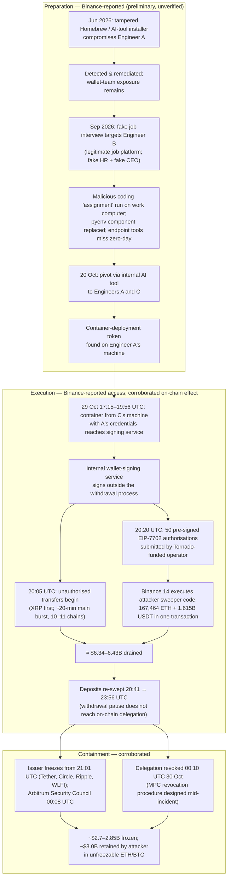
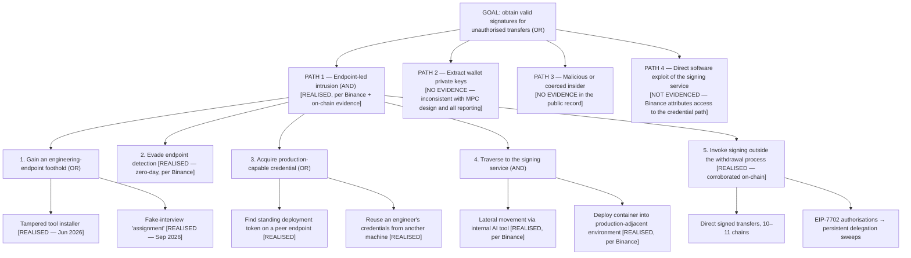
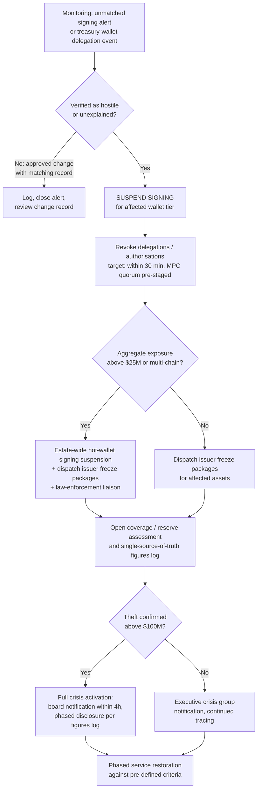

# Project BLACKSWAN II

## Enterprise Cyber Risk & GRC Assessment of the October 2026 Binance Exchange Security Incident

**An Interim Post-Incident Security Governance, Risk Assessment, Control Effectiveness and Remediation Engagement**

| | |
|---|---|
| **Engagement type** | Independent cybersecurity risk assessment — **INTERIM** (issued ~2 weeks after the incident; no final operator post-mortem exists yet) |
| **Prepared by** | Lead GRC Engineer |
| **Subject incident** | Binance centralised-exchange hot-wallet and wallet-signing-service compromise, 29 October 2026 (UTC) |
| **Assessment frameworks** | NIST CSF 2.0 · NIST SP 800-53 Rev. 5 · ISO/IEC 27001:2022 · COBIT 2019 · CIS Controls v8 · SOC 2 TSC (by analogy) |
| **Evidence basis** | Public sources only — operator statements, FBI/DOJ releases, independent blockchain-analytics analyses. Full index: `evidence/evidence-and-sources.md` |
| **Companion artefacts** | Risk register, control-gap matrix, framework crosswalk, remediation roadmap (`data/`), internal audit test plan (`audit/`), board briefing (`board/`), methodology (`methodology/`) |

> **Interim status.** This assessment distinguishes corroborated facts, operator-reported claims (principally Binance's preliminary findings report of 3 Nov 2026), and matters that cannot yet be established. Binance's detection time is unknown; the amount recovered has never been disclosed; "coverage complete" is a management representation, recorded as such. **Scope note:** this incident concerns Binance's centralised exchange. It is unrelated to the 2022 BNB Chain bridge exploit assessed in Project BLACKSWAN — a distinction Section 2 addresses explicitly.

---

# Project BLACKSWAN II — Sections 1–4

## Interim GRC Post-Incident Assessment: The October 2026 Binance Centralised-Exchange Hack

*Sections 1–4: Executive Summary · Organisational and Technological Background · Incident Reconstruction and Technical Root Cause · Threat Modelling and Security Analysis*

---

# SECTION 1: EXECUTIVE SUMMARY (INTERIM)

## 1.0 Interim status notice — read this first

This is an **interim** assessment, issued approximately two weeks after the incident. Three constraints govern everything that follows, and any reader who skips them will misread the findings:

1. **There is no final root-cause report.** Binance's only substantive technical disclosure is a *preliminary* investigation report dated 3 November 2026, which Binance itself describes as preliminary, with the investigation ongoing, an independent review invited but not published, and some technical details withheld permanently as confidential (Binance, *Security Incident on October 30, 2026: Update on Preliminary Investigation Findings and Response Progress*, 3 Nov 2026, https://www.binance.com/en/square/post/384314641614134). Where this assessment describes the intrusion path, it is describing **Binance's preliminary account, not independently verified fact**, and it is labelled as such throughout.
2. **Several headline numbers are management representations.** Binance's statements about customer coverage, blocked threats, and remediation completeness have not been independently verified (StepSecurity, *Binance's $6.34 Billion Hack: Developer Machines, AI Tooling, and Wallet Signing*, updated 3 Nov 2026, https://www.stepsecurity.io/blog/binance-hack-developer-machine-security). They are recorded here as claims, tiered separately from corroborated fact in §1.5.
3. **Binance reports in UTC+8.** Its preliminary report frames the incident as "October 30" because, in UTC+8, the theft ran 30 Oct 01:15–07:56. In UTC, the theft occurred on **29 October 2026**. All times in this assessment are UTC unless stated otherwise (Binance, 3 Nov 2026, https://www.binance.com/en/square/post/384314641614134).

## 1.1 Incident overview

On 29 October 2026, attackers drained Binance's hot wallets across 10 blockchains (TRM Labs' count) or 11 (Elliptic's) in the largest cryptocurrency theft on record. The first unauthorised outflow occurred at **20:05 UTC** (five hot wallets sending 233.46 million XRP between 20:05 and 20:09 UTC); the main burst moved most funds within roughly 20 minutes; and unauthorised Ethereum activity — repeated re-sweeps of newly deposited funds — continued until **23:56 UTC**, with the malicious delegation finally revoked at **00:10 UTC on 30 October** (TRM Labs, *North Korea Steals USD 6.36 Billion From Binance in the Largest Hack in History*, 30 Oct 2026, https://www.trmlabs.com/resources/blog/north-korea-steals-usd-6-36-billion-from-binance-in-the-largest-hack-in-history; Binance, 3 Nov 2026, https://www.binance.com/en/square/post/384314641614134).

The affected infrastructure was the exchange's **hot wallets** and its **internal wallet-signing service**. The attack classification is a **signing-authority compromise**: there is no evidence of a wallet private-key leak in any source. Binance stated on 30 October and repeated on 3 November that no private-key leak was evidenced, and independent analysis is consistent with the signing *system* having been induced to sign, rather than keys having been extracted (Binance, 3 Nov 2026, https://www.binance.com/en/square/post/384314641614134; TRM Labs, 30 Oct 2026, https://www.trmlabs.com/resources/blog/north-korea-steals-usd-6-36-billion-from-binance-in-the-largest-hack-in-history). The defining summary in the secondary literature is accurate: the attackers did not steal Binance's keys — they made Binance sign (Killswitch, *They Didn't Steal Binance's Keys. They Made Binance Sign.*, 4 Nov 2026, https://www.killswitch.work/killswitch-07-they-didn-t-steal-binance-s-keys-they-made-binance-sign/).

Per Binance's preliminary report — **not independently verified** — the intrusion chain ran over four months: a tampered developer-tool download compromised a first engineer in June 2026; a fake job interview compromised a second engineer in September; an internal AI tool was used on 20 October to pivot to two further devices, where a container-deployment token was found; and on 29 October a container deployed with stolen credentials reached the signing service (Binance, 3 Nov 2026, https://www.binance.com/en/square/post/384314641614134). The US Federal Bureau of Investigation, with the US Secret Service and IRS Criminal Investigation, attributed the theft on 31 October to North Korea's **TraderTraitor** activity cluster and published 628 associated addresses (FBI, *North Korea Responsible for $6 Billion+ Binance Attack*, 31 Oct 2026, https://www.fbi.gov/investigate/cyber/alerts/2026/north-korea-responsible-for-6-billion-binance-attack).

## 1.2 Financial exposure — four measures that must not be merged

Public discussion of this incident routinely collapses four different quantities into one number. They are separated here, as they must be in any defensible risk record:

| Measure | Figure | Attribution and status |
|---|---|---|
| **Stolen (gross)** | ~$6.34B (Binance) / $6.36B (TRM Labs) / ~$6.4B (Chainalysis) / $6.43B (Elliptic) | Range reflects valuation timing, not a dispute about scale. FBI/DOJ: "more than $6 billion" (Binance, 3 Nov 2026, https://www.binance.com/en/square/post/384314641614134; TRM Labs, 30 Oct 2026, https://www.trmlabs.com/resources/blog/north-korea-steals-usd-6-36-billion-from-binance-in-the-largest-hack-in-history; Chainalysis, *The $6.4 Billion Binance Hack*, 30 Oct 2026, updated 5 Nov, https://www.chainalysis.com/blog/binance-exploit-latest-findings-and-response/; Elliptic, *How North Korea is laundering the $6.4 billion stolen from Binance*, updated 10 Nov 2026, https://www.elliptic.co/insights/how-north-korea-is-laundering-the-6-4-billion-stolen-from-binance/) |
| **Frozen / blocked** | ~$2.85B (Binance) / ~$2.8B (Chainalysis) / ~$2.7B (TRM Labs) | Close agreement; spread is definitional (cut-off time; "frozen" vs "intercepted") and the amount is ~94–100% stablecoins and issuer-controlled assets (Chainalysis, 30 Oct 2026, https://www.chainalysis.com/blog/binance-exploit-latest-findings-and-response/; TRM Labs, 30 Oct 2026, https://www.trmlabs.com/resources/blog/north-korea-steals-usd-6-36-billion-from-binance-in-the-largest-hack-in-history). On 12 Nov the US Department of Justice stated that collective efforts had frozen more than $2.7B, of which it had obtained court authorisation to seize or restrain in excess of $1.2B (US Department of Justice, 12 Nov 2026, https://www.justice.gov/opa/pr/justice-department-announces-actions-disrupt-north-koreas-massive-theft-cryptocurrency) |
| **Retained by the attacker** | ~$3.0B in theft-linked addresses, mostly unmoved ETH and BTC (Elliptic, 10 Nov 2026) | Includes more than 420,000 ETH and all 18,270 BTC — approximately $2.4B that no issuer can freeze (TRM Labs, 30 Oct 2026, https://www.trmlabs.com/resources/blog/north-korea-steals-usd-6-36-billion-from-binance-in-the-largest-hack-in-history; Elliptic, updated 10 Nov 2026, https://www.elliptic.co/insights/how-north-korea-is-laundering-the-6-4-billion-stolen-from-binance/) |
| **Actually recovered** | **UNDISCLOSED** | No Binance, DOJ, or analytics source states an amount of stolen assets actually recovered and returned. Frozen ≠ restrained ≠ recovered, and none of the three equals Binance's own replenishment (§1.3) |

A further dynamic belongs in the risk record: racing the freezes, the attacker converted approximately **$325 million of stablecoins into approximately $285 million of ETH** in about 20 minutes, at a cost of more than 10% against market prices (Chainalysis, 30 Oct 2026, https://www.chainalysis.com/blog/binance-exploit-latest-findings-and-response/; TRM Labs, 30 Oct 2026, https://www.trmlabs.com/resources/blog/north-korea-steals-usd-6-36-billion-from-binance-in-the-largest-hack-in-history). The lesson is structural: whatever portion of hot-wallet value is held in bearer assets (ETH, BTC) rather than issuer-controlled tokens is, once signed away, effectively beyond containment.

## 1.3 Customer coverage — a management representation, precisely defined

Binance announced on 12 November that **coverage was complete** (Binance, *Binance Completes Coverage of Assets Impacted in Security Incident; New Proof of Reserves Published*, 12 Nov 2026, https://www.binance.com/en/square/post/387527915862393). "Coverage" has a specific meaning that must not be mistaken for recovery: Binance **replenished the reserves backing customer balances to at least 1:1 from its own funds** — a partial deployment of the SAFU fund, Futures Insurance Funds in excess of the level required by its risk framework, and corporate treasury — purchasing replacement tokens through market and OTC channels. No customer balance was individually debited and refunded; the loss was absorbed on Binance's balance sheet. **No source reports any customer ultimately bearing a loss of funds.** Customers did, however, bear approximately two and a half days without withdrawals, still-phased withdrawals as of 12 November, and the inability to move or exit positions during the pause — none of which the "no loss" framing captures (Binance, 12 Nov 2026, https://www.binance.com/en/square/post/387527915862393; crypto.news, *Binance says $6.3B hack assets covered, reserve proof pending*, 12 Nov 2026, https://crypto.news/binance-hack-assets-covered-proof-of-reserves/).

The coverage progression, as announced contemporaneously, was ~80% (30 Oct) → ~90% (31 Oct) → ~95% (1 Nov) → ~98% (4 Nov) → complete (12 Nov) (CompareCEX, *Binance hack Oct 2026 tracker*, checked through 13 Nov 2026, https://comparecex.com/guides/binance-security-incident-2026-10/). **One disclosure defect must be recorded:** the 3 November preliminary report retroactively states that 98% of affected assets had been replenished "as of October 31" — a figure that conflicts with Binance's own contemporaneous 31 October update (90%) and its 1 November update (95%). No source reconciles the discrepancy (Binance, 3 Nov 2026, https://www.binance.com/en/square/post/384314641614134). This is a crisis-disclosure consistency finding (R-15), not a quibble: in a solvency-adjacent event, retroactively restated progress figures are exactly what undermines confidence in every other figure the operator publishes.

Verification status of the coverage claim rests on Binance's proof of reserves (PoR), which is itself limited (R-13). The 31 October snapshot (10 tokens) had its zero-knowledge proof completed on 2 November, making ≥1:1 backing user-verifiable for those tokens. The 4 November snapshot (44 tokens) was announced with an estimated 50–60-hour proof time, but **no announcement of its completion has been located**. The 12 November snapshot (198 tokens) carried an estimated 40–50-hour proof time and was **not yet published as of this assessment** (due 13 Nov 16:00 – 14 Nov 02:00 UTC) (Binance, *Security Incident | Recovery Process Update No. 7*, 4 Nov 2026, https://www.binance.com/en-AE/square/post/384992929024378; crypto.news, 12 Nov 2026, https://crypto.news/binance-hack-assets-covered-proof-of-reserves/). Until that proof lands, "198 tokens backed ≥1:1" is a Binance claim, and a PoR snapshot in any case attests to assets at a moment for covered tokens — it is not an audit of liabilities, of controls, or of the signing infrastructure that failed.

## 1.4 Operational impact

Withdrawals were paused on 29 October at approximately 22:15 UTC (one independent reconstruction gives 22:33 UTC; the discrepancy is unresolved) and deposits were briefly suspended in the early hours of 30 October; spot and futures trading were not reported suspended. Critically, **suspending withdrawals did not stop the theft**: the Ethereum re-sweeps continued for over 90 minutes after the pause, because the EIP-7702 authorisations already existed on-chain and operated independently of the withdrawal pipeline (Binance, 3 Nov 2026, https://www.binance.com/en/square/post/384314641614134; CryptoTimes, *Binance Hack Explained*, updated 7 Nov 2026, https://www.cryptotimes.io/insights/binance-hack-explained/). Phased withdrawal reopening began on 1 November between 06:00 and 09:00 UTC across 15 networks, continued in batches on 3, 5 and 6 November, and was **still phased on 12 November; no full-reopening date has been announced** (CompareCEX, checked through 13 Nov 2026, https://comparecex.com/guides/binance-security-incident-2026-10/).

Market and confidence effects were material but must be stated with their caveats. Bitcoin fell more than 4% and ether more than 5% on 29 October, amid approximately $1.5B of leveraged liquidations and a simultaneous equity sell-off that the sources themselves note as a contributing factor (Reuters, *Crypto exchanges call for quick moves to bolster defenses after Binance heist*, 31 Oct 2026, https://www.reuters.com/legal/government/crypto-exchanges-call-quick-moves-bolster-defenses-after-binance-heist-2026-10-31/). On reopening, Binance reported net outflows of $3.64B in the first 9.5 hours; its figures of $4.72B net (as of 2 Nov) and $5.28B net (46-hour window) are published without reconciliation and are flagged, not merged, in this assessment (Reuters, *Binance sees outflows stabilising…*, 2 Nov 2026, https://www.reuters.com/business/finance/binance-sees-outflows-stabilising-exchange-returns-online-after-63-billion-heist-2026-11-02/). Santiment measured ~28,316 BTC in net outflows from Binance-associated wallets between 29 October and 5 November — while itself noting that exchange BTC balances were already declining from 25 October, so the full amount cannot be attributed to the incident (CoinEdition, *Binance Hack Triggers 28,316 BTC Outflows, Santiment Reports*, 7 Nov 2026, https://coinedition.com/binance-hack-triggers-28316-btc-outflows-santiment-reports/). User USDT holdings on Binance fell 7.95% between the 1 and 31 October PoR snapshots (to 29.48B) — a figure that *predates* the reopening and therefore reflects October behaviour, not a post-incident run — and fell further to 24.30B by 12 November (crypto.news, *Binance User USDT Holdings Fall 7.95% in Latest Proof of Reserves*, Nov 2026, https://crypto.news/binance-usdt-holdings-fall-proof-of-reserves-october-2026/).

## 1.5 Principal findings, in three evidentiary tiers

**Tier 1 — Corroborated by independent evidence**

- **F-1 (R-07, R-06).** The theft mechanism was abuse of legitimate signing authority. On Ethereum, a Tornado Cash-funded operator submitted 50 pre-signed EIP-7702 authorisations at 20:20 UTC; approximately 3 minutes 24 seconds later the Binance 14 hot wallet was swept (167,464 ETH plus 1.615B USDT and 62 other tokens) in a single transaction, and the delegation re-swept new deposits six more times — independently reconstructed on-chain (TRM Labs, 30 Oct 2026, https://www.trmlabs.com/resources/blog/north-korea-steals-usd-6-36-billion-from-binance-in-the-largest-hack-in-history; Chainalysis, 30 Oct 2026, https://www.chainalysis.com/blog/binance-exploit-latest-findings-and-response/).
- **F-2 (R-08).** Hot-wallet concentration made a single signing path worth more than $6B in minutes: ~$6.36–6.43B across 10–11 chains in a ~20-minute main burst (TRM Labs, 30 Oct 2026; Elliptic, updated 10 Nov 2026, https://www.elliptic.co/insights/how-north-korea-is-laundering-the-6-4-billion-stolen-from-binance/).
- **F-3 (R-09, R-11).** Containment was asymmetric. Issuer freezes began within the hour (Tether 21:01 UTC, Circle 21:04 UTC) and ultimately blocked ~$2.7–2.85B — but the delegated authority on Ethereum could not be revoked until 00:10 UTC, a delay Binance attributes to its MPC design requiring a specialised revocation procedure (Binance, 3 Nov 2026, https://www.binance.com/en/square/post/384314641614134), and ~$3.0B in bearer assets sits beyond any freeze (Elliptic, updated 10 Nov 2026, https://www.elliptic.co/insights/how-north-korea-is-laundering-the-6-4-billion-stolen-from-binance/).
- **F-4.** Attribution is official and early: the FBI attributed the theft to North Korea's TraderTraitor on 31 October and published 628 addresses, urging virtual asset service providers to block transactions with or derived from them — a public-service announcement, not an OFAC designation carrying a statutory blocking duty (FBI, 31 Oct 2026, https://www.fbi.gov/investigate/cyber/alerts/2026/north-korea-responsible-for-6-billion-binance-attack). North Korea denied the attribution on 3 November (CoinDesk, *North Korea denies role in $6.4 billion Binance hack after FBI points to TraderTraitor*, 3 Nov 2026, https://www.coindesk.com/business/2026/11/03/north-korea-denies-role-in-usd6-4-billion-binance-hack-after-fbi-points-to-tradertraitor).

**Tier 2 — Reported by Binance (preliminary), not independently verified**

- **F-5 (R-01–R-06).** The entire endpoint intrusion chain (§3.1): the June 2026 tampered Homebrew/AI-tool download compromising Engineer A, detected and remediated but leaving team exposure; the September 2026 fake job interview compromising Engineer B via a malicious coding assignment that endpoint tools missed; the 20 October pivot through an internal AI tool to Engineers A and C; the container-deployment token found on A's machine; and the 29 October container, deployed from C's machine with A's credentials, reaching the signing service (Binance, 3 Nov 2026, https://www.binance.com/en/square/post/384314641614134).
- **F-6 (R-04).** A prior compromise was detected and remediated in June, yet the exposure it created — the wallet team's identities and roles — was precisely what the successful September targeting used. The remediation closed the device; it did not close the targeting risk (Binance, 3 Nov 2026, https://www.binance.com/en/square/post/384314641614134; assessor's characterisation).
- **F-7 (R-12).** The coverage programme and its funding split (§1.3), Binance's claim to have blocked 57 suspected North Korea-linked threats in 2026 (~one every five days), and its remediation claims (systems rebuilt, entry points closed, enhanced device scanning) are Binance-only figures and assertions (Binance, 3 Nov 2026, https://www.binance.com/en/square/post/384314641614134; Cointelegraph, *Binance Security Chief Warned of Hack Tactic Before $6.3B Theft*, 12 Nov 2026, https://cointelegraph.com/news/binance-cso-foreshadowed-6b-hack-tactic-months-before-attack; StepSecurity, 3 Nov 2026, https://www.stepsecurity.io/blog/binance-hack-developer-machine-security).

**Tier 3 — Cannot yet be established from the public record**

- **F-8 (R-10). Binance's detection time is unknown.** Binance states only that it "subsequently received an internal alert about large transfers" — undated. External on-chain reporting appeared within minutes of the 20:20 UTC Ethereum delegation, and CoinDesk reported a possible multi-billion hack at 21:12 UTC. Whether Binance's internal detection preceded, matched, or followed public detection **cannot be determined**, and this assessment makes no claim about it (Binance, 3 Nov 2026, https://www.binance.com/en/square/post/384314641614134). For the world's largest exchange, the absence of a published detection timeline is itself the finding.
- **F-9 (R-06, R-07).** How the internal AI tool was abused (it is unnamed; no prompt-injection, MCP, or product detail has been published), what segmentation or approval checks stood between a developer container and a cross-chain signing service, and whether signing requests were validated against approved withdrawals — all unknown (StepSecurity, 3 Nov 2026, https://www.stepsecurity.io/blog/binance-hack-developer-machine-security; Hacken, *Lessons from Binance $6.3B hack analysis*, Nov 2026, https://hacken.io/insights/binance-hack/).
- **F-10 (R-12, R-13).** The amount actually recovered; the final allocation of coverage funding among SAFU, Futures Insurance and treasury; whether SAFU has in fact been replenished to ~$1B; and the completion status of the 4 November ZK proof — none disclosed (Binance, 12 Nov 2026, https://www.binance.com/en/square/post/387527915862393).

## 1.6 Lessons so far

1. **The warning-to-breach gap is the central governance fact.** In July 2026, Binance's CSO Jimmy Su described the fake-interview tactic in detail to Cointelegraph — attackers tailoring a job opportunity to an employee and persuading them to run code as a technical assessment (Cointelegraph, 12 Nov 2026, https://cointelegraph.com/news/binance-cso-foreshadowed-6b-hack-tactic-months-before-attack). Chainalysis has since documented that smaller fake-interview attacks over roughly 18 months — more than $14.3M in the studied set — were rehearsals refining the playbook used against Binance (Chainalysis, *DPRK Hackers Perfected Their Fake Interview Playbook Over Dozens of Attacks Before Binance*, 3 Nov 2026, via https://www.chainalysis.com/blog/category/crime/). The threat was known, named, and rehearsed in public. The control failure was not awareness; it was that awareness never became architecture.
2. **Endpoint compromise must be assumed; blast radius is the control.** Reuters' post-incident analysis frames the industry question correctly: not whether social engineering can be stopped, but why internal controls do not limit what one compromised employee can reach (Reuters, 11 Nov 2026, via WEEX republication, https://www.weex.com/news/detail/binance-hack-exposes-cybersecurity-gaps-at-crypto-exchanges-mwox1cwirlxw3g0cua3saqrt). A peer benchmark now exists in public: Coinbase stated on 4 November that no single employee has standing access to its production wallet signing (CryptoCompass, *Coinbase Says It Was Unaffected…*, 4 Nov 2026, https://cryptocompass.com/articles/coinbase-says-it-was-unaffected-by-6-3-billion-binance).
3. **Revocation is a design requirement, not an incident improvisation.** TRM's defensive guidance — monitor for any EIP-7702 delegation on treasury wallets, treat batched authorisations as an indicator of compromise, and maintain a tested, pre-approved revocation method — follows directly from four hours of re-sweeps (TRM Labs, 30 Oct 2026, https://www.trmlabs.com/resources/blog/north-korea-steals-usd-6-36-billion-from-binance-in-the-largest-hack-in-history).
4. **Coverage is not a control.** Binance's balance sheet absorbed a $6.34B loss; that is financial resilience, and it protected customers. It is not evidence that the control environment worked, and it must not be allowed to close the governance file — particularly while the funding split, the SAFU refill, and recovered amounts remain undisclosed.

## 1.7 Strategic recommendations

- **SR-1 — Bind signing authority to policy, and partition it.** A signing service must sign only transactions that match an approved withdrawal intent, with signing infrastructure and approval paths separated by chain and wallet tier, and any EIP-7702 delegation on a treasury wallet treated as a critical alert (addresses R-06, R-07; per TRM Labs, 30 Oct 2026, https://www.trmlabs.com/resources/blog/north-korea-steals-usd-6-36-billion-from-binance-in-the-largest-hack-in-history).
- **SR-2 — Remove standing privilege from engineering endpoints.** No long-lived deployment tokens on laptops; just-in-time, hardware-backed credentials; and a maintained inventory of what any single compromised developer machine can reach (addresses R-02, R-03, R-05; per StepSecurity, 3 Nov 2026, https://www.stepsecurity.io/blog/binance-hack-developer-machine-security).
- **SR-3 — Govern internal AI and automation tooling as privileged identities.** Tools that can act across machines require the same approvals, logging, and scope limits as human administrators (addresses R-05, R-06; per Hacken, Nov 2026, https://hacken.io/insights/binance-hack/).
- **SR-4 — Pre-engineer containment.** Tested delegation-revocation under MPC, hot-wallet velocity limits and circuit breakers that operate independently of the withdrawal pipeline, and freeze-coordination playbooks with issuers (addresses R-08, R-09, R-11, R-14).
- **SR-5 — Restore assurance discipline.** Publish a detection timeline; reconcile progress figures before publication rather than restating them afterwards; complete and announce every PoR proof; and deliver the final post-mortem and the invited independent review (addresses R-10, R-13, R-15).

## 1.8 Executive risk statement

This incident demonstrates that, at the world's largest cryptocurrency exchange, a four-month intrusion that began with two social-engineering compromises of individual engineers could be converted — through standing credentials, cross-machine tooling, and a reachable signing service — into the largest theft in the industry's history, in about twenty minutes of execution. The enterprise risk is not that employees can be deceived; that is a constant. The risk is that the architecture treated deceived employees' machines as trusted, treated a signing service's callers as authorised for whatever they requested, and concentrated more than $6B of immediately transferable value behind that single path — two months after the organisation's own security chief had described this exact attack in public. Until the final root-cause report and independent review are published, the completeness of remediation is an assertion by the affected party, and this assessment treats it as such.

---

# SECTION 2: ORGANIZATIONAL AND TECHNOLOGICAL BACKGROUND

## 2.1 Entity discipline: Binance the exchange is not BNB Chain

This assessment concerns **Binance's centralised exchange** — the custodial trading platform whose hot wallets and internal signing service were compromised. It must not be confused with the October 2022 exploit of the BSC Token Hub bridge, which concerned BNB Chain *protocol* infrastructure (genesis system contracts and a validator set), involved no exchange custody systems, and is the subject of the companion assessment (Project BLACKSWAN I). The two incidents share a brand ecosystem and nothing else of evidentiary relevance: different entity, different architecture, different failure mode — a forged cryptographic proof against a bridge in 2022; abused signing authority inside an exchange in 2026. Any analysis that imports findings from one into the other is unsound, and this assessment does not do so.

Within the exchange, the relevant organisational functions are: the **wallet infrastructure team** (development and operations for deposit/withdrawal systems — the team to which the compromised engineers belonged, per Binance's preliminary report); the **security function** led by the Chief Security Officer, which owns threat detection, including the North Korea-linked threat monitoring Binance cites; and the **executive layer** (co-CEOs Richard Teng and Yi He, and founder CZ) which fronted crisis communications. The FBI's attribution statement and the DOJ's seizure action are addressed in §3; the fragmented regulatory perimeter around the exchange is treated in later sections of this report (R-16).

## 2.2 Custodial wallet architecture: hot wallets, cold storage, and the signing service

A centralised exchange holds customer assets in wallets it controls. The standard architecture separates:

- **Cold storage** — wallets whose keys are kept offline, holding the majority of assets. Co-CEO Richard Teng stated on 30 October that most customer assets were in cold storage and that the attack affected the exchange's own hot wallet (reported by Cointelegraph, via secondary summaries of Binance's statements, 30 Oct 2026).
- **Hot wallets** — internet-connected wallets that service day-to-day deposit and withdrawal flows. They are, by design, the most exposed and the most liquid component of the system. In this incident, hot wallets across 10–11 chains held, in aggregate, more than $6B of immediately transferable value (TRM Labs, 30 Oct 2026, https://www.trmlabs.com/resources/blog/north-korea-steals-usd-6-36-billion-from-binance-in-the-largest-hack-in-history).
- **The withdrawal pipeline** — the business process that validates a customer withdrawal request (account checks, limits, risk screening) and constructs a transaction for signing.
- **The wallet-signing service** — the internal service that holds or accesses signing capability and produces valid signatures for wallet transactions. It is the junction between business intent and irreversible on-chain effect, and therefore the highest-consequence component in the architecture.

The control expectation at that junction is the one Hacken's post-incident analysis states plainly: a signer that signs whatever an authorised caller sends, without checking the request against an approved withdrawal, is the core failure pattern (Hacken, *Lessons from Binance $6.3B hack analysis*, Nov 2026, https://hacken.io/insights/binance-hack/). Binance's own account establishes that the attackers obtained signatures **outside** the normal withdrawal process: "attackers used unauthorized access to the internal wallet signing service to bypass normal withdrawal processes and initiate transactions" (Binance, 3 Nov 2026, https://www.binance.com/en/square/post/384314641614134). What Binance has **not** published is the control detail that would let an assessor judge the design: what authentication and authorisation a caller needed, whether requests were bound to withdrawal records, what value limits applied, and how the service was segmented from the corporate network (F-9, §1.5).

## 2.3 MPC signing, at the level the public record supports

Binance states that the affected hot wallets use **multi-party computation (MPC)** (Binance, 3 Nov 2026, https://www.binance.com/en/square/post/384314641614134). In an MPC (threshold-signature) design, no complete private key exists in one place: key material is split into shares held by separate parties or systems, and a valid signature is produced only when a threshold of share-holders cooperates in the signing protocol. Properly implemented, MPC removes the single-key-theft scenario — consistent with the absence of any evidenced key leak here.

MPC, however, changes rather than eliminates the risk surface, and this incident exhibits its characteristic weakness: **the security boundary moves from the key to the signing policy and to whatever can invoke the signing protocol.** If an attacker reaches a component that is an authorised participant or an authorised caller, the threshold protocol will faithfully co-sign an illegitimate transaction. Binance's second MPC-related admission is operational: because no single private key existed, there was no single key with which to immediately revoke the Ethereum delegations; a specialised revocation procedure had to be designed and executed during the incident, extending containment from minutes to hours (Binance, 3 Nov 2026, https://www.binance.com/en/square/post/384314641614134). The governance lesson is that threshold signing must be paired with threshold *governance*: pre-engineered revocation, policy binding, and caller authorisation that is independent of network reachability (§4, SR-1, SR-4).

## 2.4 EIP-7702, explained accurately and briefly

EIP-7702 is an Ethereum account-abstraction mechanism (introduced with the Pectra upgrade) that allows an externally owned account (EOA) to **delegate its execution to smart-contract code** by means of a signed authorisation. The account's address and balance do not change; but when the account is called, it executes the delegated code instead of behaving as a plain account. The authorisation is a signed object that **any third party (a relayer/operator) can submit on-chain** — the signature, not the submitter, is the authority.

The attack applied this as follows, per on-chain reconstruction. The signing path was induced to produce **50 signed authorisations** for the Binance 14 hot wallet across 50 consecutive nonce values — pre-signing a range guaranteed that one authorisation would match the wallet's nonce at execution time, because a busy hot wallet's nonce moves constantly. A Tornado Cash-funded operator wallet submitted the batch at **20:20 UTC**; once a delegation to attacker-deployed sweeper code was in place, a call to Binance 14 executed that code and swept **167,464 ETH and 63 tokens, including 1.615B USDT, in a single transaction approximately 3 minutes 24 seconds later**. The delegation persisted across subsequent deposits: funds arriving at Binance 14 were re-swept at 20:41, 20:59, 21:04, 21:44, 22:39 and 23:56 UTC. Binance 14's separate role as executor of a Binance smart account additionally enabled the removal of 823M USDC (frozen by Circle shortly afterwards) (TRM Labs, 30 Oct 2026, https://www.trmlabs.com/resources/blog/north-korea-steals-usd-6-36-billion-from-binance-in-the-largest-hack-in-history; Chainalysis, 30 Oct 2026, https://www.chainalysis.com/blog/binance-exploit-latest-findings-and-response/; Alfocea, *The October 29 Binance theft: 50 signatures, one lucky nonce…*, Nov 2026, https://cr0hn.medium.com/on-october-29-2026-at-20-20-59-utc-the-binance-hot-wallet-known-as-binance-14-stopped-being-an-becd5588e542).

Two properties made this mechanism decisive. First, **the delegation lived on-chain**, so it was unaffected by Binance suspending its own withdrawal systems. Second, **revocation required a new authorisation from the compromised wallet**, which — under MPC — Binance could not produce quickly (§2.3). EIP-7702 is a legitimate and useful standard; the control failure is that a treasury wallet could acquire a delegation to arbitrary code without that event being prevented by signing policy or detected as a critical anomaly in real time (R-07, R-09).

## 2.5 Threat actor: TraderTraitor

The FBI "refers to this specific North Korean malicious cyber activity as 'TraderTraitor'" and stated that North Korea "was responsible for the theft of more than $6 billion USD in virtual assets from cryptocurrency exchange Binance, on or about October 29, 2026" (FBI, 31 Oct 2026, https://www.fbi.gov/investigate/cyber/alerts/2026/north-korea-responsible-for-6-billion-binance-attack). The FBI, with USSS and IRS-CI, observed TraderTraitor actors converting stolen assets primarily into ether, expected further laundering through DeFi and instant-swap services, and published 628 addresses (independently counted as 608 Ethereum, 19 Bitcoin, 1 Solana) that VASPs were urged to block.

Three features of the actor profile matter for control design:

1. **The recruitment vector is a documented, rehearsed playbook, not a novelty.** Chainalysis's follow-on research documents dozens of smaller fake-interview attacks over approximately 18 months — over $14.3M in the studied set — functioning as rehearsals that refined the playbook later used against Binance (Chainalysis, 3 Nov 2026, via https://www.chainalysis.com/blog/category/crime/). The actor targets identifiable engineering staff through legitimate job platforms, fictitious companies, live video interviews with impersonated HR staff and executives, and malicious "technical assessment" code.
2. **The actor is patient and multi-stage.** Preparation for the on-chain phase began at least 36 hours before the theft (operator-wallet funding via Tornado Cash on 28 October, with test deployments), and — on Binance's account — the endpoint phase ran for four months (TRM Labs, 30 Oct 2026, https://www.trmlabs.com/resources/blog/north-korea-steals-usd-6-36-billion-from-binance-in-the-largest-hack-in-history; Binance, 3 Nov 2026, https://www.binance.com/en/square/post/384314641614134).
3. **Attribution rests on financial behaviour as much as intrusion forensics.** Chainalysis announced its attribution on 30 October; its strongest evidence was the real-time **commingling of Binance proceeds with proceeds of the September 2026 Bitget theft** (itself North Korea-attributed), independently observed by on-chain investigators via THORChain (Chainalysis, 30 Oct 2026, https://www.chainalysis.com/blog/binance-exploit-latest-findings-and-response/). The laundering operation that followed was industrial in scale: more than 20,000 wallets, 16 blockchains, at least 36 services and at least 65,000 transactions (Elliptic, updated 10 Nov 2026, https://www.elliptic.co/insights/how-north-korea-is-laundering-the-6-4-billion-stolen-from-binance/). Note for the record: descriptions circulating in commentary of Hong Kong intermediaries, Russian and Cambodian networks and UnionPay cash-out channels describe Chainalysis-documented behaviour from **previous** North Korean thefts — the expected end-game pattern — and have **not** been observed for these funds, of which Elliptic assesses only a negligible amount had likely been cashed out as of 10 November (Olivier/Forvis Mazars via ITWeb, *What the Binance hack tells us about how crypto really works*, 12 Nov 2026, https://itweb.africa/article/what-the-binance-hack-tells-us-about-how-crypto-really-works/mQwkoM6YrZ373r9A; Elliptic, updated 10 Nov 2026, https://www.elliptic.co/insights/how-north-korea-is-laundering-the-6-4-billion-stolen-from-binance/).

Binance itself has not named an attacker; its preliminary report cites the FBI's attribution. North Korea denied responsibility on 3 November, characterising the attribution as a "grave political provocation," without offering a technical rebuttal (CoinDesk, 3 Nov 2026, https://www.coindesk.com/business/2026/11/03/north-korea-denies-role-in-usd6-4-billion-binance-hack-after-fbi-points-to-tradertraitor).

## 2.6 Critical assets and the trust assumptions that failed

| # | Critical asset | Why it is critical |
|---|---|---|
| A-1 | The wallet-signing service and its signing policy | Sole junction between intent and irreversible transfer; compromise converts directly to loss |
| A-2 | Hot wallets (10–11 chains) and their aggregate balances | The loss pool itself; >$6B transferable in minutes |
| A-3 | Signing authorisations and delegations (incl. EIP-7702 state) | Portable authority: a signed authorisation is spendable by whoever holds it |
| A-4 | Engineering endpoints of the wallet infrastructure team | The evidenced entry point; holders of credentials, tokens and network reach |
| A-5 | Credentials and deployment tokens (incl. container-deployment token) | The bridge from endpoint compromise to production effect |
| A-6 | Internal AI/automation tooling with cross-machine reach | A privileged identity in software form; per Binance, the lateral-movement vehicle |
| A-7 | Customer balances and the reserves backing them (incl. SAFU, Futures Insurance Funds) | The liability side; the coverage event of §1.3 |
| A-8 | Organisational credibility of disclosures and PoR | The asset that determines whether a liquidity event becomes a solvency panic |

The architecture, as evidenced, rested on trust assumptions that the incident falsified — each is stated as the design appears to have held it, with the outcome:

| # | Trust assumption | Outcome |
|---|---|---|
| T-1 | An engineering endpoint that passes endpoint-security tooling is safe to hold production-adjacent credentials | **Violated** — per Binance, endpoint tools missed zero-day malware on Engineer B's machine (R-03) |
| T-2 | Software obtained through normal developer channels (package managers, tool installers) is authentic | **Violated** — per Binance, a tampered Homebrew installer compromised Engineer A in June (R-02) |
| T-3 | Recruitment activity is a personal matter external to production security | **Violated** — the fake interview was the decisive initial access (R-01) |
| T-4 | A caller that reaches the signing service and authenticates is authorised for the transactions it requests | **Violated** — signatures were obtained outside the withdrawal process (R-07) |
| T-5 | Internal tools that act across employee machines are benign because they are internal | **Violated** — per Binance, an internal AI tool carried the compromise to two further engineers (R-05, R-06) |
| T-6 | Suspending withdrawals stops unauthorised outflows | **Violated** — on-chain EIP-7702 delegations operated independently of the withdrawal pipeline (R-14) |
| T-7 | Remediation of a detected endpoint compromise closes the incident | **Violated** — the June remediation left the targeting exposure that September exploited (R-04) |

---

# SECTION 3: INCIDENT RECONSTRUCTION AND TECHNICAL ROOT CAUSE

## 3.1 Chronological narrative, in evidentiary tiers

**Phase 0 — Preparation of the ground (June–September 2026) [Binance-reported, preliminary].** Per Binance's preliminary report, in June 2026 Engineer A — a wallet development and operations engineer — searched online to install a popular AI coding tool and downloaded a **tampered Homebrew installer**. Binance states its security team proactively detected the anomaly, replaced the device and rotated all related credentials; however, Engineer A's role information and the identities of colleagues on the wallet infrastructure team "had already been exposed to the attackers" (Binance, 3 Nov 2026, https://www.binance.com/en/square/post/384314641614134). The assessor notes the structural significance: the June incident was closed as a device compromise, but its product — a targeting package on the wallet team — remained live (R-04).

In September 2026, Software Engineer B, whose profile on a **legitimate job platform** identified Binance as employer, was approached by an impersonator posing as a project director of a fictitious company. A first-round live video interview with a fake "HR representative" (supported by a social-media account with personal photos and video) built trust; a second round, over a popular messaging app, featured an impersonated CEO. Near the end, B was asked to download an "assignment" containing a code repository **onto their work computer**. The repository's installation executed malicious code which used obfuscation and evasion, **replaced a component of the legitimate development tool pyenv with a malicious version**, executed commands, communicated with an attacker server, and erased its traces. Binance describes the malware as zero-day and states endpoint security tools failed to detect it at the time (Binance, 3 Nov 2026, https://www.binance.com/en/square/post/384314641614134; corroborated as Binance's account by Reuters, *Binance hackers used fake job interview to compromise computer before $6.3 billion attack*, 3 Nov 2026).

**Phase 1 — Lateral movement (20 October 2026) [Binance-reported; mechanism unknown].** Per Binance, attackers used Engineer B's compromised computer to **take control of the devices of Engineer A and Engineer C** (another wallet software engineer) **through internal AI tools**, and quickly discovered **a token with container-deployment permissions on Engineer A's computer** (Binance, 3 Nov 2026, https://www.binance.com/en/square/post/384314641614134). Binance has not named the tool or explained the abuse path; independent analysis confirms the report points to no prompt injection, MCP exploit, or named product (StepSecurity, 3 Nov 2026, https://www.stepsecurity.io/blog/binance-hack-developer-machine-security). In total, Binance's account implicates **three engineers and four computers** over roughly four months.

**Phase 2 — On-chain preparation (28 October 2026) [Corroborated on-chain].** At least 36 hours before the theft, the operator wallet was funded by three small Tornado Cash withdrawals, and test deployments and rehearsals were conducted against three wallets (TRM Labs, 30 Oct 2026, https://www.trmlabs.com/resources/blog/north-korea-steals-usd-6-36-billion-from-binance-in-the-largest-hack-in-history).

**Phase 3 — Access to the signing service (29 October, 17:15–19:56 UTC) [Binance-reported].** Per Binance (01:15–03:56 UTC+8), attackers logged into Engineer C's computer, **deployed a container using credentials stolen from Engineer A**, and ran a malicious script, reaching the internal wallet-signing service (Binance, 3 Nov 2026, https://www.binance.com/en/square/post/384314641614134). Whether the signing service authenticated the container, checked requests against withdrawal records, or applied value limits is **not disclosed** (F-9).

**Phase 4 — The theft (29 October, 20:05–23:56 UTC) [Corroborated on-chain].** The drain began at 20:05 UTC with XRP and other non-Ethereum chains; the Ethereum leg began at 20:20 UTC with the submission of the 50 EIP-7702 authorisations and the Binance 14 sweep ~3 minutes later (§2.4). Most value moved in a ~20-minute main burst; the Binance 14 delegation re-swept incoming deposits six further times, the last unauthorised transfer landing at 23:56 UTC (TRM Labs, 30 Oct 2026, https://www.trmlabs.com/resources/blog/north-korea-steals-usd-6-36-billion-from-binance-in-the-largest-hack-in-history; Chainalysis, 30 Oct 2026, https://www.chainalysis.com/blog/binance-exploit-latest-findings-and-response/). Asset totals by chain (TRM, at theft prices): Ethereum ~$3.79B (200,630 ETH; 1.875B USDT; 823M USDC; 88.5M RLUSD; 181 further tokens); Bitcoin 18,270 BTC (~$1.47B); Tron ~$628M; XRP Ledger ~$296M; Solana ~$96M; Arbitrum/Optimism/Base ~$39M; Avalanche ~$28M; Polygon ~$10M (TRM Labs, 30 Oct 2026, https://www.trmlabs.com/resources/blog/north-korea-steals-usd-6-36-billion-from-binance-in-the-largest-hack-in-history).

**Phase 5 — Containment, in parallel and in arrears [Corroborated].** Third-party containment was fast: Tether froze 971.1M USDT at 21:01 UTC and Circle froze 823M USDC at 21:04 UTC; Ripple froze the RLUSD wallet at 22:01 UTC (40.5M RLUSD remaining of 88.5M taken); World Liberty Financial froze 27.8M USD1 at 22:10 UTC; the Arbitrum Security Council forcibly moved ~$30M of assets from the attacker's Arbitrum wallet at 00:08 UTC (TRM Labs, 30 Oct 2026, https://www.trmlabs.com/resources/blog/north-korea-steals-usd-6-36-billion-from-binance-in-the-largest-hack-in-history). Binance states the verified frozen total reached $2.54B by 23:35 UTC (Binance, 3 Nov 2026, https://www.binance.com/en/square/post/384314641614134). Meanwhile the attacker raced the freezes, swapping ~$325M of stablecoins into ~$285M of ETH (Chainalysis, 30 Oct 2026, https://www.chainalysis.com/blog/binance-exploit-latest-findings-and-response/). Binance's own containment lever — pausing withdrawals at ~22:15 UTC — did not reach the on-chain delegation; revocation was only effected at **00:10 UTC on 30 October**, which Binance attributes to the MPC design requiring a specialised revocation procedure (Binance, 3 Nov 2026, https://www.binance.com/en/square/post/384314641614134).

**Phase 6 — Disclosure and recovery (30 October – 12 November) [Corroborated sequence; content partly Binance-only].** Binance's first formal update (30 October) attributed the incident to "a compromised DevOps engineer's laptop" — an account Binance itself superseded the same day ("additional points of breach") and replaced on 3 November with the three-engineer chain (§3.1). Early disclosure therefore **understated the intrusion path** (R-15). The FBI attributed the theft to TraderTraitor on 31 October (FBI, 31 Oct 2026, https://www.fbi.gov/investigate/cyber/alerts/2026/north-korea-responsible-for-6-billion-binance-attack). Coverage milestones and PoR snapshots followed as detailed in §1.3; withdrawals reopened in phases from 1 November. On 12 November, Binance announced coverage complete, and the DOJ announced court-authorised seizure/restraint of more than $1.2B within the more-than-$2.7B frozen total (Binance, 12 Nov 2026, https://www.binance.com/en/square/post/387527915862393; US Department of Justice, 12 Nov 2026, https://www.justice.gov/opa/pr/justice-department-announces-actions-disrupt-north-koreas-massive-theft-cryptocurrency). *For the avoidance of doubt: the same DOJ release announced a separate action against the "FaceStealer" campaign; that action does not concern this incident and no part of it is treated as evidence here.* As of this assessment, the attacker retains ~$3.0B, largely unmoved (Elliptic, updated 10 Nov 2026, https://www.elliptic.co/insights/how-north-korea-is-laundering-the-6-4-billion-stolen-from-binance/), laundering proceeds through an automated operation spanning 20,000+ wallets and 16 chains, including real-time commingling with the September 2026 Bitget theft proceeds (Chainalysis, 30 Oct 2026, https://www.chainalysis.com/blog/binance-exploit-latest-findings-and-response/; Elliptic, updated 10 Nov 2026, https://www.elliptic.co/insights/how-north-korea-is-laundering-the-6-4-billion-stolen-from-binance/).

## 3.2 Detailed timeline (all times UTC)

| Time (UTC) | Event | Evidence tier / source |
|---|---|---|
| Jun 2026 (day not published) | Engineer A downloads tampered Homebrew installer for an AI coding tool; endpoint compromised | Binance preliminary report, 3 Nov 2026 |
| Jun 2026 | Binance detects the anomaly, replaces the device, rotates credentials; wallet-team role/identity exposure already effected | Binance preliminary report |
| Sep 2026 | Fake job interview targets Engineer B via a legitimate job platform; malicious coding "assignment" run on work computer; pyenv component replaced; endpoint tools miss zero-day malware | Binance preliminary report |
| 20 Oct 2026 | Attackers pivot via an internal AI tool from B's machine to Engineers A and C; container-deployment token found on A's machine | Binance preliminary report; tool/mechanism undisclosed |
| 28 Oct 2026 | Operator wallet funded via three small Tornado Cash withdrawals; test deployments/rehearsals on three wallets | Corroborated on-chain (TRM Labs, 30 Oct 2026) |
| 29 Oct, 17:15–19:56 | Container deployed from Engineer C's machine using Engineer A's credentials; malicious script reaches the internal wallet-signing service | Binance preliminary report (01:15–03:56 UTC+8) |
| 29 Oct, 20:05–20:09 | **Theft begins**: five hot wallets send 233.46M XRP, leaving minimum balances | Corroborated (TRM Labs; Binance) |
| 29 Oct, ~20:05–20:25 | Main burst: most funds across 10–11 chains move within ~20 minutes | Corroborated (TRM Labs; Chainalysis) |
| 29 Oct, 20:20 | Operator submits **50 pre-signed EIP-7702 authorisations** for Binance 14 | Corroborated on-chain (TRM Labs; Chainalysis) |
| 29 Oct, ~20:24 | Binance 14 swept in a single transaction 3m24s later: 167,464 ETH + 1.615B USDT + 62 other tokens | Corroborated on-chain (TRM Labs) |
| 29 Oct, 20:41 / 20:59 / 21:04 / 21:44 / 22:39 / 23:56 | Delegation re-sweeps new deposits to Binance 14 six further times | Corroborated on-chain (TRM Labs) |
| 29 Oct, ~21:00 onwards | Attacker swaps ~$325M stablecoins → ~$285M ETH in ~20 minutes, racing the freezes | Corroborated (Chainalysis) |
| 29 Oct, 21:01 | **Tether freezes** 971.1M USDT in the main receiving wallet | Corroborated (TRM Labs) |
| 29 Oct, 21:04 | **Circle freezes** 823M USDC | Corroborated (TRM Labs) |
| 29 Oct, 21:12 | CoinDesk reports a possible multi-billion-dollar hack — external detection is in the public record. **Binance's own detection time has never been stated** | Corroborated (CoinDesk, via research timeline) |
| 29 Oct, 22:01 | Ripple freezes RLUSD wallet (40.5M RLUSD still inside) | Corroborated (TRM Labs) |
| 29 Oct, 22:10 | World Liberty Financial freezes 27.8M USD1 | Corroborated (TRM Labs) |
| 29 Oct, ~22:15 | Binance pauses withdrawals (one reconstruction gives 22:33 — unresolved). Re-sweeps continue regardless | Binance action; time per CryptoTimes timeline, updated 7 Nov 2026 |
| 29 Oct, 23:35 | Binance states verified frozen total has reached $2.54B | Binance preliminary report |
| 29 Oct, 23:56 | Final unauthorised transfer (2,961.9 ETH, broadcast earlier and pending) | Corroborated (Binance; on-chain) |
| 30 Oct, 00:08 | Arbitrum Security Council forcibly moves 8,426 ETH + 74.6M ARB (~$30M) from the attacker's Arbitrum wallet | Corroborated (TRM Labs) |
| 30 Oct, 00:10 | **Malicious EIP-7702 delegation revoked** (new Binance 14 authorisation clearing the delegated code) | Corroborated (Binance; on-chain reconstruction 00:10:35) |
| 30 Oct, 00:13–~04:17 | Deposits also suspended, then restored as working (Yi He) | Binance via secondary timelines |
| 30 Oct | Binance *Security Incident Update*: ~$6.3B impact; ~$3B frozen claimed; cause given as a compromised DevOps laptop — **superseded the same day** by Update #2 ("additional points of breach"; >$6.34B set aside; coverage ~80%) | Binance (via CompareCEX tracker) |
| 31 Oct | **FBI attributes the theft to North Korea / TraderTraitor**; 628 addresses published; VASPs urged to block | Corroborated — FBI, 31 Oct 2026 |
| 31 Oct | Binance Recovery Update #3: coverage ~90%; funding sources named (SAFU partial, Futures Insurance excess, treasury); PoR snapshot taken (10 tokens, 00:00 UTC) | Binance |
| 1 Nov, 06:00–09:00 | **Phase 1 withdrawal reopening** — 15 networks (BTC first) | Corroborated (Binance; trackers) |
| 1 Nov | Recovery Update #4: coverage ~95% | Binance |
| 2 Nov | 31 Oct PoR **ZK proof completed** — 10-token holders can verify ≥1:1 | Binance Recovery Update #5 |
| 3 Nov | **Binance preliminary investigation report** published (full chain in §3.1; retroactively claims 98% replenished "as of 31 Oct," conflicting with the contemporaneous 90%/95% figures). North Korea denies attribution (KCNA). Chainalysis publishes fake-interview playbook research | Binance; CoinDesk, 3 Nov 2026; Chainalysis, 3 Nov 2026 |
| 4 Nov | Recovery Update #7: coverage ~98%; PoR snapshot (44 tokens), ZK estimated 50–60h — **no completion announcement has been located** | Binance, 4 Nov 2026 |
| 5–6 Nov | Withdrawal reopening batches 3 and 4; 6 Nov notice targets 13 Nov for six further assets | Binance (via trackers) |
| 10 Nov | Elliptic update: **~$3.0B remains in theft-linked addresses**, mostly unmoved ETH/BTC; negligible cash-out assessed | Corroborated (Elliptic) |
| 12 Nov | Binance announces **coverage complete**; PoR snapshot (198 tokens), ZK proof pending (due 13 Nov 16:00 – 14 Nov 02:00 UTC) | Binance, 12 Nov 2026 |
| 12 Nov | **DOJ**: court-authorised seizure/restraint of >$1.2B within >$2.7B collectively frozen (separate FaceStealer action in the same release is not this incident) | Corroborated — US DOJ, 12 Nov 2026 |

## 3.3 Attack-flow diagram

## 3.4 Attack-surface analysis

| Attack surface | Exposure | How it featured | Evidence tier |
|---|---|---|---|
| Recruitment / social channel | Employees publicly identifiable by employer on legitimate job platforms; interview processes invite running third-party code | The decisive initial access (Engineer B); preceded by actor rehearsals over ~18 months | Binance-reported; playbook corroborated (Chainalysis, 3 Nov 2026) |
| Developer supply chain | Engineers install tools via public package channels (Homebrew) on production-adjacent machines | June compromise of Engineer A via tampered installer | Binance-reported |
| Engineering endpoints | Wallet-team workstations held credentials, a deployment token, and reach toward production systems | Two of three compromises landed here; token and pivot both endpoint-resident | Binance-reported |
| Endpoint detection tooling | Relied on to catch commodity and novel malware | Missed the September zero-day, per Binance | Binance-reported |
| Internal AI / automation tooling | Cross-machine capability makes the tool a privileged identity | Lateral-movement vehicle to Engineers A and C | Binance-reported; mechanism unknown |
| Identity and tokens | Standing container-deployment token stored on a laptop; credentials portable between machines | Token found on A; container deployed from C using A's credentials | Binance-reported |
| Path from endpoints/containers to the signing service | Segmentation and authorisation checks undisclosed | A single deployment path reached a signing service covering 10–11 chains | Effect corroborated; control design **unknown** |
| Signing-service policy | Whether requests were bound to approved withdrawals, value-limited, or delegation-aware | Signed transfers outside the withdrawal process; 50 EIP-7702 authorisations produced | Effect corroborated (on-chain); policy design **unknown** |
| On-chain delegation state (EIP-7702) | Treasury wallet could carry a persistent delegation to arbitrary code | Six re-sweeps over ~3.5 hours; survived withdrawal suspension | Corroborated on-chain |
| Hot-wallet balances | >$6B across chains in online wallets | The loss pool; concentration converted one signing path into a record theft | Corroborated |
| Freeze ecosystem | Containment depends on issuers/venues acting on bearer-asset chains where no freeze exists | ~$2.7–2.85B frozen (stablecoins); ~$3.0B unfreezable | Corroborated |
| Disclosure and reserves surface | Public figures drive depositor behaviour during the event | Early understatement of the path; retroactively restated coverage figure; pending ZK proofs | Corroborated as published record |

## 3.5 Root-cause analysis

**Immediate cause (corroborated).** Unauthorised transactions bearing valid Binance signatures were executed across 10–11 chains, having been initiated through the internal wallet-signing service outside the normal withdrawal process; on Ethereum, pre-signed EIP-7702 authorisations delegated a hot wallet to attacker code (Chainalysis, 30 Oct 2026, https://www.chainalysis.com/blog/binance-exploit-latest-findings-and-response/; TRM Labs, 30 Oct 2026, https://www.trmlabs.com/resources/blog/north-korea-steals-usd-6-36-billion-from-binance-in-the-largest-hack-in-history; Binance, 3 Nov 2026, https://www.binance.com/en/square/post/384314641614134).

**Contributing causes.**
1. Initial access succeeded twice against the same team, through two different social vectors — a tampered tool download and a fake recruitment process (Binance-reported; R-01, R-02).
2. Endpoint detection did not detect the September malware, described by Binance as zero-day with obfuscation, component replacement, and trace erasure (Binance-reported; R-03).
3. The June compromise was remediated at device level while its intelligence product — team targeting data — remained effective (Binance-reported facts; R-04).
4. A standing container-deployment token was present on an engineer's laptop, and credentials were usable from a different engineer's machine (Binance-reported; R-05).
5. An internal AI tool provided cross-machine reach between employee devices (Binance-reported; mechanism unknown; R-05, R-06).
6. Hot-wallet value concentration placed >$6B behind the signing path (corroborated; R-08).
7. Revocation of on-chain delegated authority was slow by design — MPC required a purpose-built procedure mid-incident (Binance admission; R-09).
8. The primary operational containment lever (withdrawal suspension) was architecturally incapable of stopping the Ethereum leg (corroborated; R-14).

**Systemic causes — stated with their limits.** Two systemic findings are supported by the public record. First, a **warning-to-control translation failure**: the decisive TTP was described publicly by Binance's own CSO in July 2026, was the subject of dozens of documented rehearsal attacks over ~18 months, and Binance states it blocked 57 suspected North Korea-linked threats in 2026 — yet the successful attack still traversed employee endpoints, standing tokens, and a reachable signing service (Cointelegraph, 12 Nov 2026, https://cointelegraph.com/news/binance-cso-foreshadowed-6b-hack-tactic-months-before-attack; Chainalysis, 3 Nov 2026, via https://www.chainalysis.com/blog/category/crime/; Binance, 3 Nov 2026, https://www.binance.com/en/square/post/384314641614134). Defence was weighted toward *detecting attempts* rather than *bounding the consequence of a successful one* (Reuters, 11 Nov 2026, https://www.weex.com/news/detail/binance-hack-exposes-cybersecurity-gaps-at-crypto-exchanges-mwox1cwirlxw3g0cua3saqrt). Second, **assurance opacity**: detection timing, signing-policy design, segmentation, and coverage-funding detail are all undisclosed, so the control environment cannot currently be audited from outside (R-10, R-13).

What this assessment **cannot** establish as systemic root cause — and therefore does not assert — includes: whether a signing-policy control was ever designed and failed, or never existed; the state of internal risk ownership and prior internal-audit findings; and whether the internal AI tool's cross-machine capability had ever been risk-assessed. Each requires Binance's final root-cause report and the invited independent review. Any interim report that purported to settle them would be fabricating.

## 3.6 Five Whys (inference levels labelled)

1. **Why did more than $6B leave Binance in about twenty minutes?** Because validly signed transfers and delegations, initiated outside the withdrawal process, were executed across 10–11 chains before any control interrupted them. *(Corroborated mechanism.)*
2. **Why could an attacker-controlled process obtain those signatures?** Per Binance, because a container deployed with a stolen deployment token, from a compromised engineer's machine, reached the internal wallet-signing service. *(Binance-reported; the service's own checks are undisclosed.)*
3. **Why did a compromised endpoint carry that reach?** Because endpoints of the wallet team held standing credentials and tokens with production effect, and internal tooling connected those endpoints to one another. *(Binance-reported facts; the characterisation of this as a privilege-design choice is assessor inference.)*
4. **Why were three wallet-team engineers' machines compromised?** Because two distinct social vectors (tampered tooling; fake recruitment) defeated user and endpoint controls against a team whose identities a prior, remediated compromise had already exposed. *(Binance-reported.)*
5. **Why did a publicly rehearsed, internally anticipated technique succeed end-to-end?** *(Analytical inference, held provisionally pending the final report.)* Because threat knowledge was operationalised as detection and blocking of attempts — the metric Binance cites is attempts stopped — rather than as architectural limits ensuring that one successful deception cannot reach signing authority. The control system measured the front door; the loss walked through the corridor behind it.

## 3.7 MITRE ATT&CK mapping — where it fits, and where it runs out

Unlike a blockchain-protocol exploit, this was a **conventional enterprise intrusion** for most of its length, and ATT&CK maps it well up to the signing-service boundary. The mapping below is an assessor mapping of Binance-reported and corroborated events to techniques; the mapping itself is analysis, not evidence.

| ATT&CK tactic | Technique | Incident application |
|---|---|---|
| Reconnaissance | T1589 Gather Victim Identity Information | Wallet-team engineers identified via employer details on a legitimate job platform (building on June exposure, per Binance) |
| Initial Access | T1566 Phishing (social-engineering lure) | Fake recruitment process culminating in the "assignment" download — ATT&CK has no dedicated fake-interview technique; the lure is modelled here |
| Initial Access / Persistence | T1195.002 Supply Chain Compromise: Compromise Software Supply Chain | Tampered Homebrew installer (June); malicious pyenv component substituted for a legitimate tool (September) |
| Execution | T1204.002 User Execution: Malicious File | Engineer B ran the assignment's installation on a work computer |
| Execution | T1059 Command and Scripting Interpreter | Malware executed commands and ran a malicious script in the signing-service phase (per Binance) |
| Persistence / Defense Evasion | T1554 Compromise Host Software Binary | Legitimate pyenv component replaced with a malicious version |
| Defense Evasion | T1027 Obfuscated Files or Information; T1070 Indicator Removal | Obfuscation/evasion and trace erasure described by Binance; endpoint tools did not detect |
| Credential Access | T1528 Steal Application Access Token | Container-deployment token taken from Engineer A's machine and used from Engineer C's |
| Lateral Movement | T1021 Remote Services; T1072 Software Deployment Tools | Movement to Engineers A and C (via internal AI tooling — see gap note); container deployment as the production step |
| Command and Control | T1071 Application Layer Protocol | Malware communicated with an attacker server (per Binance) |
| Impact | T1657 Financial Theft | Validly signed transfers and delegation sweeps moved >$6B to attacker addresses |

**Gaps, stated plainly.** (i) ATT&CK has **no technique for abuse of internal AI/agent tooling** to move between employee machines; T1021/T1072 are approximations, and the gap matters because this tool class is now a evidenced lateral-movement vector (R-05). (ii) The decisive act — **inducing a legitimate signing service to sign unauthorised transactions** — has no dedicated technique; it is an abuse of intended functionality by an authenticated path, approximated only by combining Valid Accounts (T1078) concepts with T1657. (iii) **EIP-7702 delegation abuse** is blockchain-native and outside ATT&CK's scope entirely. The correct conclusion is not that ATT&CK failed, but that an exchange's threat model must extend beyond it at exactly the point where enterprise IT becomes financial infrastructure.

---

# SECTION 4: THREAT MODELING AND SECURITY ANALYSIS

## 4.1 Model scope

**System in scope:** the path from a member of the public, through Binance's engineering workforce and internal tooling, to the wallet-signing service and hot wallets — i.e., the full evidenced attack surface, not merely the component that failed last.

**Threat actors.** (i) **TraderTraitor** (FBI-attributed): a state-sponsored, financially motivated actor with demonstrated patience (months), rehearsed social-engineering playbooks, developer-supply-chain capability, and industrial-scale laundering (FBI, 31 Oct 2026, https://www.fbi.gov/investigate/cyber/alerts/2026/north-korea-responsible-for-6-billion-binance-attack; Chainalysis, 3 Nov 2026, via https://www.chainalysis.com/blog/category/crime/). This is the realised actor and the design-basis threat for an exchange of Binance's scale. (ii) Other organised financially motivated groups capable of purchasing or replicating the playbook — the techniques are now public in detail. (iii) A malicious or coerced insider — no evidence in this incident; retained in the model because the same controls (least privilege, separation of duties, signing policy) govern both.

**Trust boundaries.**
- **TB-1 — Public internet ↔ employee:** recruitment approaches, job-platform profiles, downloadable tooling. Crossed by both initial accesses.
- **TB-2 — Employee endpoint ↔ internal tooling:** the endpoint is treated as a trusted operator console for internal AI/automation tools.
- **TB-3 — Corporate environment ↔ production wallet enclave:** the boundary the container deployment crossed, per Binance's account; its controls are undisclosed.
- **TB-4 — Withdrawal pipeline ↔ signing service:** the intent boundary. The incident's essence is that signing occurred without crossing this boundary legitimately — requests arrived at the signer without the pipeline's authorisation context.
- **TB-5 — Signing service ↔ public blockchains:** the irreversibility boundary. Everything beyond it (delegations, transfers) is outside the operator's unilateral control; containment depends on issuers, validators' governance (cf. Arbitrum), and pre-positioned revocation capability.

## 4.2 STRIDE analysis by component

● = threat realised in this incident (on Binance-reported or corroborated evidence). ○ = applicable, not evidenced as realised. — = not materially applicable.

| Component | S | T | R | I | D | E | Principal realised / applicable threats |
|---|---|---|---|---|---|---|---|
| Recruitment channel | ● | — | ○ | ● | — | — | **Spoofing:** impersonated project director, HR representative and CEO of a fictitious company. **Information disclosure:** employer/team details harvested from a legitimate job platform |
| Engineering endpoint | ○ | ● | ○ | ● | — | ● | **Tampering:** tampered installer; pyenv component replaced. **Information disclosure:** credentials, deployment token, team data. **Elevation of privilege:** malware executed commands with the engineer's authority; evaded endpoint tooling |
| Internal AI / dev tooling | ● | ○ | ○ | ● | — | ● | **Spoofing:** actions taken through a legitimate tool under a compromised user's context are indistinguishable from the user's. **Elevation of privilege:** cross-machine control exceeding any single user's intended scope. **Information disclosure:** token discovered on a peer's machine |
| Identity & credentials | ● | — | ○ | ● | — | ● | **Spoofing:** Engineer A's credentials used from Engineer C's machine. **Information disclosure:** standing token resident on a laptop. **Elevation of privilege:** a deployment token conferred production effect |
| Signing service | ● | ● | ○ | — | — | ● | **Spoofing (of intent):** requests presented as authorised signing work without withdrawal-pipeline provenance. **Tampering:** signed outputs (transfers; EIP-7702 authorisations) determined by the attacker. **Elevation of privilege:** one path exercised signing authority across 10–11 chains |
| Hot wallets | — | ● | — | ○ | ● | — | **Tampering:** Binance 14's execution delegated to attacker code on-chain. **Denial of service:** withdrawal availability lost for ~2.5 days and phased thereafter |
| Withdrawal pipeline | — | — | — | — | ● | — | **Not breached — bypassed.** Its controls were never evaluated by the attacker because the attack routed around it; its suspension (DoS of legitimate function) did not impede the theft |

*Model note:* STRIDE's per-component view understates the incident's real shape, which was **compositional**: no single component's failure was sufficient. Recruitment spoofing (TB-1) only mattered because endpoints held tokens (TB-2), tokens only mattered because a deployment path reached the signer (TB-3/TB-4), and the signer only mattered at this scale because hot wallets concentrated >$6B behind it (TB-5). Threat models that score components independently will systematically under-rate exactly this class of failure — a methodological finding this assessment carries into its control recommendations.

## 4.3 Evaluation against security principles

| Principle | Verdict | Basis |
|---|---|---|
| **Zero Trust** | **Not evidenced; inconsistent with observed outcome** | Per Binance's account, a stolen credential plus network reach sufficed to traverse from an employee endpoint to the signing service. A zero-trust design verifies every request's identity, device, and authorisation context regardless of origin; no public evidence describes such verification at TB-3/TB-4, and the outcome is evidence against its effective presence |
| **Defense in Depth** | **Failed internally; partially supplied externally** | Behind the endpoint there is no evidenced second control that independently checked signing intent — the pipeline was routed around, not defeated in layers. The depth that did operate came from outside the firm: issuer freezes and the Arbitrum Security Council bounded the loss (R-11) |
| **Least Privilege** | **Violated** | A standing container-deployment token on a laptop; credentials portable across machines; a single signing path with cross-chain scope. Each is a standing-privilege artefact whose compromise had production effect (R-05, R-06, R-07) |
| **Separation of Duties** | **Cannot be established; not evidenced** | No public evidence describes multi-party approval for production deployments reaching signing infrastructure, or for signing requests themselves. The available peer benchmark — Coinbase's 4 November statement that no single employee has standing access to its production wallet signing (CryptoCompass, 4 Nov 2026, https://cryptocompass.com/articles/coinbase-says-it-was-unaffected-by-6-3-billion-binance) — defines the expectation Binance's final report will be judged against |
| **Secure by Design** | **Failed at the delegation/revocation surface** | EIP-7702 delegation on a treasury wallet and MPC revocation were evidently not pre-engineered into the wallet design: revocation required a procedure designed during the incident (Binance admission), and TRM's guidance treats both delegation monitoring and a pre-tested revocation method as controls that should pre-exist (TRM Labs, 30 Oct 2026, https://www.trmlabs.com/resources/blog/north-korea-steals-usd-6-36-billion-from-binance-in-the-largest-hack-in-history) |
| **Fail Secure** | **Failed — the fail-closed boundary was drawn around the wrong component** | When operators shut the withdrawal pipeline, the system did not fail closed: the on-chain delegation continued paying out for over 90 minutes. A fail-secure design ties the emergency stop to the *signing* function and to on-chain authority, not only to the customer-facing pipeline (R-14) |
| **Continuous Monitoring** | **Cannot be established** | Binance claims substantial monitoring of inbound threats (57 claimed blocks) and an internal alert of unknown timing (F-8). Monitoring of *signing behaviour* — anomalous authorisation batches, new delegations on treasury wallets, outflows unmatched to withdrawals — is not evidenced; the authorisation batch and six re-sweeps proceeded without a publicly evidenced internal interruption (R-10) |

**Synthesis.** The realised attack did not defeat Binance's strongest controls; it avoided them. Each principle above fails in a different vocabulary, but the underlying architecture is one decision repeated: **authority was organised around components and their callers, not around verified intent and bounded consequence.** That is the finding the remediation programme (Sections 11–13 of this report) is built to reverse.

## 4.4 Attack tree

## 4.5 Control interruption points

Each point is a place where a control would have broken the realised chain. "Status" is judged strictly on the public record.

| # | Interruption point (stage) | Control that interrupts | Risk IDs | Status in this incident |
|---|---|---|---|---|
| CP-1 | Software acquisition (Jun initial access) | Verified-provenance installation: signed/allow-listed packages, isolated install environments for engineering tools | R-02 | **Ineffective or absent** — per Binance, the installer came from a web search for a popular tool |
| CP-2 | Recruitment interaction (Sep initial access) | Candidate-code policy with technical teeth: third-party assessment code runs only in a sacrificial sandbox, never on a production-adjacent machine; targeted-staff briefings for the wallet team | R-01 | **Not evidenced** — the CSO had publicly described this tactic in July; the assignment nonetheless ran on a work computer |
| CP-3 | Persistence on the endpoint | Integrity monitoring of developer-tool components (e.g., pyenv/Homebrew paths) — behaviour-independent of malware novelty | R-03 | **Ineffective** — component replacement persisted; Binance attributes the miss to a zero-day, which integrity monitoring is specifically designed to survive |
| CP-4 | Aftermath of the June detection | Exposure-closure: treat harvested team identities as a live threat — heightened monitoring and contact-point rotation for the exposed team | R-04 | **Not performed, as evidenced** — September targeting used precisely the June exposure (per Binance) |
| CP-5 | Credential storage and use | No standing tokens on endpoints; just-in-time credentials bound to user, device, and task; tokens non-transferable between machines | R-05 | **Absent, as evidenced** — a deployment token sat on a laptop and credentials operated from a different machine |
| CP-6 | Cross-machine tooling | Internal AI/automation tools governed as privileged identities: per-action approval, full logging, scope limits | R-05, R-06 | **Cannot be established** — no public evidence of approval or logging controls on the tool |
| CP-7 | Production boundary (TB-3/TB-4) | Segmented signing enclave: the signing service accepts requests only from the withdrawal pipeline's service identity, mutually authenticated, with requests bound to withdrawal records | R-06, R-07 | **Cannot be established** — Binance does not describe the barrier; the outcome shows that, whatever existed, it did not hold |
| CP-8 | Signing policy | Policy-bound signing: sign only transactions matching approved withdrawal intent; per-chain and per-tier separation of signing authority; value-velocity limits | R-07, R-08 | **Not evidenced** — signatures were produced outside the withdrawal process across 10–11 chains (corroborated effect) |
| CP-9 | On-chain authority | Delegation guardrails: EIP-7702 authorisations for treasury wallets blocked by policy or alerted in real time; batched authorisations across nonce ranges treated as a critical indicator | R-07, R-10 | **Absent, as evidenced** — 50 authorisations executed; six re-sweeps ran ~3.5 hours (TRM Labs, 30 Oct 2026, https://www.trmlabs.com/resources/blog/north-korea-steals-usd-6-36-billion-from-binance-in-the-largest-hack-in-history) |
| CP-10 | Containment | Pre-tested MPC revocation procedure and signing-level circuit breakers that act independently of the withdrawal pipeline | R-09, R-14 | **Absent** — the revocation procedure was designed during the incident (Binance admission); the withdrawal pause could not reach the delegation |
| CP-11 | Ecosystem containment | Pre-agreed freeze playbooks with stablecoin issuers and major venues; rapid propagation of FBI/analytics address lists | R-11 | **Effective** — freezes began at 21:01 UTC and bounded losses; structurally capped at the stablecoin share, which is why CP-8/CP-9 remain the decisive points |

**Reading of the table.** The chain had eleven realistic interruption points; the only one that operated was the one outside Binance's control (CP-11). Two internal points are judged failed on corroborated effect (CP-9, CP-10), four on Binance's own account (CP-1 to CP-5), and two cannot be judged at all because Binance has not described the controls (CP-6, CP-7) — which, for the two boundaries that matter most (TB-3, TB-4), is the most consequential entry in the table.

---

# Project BLACKSWAN II — Interim GRC Assessment

## Sections 5–8: Governance Assessment · Risk Assessment · Control Gap Analysis · Framework Mapping

> **Interim status.** This assessment is issued approximately two weeks after the incident. The only substantive technical disclosure by the operator is a *preliminary* report (Binance, *Security Incident on October 30, 2026: Update on Preliminary Investigation Findings and Response Progress*, 3 Nov 2026, https://www.binance.com/en/square/post/384314641614134). No final post-mortem and no independent review have been published. Every intrusion-path statement sourced to that report is therefore labelled **preliminary — not independently verified**. Figures for value stolen are presented as a range across Binance, TRM Labs, Chainalysis and Elliptic; figures for value *recovered* have never been disclosed by any party and are treated as unknown throughout.

---

## Section 5 — GRC Governance Assessment

### 5.0 Approach

For each governance area this section applies a three-part discipline: (i) what the **public evidence** shows; (ii) what **cannot be established** from public evidence; and (iii) the **control that should exist** in an organisation operating a signing service capable of moving billions of dollars. Where the evidence shows an outcome but not a structure — a common position in an interim assessment — the section says so rather than inferring a governance failure. One area, foreseeability (§5.10), receives extended treatment because the public record on it is unusually specific.

### 5.1 Security governance structure and accountability

**Public evidence.** Binance operates a dedicated security function led by a Chief Security Officer, Jimmy Su, who speaks publicly on threat matters, and its preliminary report describes security-team actions at each stage of the intrusion — proactive detection of the June 2026 endpoint anomaly, device replacement and credential rotation (Binance, 3 Nov 2026, https://www.binance.com/en/square/post/384314641614134). Executive accountability was visibly exercised during the response: co-CEOs Yi He and Richard Teng communicated coverage and recovery commitments from 30 October onward (Reuters, *Crypto exchanges call for quick moves to bolster defenses after Binance heist*, 31 Oct 2026, https://www.reuters.com/legal/government/crypto-exchanges-call-quick-moves-bolster-defenses-after-binance-heist-2026-10-31/).

**Cannot be established.** The committee structure above the CISO, the reporting line from security to the board, the named accountable owner for wallet-signing risk, and whether signing-infrastructure risk appeared in any board or risk-committee pack before October 2026. None of this is public.

**Control that should exist.** A named executive owner for signing-authority risk (distinct from wallet operations), a documented RACI spanning endpoint security, identity, wallet infrastructure and incident response, and standing board-level reporting on a small set of signing and hot-wallet risk indicators (§6, KRIs).

### 5.2 Risk appetite and tolerance — hot-wallet limits as the appetite statement

**Public evidence.** Approximately $6.34B (Binance) to $6.43B (Elliptic) of immediately transferable value was held in hot wallets and reachable through the signing service in a main burst of roughly twenty minutes (TRM Labs, *North Korea Steals USD 6.36 Billion From Binance in the Largest Hack in History*, 30 Oct 2026, https://www.trmlabs.com/resources/blog/north-korea-steals-usd-6-36-billion-from-binance-in-the-largest-hack-in-history; Elliptic, *How North Korea is laundering the $6.4 billion stolen from Binance*, updated 10 Nov 2026, https://www.elliptic.co/insights/how-north-korea-is-laundering-the-6-4-billion-stolen-from-binance/). The contrast most often drawn by peers is Coinbase's 4 Nov statement that it holds more than 99% of customer assets in cold storage and has no single employee with standing access to production wallet signing (Coinbase statement, reported by CryptoCompass, 4 Nov 2026, https://cryptocompass.com/articles/coinbase-says-it-was-unaffected-by-6-3-billion-binance).

**Cannot be established.** Whether Binance had a board-approved maximum hot-wallet exposure, per-asset or per-chain caps, or automated sweep thresholds — and if it did, whether the October position was within appetite. No appetite statement is public.

**Control that should exist.** Hot-wallet exposure is a risk-appetite decision and should be governed as one: a board-approved cap (absolute and as a share of reserves), automated top-up/sweep mechanics that keep balances near operational minimums, and breach-of-cap escalation to the CRO within hours, not at month-end. Risk R-08 carries this into the register.

### 5.3 Security policy management

**Public evidence.** Binance's preliminary report references internal standards indirectly — endpoint tooling, credential rotation on compromise, device replacement — indicating an operative policy set for endpoint incidents (Binance, 3 Nov 2026, https://www.binance.com/en/square/post/384314641614134). TRM's post-incident guidance — signing policies should reject unexpected EIP-7702 authorisations — implies the relevant policy question (what may the signer sign?) is an industry-recognised policy object, not a purely technical one (TRM Labs, 30 Oct 2026, https://www.trmlabs.com/resources/blog/north-korea-steals-usd-6-36-billion-from-binance-in-the-largest-hack-in-history).

**Cannot be established.** The existence, content and exception history of policies governing signing authority, delegated authorisations, deployment tokens, and developer-tool installation. Policy documents are not public.

**Control that should exist.** A signing-authority policy that enumerates permissible signature types (with EIP-7702 delegations denied by default), a credential policy prohibiting standing tokens on endpoints, and a developer-tooling policy restricted to verified sources — each with a named owner, annual review, and an exception register visible to the CISO.

### 5.4 Change management

**Public evidence.** Two change-relevant facts are public. First, the June 2026 compromise was closed with device replacement and credential rotation — a remediation change — yet the exposure it created (the wallet team's identities and roles) fed the September targeting (Binance, 3 Nov 2026, https://www.binance.com/en/square/post/384314641614134). Second, post-incident, Binance states it rebuilt affected wallet systems and internal AI tools in a fresh environment (Binance, 3 Nov 2026); independent analysts note these remediation claims "have not yet been independently verified" (StepSecurity, *Binance's $6.34 Billion Hack: Developer Machines, AI Tooling, and Wallet Signing*, 3 Nov 2026, https://www.stepsecurity.io/blog/binance-hack-developer-machine-security).

**Cannot be established.** Change-control coverage for the internal AI tooling estate and the signing service configuration: approval records, segregation between requester and approver, and rollback provisions are not public.

**Control that should exist.** Full change records for wallet-adjacent systems, with a closure standard for security-driven changes that includes an *exposure assessment* — what the attacker learned or retained — before a compromise is closed (risk R-04).

### 5.5 Developer-tooling governance

**Public evidence.** Both initial-access legs ran through developer tooling obtained or modified outside a controlled channel: a tampered Homebrew installer for an AI coding tool downloaded after a web search in June, and a malicious coding-assignment repository in September that replaced a component of pyenv with a malicious version (Binance, 3 Nov 2026, https://www.binance.com/en/square/post/384314641614134). Security-firm analysis frames the general lesson plainly: inventory what a compromised developer machine can reach, and treat long-lived deployment tokens on laptops as a defect (StepSecurity, 3 Nov 2026, https://www.stepsecurity.io/blog/binance-hack-developer-machine-security; Hacken, *Lessons from Binance $6.3B hack analysis*, Nov 2026, https://hacken.io/insights/binance-hack/).

**Cannot be established.** Whether Binance operated a managed software catalogue, signed-installer enforcement, or toolchain integrity monitoring before October — and if it did, why web-sourced installation remained possible on a wallet-team workstation.

**Control that should exist.** An enterprise developer-tooling catalogue with signature and hash verification at install, allow-listing enforcement, a managed internal mirror for package managers, and post-install integrity monitoring of toolchain paths (the pyenv replacement is precisely the event such monitoring exists to catch).

### 5.6 Third-party and recruitment-channel risk

**Public evidence.** The September initial access arrived through a *recruitment channel*: a fictitious company, a fake HR representative and a fake CEO, operating through a legitimate job platform and a popular messaging app, persuaded an engineer whose public profile mentioned Binance to download and install a coding assignment on a work computer (Binance, 3 Nov 2026, https://www.binance.com/en/square/post/384314641614134). Chainalysis research published 3 Nov found the same fake-interview playbook had been rehearsed across dozens of smaller attacks over roughly eighteen months before Binance (Chainalysis, Crime blog, 3 Nov 2026, https://www.chainalysis.com/blog/category/crime/). Reuters' analysis adds that exchange engineers are identifiable, attractive targets precisely because their roles are visible (Reuters, *Analysis: Binance hack reveals crypto's uphill battle against hackers*, 11 Nov 2026, via WEEX republication, https://www.weex.com/news/detail/binance-hack-exposes-cybersecurity-gaps-at-crypto-exchanges-mwox1cwirlxw3g0cua3saqrt).

**Cannot be established.** Whether any policy addressed assessment code from prospective employers, whether staff had a reporting channel for suspicious recruiter contact, and whether the public-profile exposure of wallet-team staff had ever been risk-assessed.

**Control that should exist.** A bright-line rule — third-party code from recruitment or assessment processes never executes on a corporate device; an isolated sandbox environment is provided for the small number of legitimate cases — plus a low-friction reporting channel and periodic, role-specific briefings for staff whose public profiles advertise production-adjacent roles.

### 5.7 Security assurance and independent review

**Public evidence.** Binance states its preliminary findings "will undergo further independent review" and that it invited a third-party cybersecurity review; none has been published as of this assessment (Binance, 3 Nov 2026, https://www.binance.com/en/square/post/384314641614134). On financial assurance, the proof-of-reserves sequence is public: the 31 Oct snapshot's ZK proof completed on 2 Nov; no completion announcement for the 4 Nov 44-token proof has been located; the 12 Nov 198-token proof was not yet published at the time of research (CompareCEX incident tracker, checked 13 Nov 2026, https://comparecex.com/guides/binance-security-incident-2026-10/; crypto.news, *Binance says $6.3B hack assets covered, reserve proof pending*, 12 Nov 2026, https://crypto.news/binance-hack-assets-covered-proof-of-reserves/).

**Cannot be established.** The scope, status and reporting line of the invited independent review; whether any pre-incident assurance (internal audit, penetration testing, red team) covered the signing service or the endpoint-to-signing path.

**Control that should exist.** An assurance map for the signing estate: annual independent testing of the endpoint-to-signing path, publication commitments with dates for incident reviews, and PoR communications that state the instrument's limits (point-in-time assets; not liabilities, not controls) alongside the figures (risk R-13).

### 5.8 Detection, escalation and crisis decision rights

**Public evidence.** Binance's preliminary report states that it "received an internal alert about large transfers and immediately launched an investigation" but gives **no detection time**; external on-chain observers described the Binance 14 sweep within roughly eight minutes of the 20:20 UTC delegation (Binance, 3 Nov 2026, https://www.binance.com/en/square/post/384314641614134; LunarCrush reconstruction, Nov 2026, referenced in the evidence base). Containment decisions were consequential and slow for a specific, admitted reason: because the affected wallets use multi-party computation, no single key could revoke the EIP-7702 delegations, and a specialised revocation procedure had to be designed during the incident; delegations re-swept deposits until revocation at 00:10 UTC (Binance, 3 Nov 2026; TRM Labs, 30 Oct 2026).

**Cannot be established.** Who held pre-delegated authority to pause signing, freeze internal transfers or revoke delegations before the incident; whether escalation thresholds existed; and whether internal detection preceded external reporting.

**Control that should exist.** Pre-delegated, rehearsed crisis authority — including a tested revocation method for delegated signing authority (TRM's explicit recommendation) — with decision rights documented to the level of "who can halt signing at 03:00 on a Sunday," and detection performance reported as a governed metric (risk R-10).

### 5.9 Executive and board oversight

**Public evidence.** Executives were publicly active and consistent on one commitment from 30 Oct: customers would not bear the loss (Reuters, 31 Oct 2026, https://www.reuters.com/legal/government/crypto-exchanges-call-quick-moves-bolster-defenses-after-binance-heist-2026-10-31/). Two disclosure-quality issues are nonetheless visible in the record: Binance's initial 30 Oct account (a single compromised DevOps laptop) was superseded by its own 3 Nov preliminary report (three engineers, four machines, a four-month chain); and the 3 Nov report's statement that 98% of affected assets had been replenished *as of 31 Oct* conflicts with Binance's contemporaneous 31 Oct update (90%) and 1 Nov update (95%) — a discrepancy no source has reconciled (Binance, 3 Nov 2026, https://www.binance.com/en/square/post/384314641614134; CompareCEX tracker, https://comparecex.com/guides/binance-security-incident-2026-10/).

**Cannot be established.** Board involvement in approving the coverage waterfall (SAFU / futures insurance / treasury), the SAFU replenishment commitment to ~$1B, or the phased withdrawal reopening criteria. The CFO's departure announced 7 Nov is a matter of public record; **no source establishes any link to the incident**, and none is asserted here.

**Control that should exist.** A disclosure committee (security, finance, legal, communications) owning a single versioned incident fact base, so that coverage percentages and intrusion scope are published once, consistently, or not published at all (risk R-15); and board approval, minuted, for reserve-fund drawdowns above a defined threshold (risk R-12).

### 5.10 Foreseeability: a threat-intelligence-to-control translation question

This point must be framed precisely, because it is the easiest in the assessment to overstate. The following are evidenced. In a July 2026 interview, Binance's CSO described the fake-interview tactic in specific terms — attackers tailoring a job opportunity to an employee and persuading them to run code as part of a technical assessment — as "something we worry about a lot internally" (Cointelegraph, *Binance Security Chief Warned of Hack Tactic Before $6.3B Theft*, 12 Nov 2026, https://cointelegraph.com/news/binance-cso-foreshadowed-6b-hack-tactic-months-before-attack). The FBI had published TraderTraitor guidance before October, and on 31 Oct attributed this theft to that actor cluster, publishing 628 addresses (FBI, *North Korea Responsible for $6 Billion+ Binance Attack*, 31 Oct 2026, https://www.fbi.gov/investigate/cyber/alerts/2026/north-korea-responsible-for-6-billion-binance-attack). Binance states it blocked 57 suspected North Korea-linked threat incidents in 2026 before this one succeeded in September (Binance, 3 Nov 2026, https://www.binance.com/en/square/post/384314641614134 — Binance-sourced, not independently verified). Two months after the CSO's description, the described tactic succeeded against a Binance software engineer.

What this evidence supports is a **question**, not a conclusion: whether the organisation's threat-intelligence-to-control pipeline — the mechanism that converts a known, named, rehearsed TTP into a specific preventive control (here, most obviously, the recruitment-code rule in §5.6 and the tooling controls in §5.5) — functioned with the speed and authority the threat warranted. Reuters' expert commentary frames the same gap generically: the scrutiny is "not social engineering itself but the absence of internal controls limiting what an attacker can do after an employee compromise" (Reuters, 11 Nov 2026, https://www.weex.com/news/detail/binance-hack-exposes-cybersecurity-gaps-at-crypto-exchanges-mwox1cwirlxw3g0cua3saqrt). It does **not** establish that any individual or committee failed a defined duty: the internal record of what was decided after July is not public, and this assessment does not pretend otherwise. The governance recommendation is structural — every actor-TTP advisory affecting the firm should generate a tracked control action with an owner and a deadline, or a documented, dated risk acceptance — so that the question never again has to be asked from outside.

### 5.11 Proposed governance accountability model

The model below is a **proposal** by this assessment, not a description of Binance's actual structure (which is not public).

| Governance body / role | Accountabilities | Standing artefacts & outputs | Cadence |
|---|---|---|---|
| Board Risk Committee | Approve risk appetite for hot-wallet exposure and reserve-fund drawdowns; receive signing-risk reporting | Appetite statement; drawdown approvals; KRI pack | Quarterly; ad hoc in crisis |
| Chief Executive / Co-CEOs | Own crisis decisions and external commitments (coverage, reopening) | Crisis decision log; public commitment register | Per incident |
| Chief Information Security Officer | Own security control framework; TTP-to-control translation; detection performance | Control-action tracker for actor TTPs; detection metrics | Monthly to Risk Committee |
| Chief Risk Officer | Own risk register, appetite monitoring, coverage/refill governance | Register (§6); appetite breach reports | Monthly |
| Head of Wallet Infrastructure | Own signing-authority policy, delegation inventory, revocation readiness | Signing policy; delegation inventory; revocation drill results | Monthly; drills quarterly |
| Chief Security Architect | Own segmentation between corporate and production signing zones | Path inventory to signing enclave; segmentation test results | Quarterly |
| Head of Platform Engineering (DevSecOps) | Own developer-tooling catalogue and endpoint build standards | Verified-tooling catalogue; integrity-monitoring reports | Monthly |
| Head of Identity & Access Management | Own credential lifecycle; prohibition of standing endpoint tokens | Token inventory (target: zero on endpoints); JIT access reports | Weekly operational; monthly governance |
| Head of Detection & Response | Own monitoring of signing/delegation/transfer anomalies; IR and revocation runbooks | Detection SLAs; exercise reports | Continuous; monthly reporting |
| CFO / Head of Treasury | Own SAFU and insurance-fund governance, refill schedule, PoR production | Coverage waterfall disclosure; refill milestones; PoR with scope statement | Monthly until refill complete |
| Head of Internal Audit | Independent assurance over the above; track remediation to closure | Audit plan (§12 of the full report); closure evidence reviews | Quarterly |
| Chief Compliance Officer | Jurisdiction notification matrix; supervisory engagement | Notification test results; regulator correspondence log | Quarterly |

---

## Section 6 — Risk Assessment and Quantification

### 6.1 Methodology

Risks are scored on a 5×5 matrix. **Likelihood** is the assessed probability that the risk *materialises successfully* (causing loss) within twelve months, not the frequency of attempts — attempts by this actor cluster are near-continuous on Binance's own account, and scoring attempts would flatten every distinction that matters.

| Likelihood | Criterion |
|---|---|
| 1 — Rare | No known successful precedent in the sector; multiple independent controls must fail |
| 2 — Unlikely | Precedent exists but controls, if implemented and evidenced, make success improbable |
| 3 — Possible | Successful precedent in the sector within 24 months, or control state unproven |
| 4 — Likely | Successful precedent against this firm or a close peer within 12 months; control gap evidenced |
| 5 — Almost certain | Repeated successful materialisation within 12 months |

| Impact | Criterion |
|---|---|
| 1 — Minimal | Operational nuisance; no customer or regulatory consequence |
| 2 — Minor | Contained cost; limited disclosure obligation |
| 3 — Major | Material cost or customer harm; supervisory attention; press coverage |
| 4 — Severe | Nine-figure loss potential, sustained customer harm, or formal regulatory action |
| 5 — Catastrophic | Billion-dollar-scale loss, existential confidence event, or multi-jurisdiction enforcement |

Score = Likelihood × Impact. Bands: **1–4 Low · 5–9 Moderate · 10–16 High · 17–25 Extreme**.

### 6.2 Conventions and residual discipline

- **Inherent ratings are assessed as of 28 October 2026** — the control state evidenced by the incident itself, before any post-incident remediation claims.
- **Residual ratings assume the recommended controls in the register are implemented *and* independently evidenced.** They are targets for verification (Section 12 of the full report), not assertions about Binance's current state, which in several areas cannot be established from public evidence.
- No residual rating falls below **Moderate** where the threat is a persistent, adaptive state actor; social-engineering risk (R-01) remains **High** at residual because the vector cannot be eliminated, only contained. Residual impact for R-08 falls furthest because value caps bound single-event loss *mechanically*, independent of attacker behaviour.

### 6.3 Risk summary

| ID | Risk | Inherent (L×I) | Rating | Residual (L×I) | Rating |
|---|---|---|---|---|---|
| R-01 | Social-engineering initial access via fake recruitment | 4×5 = 20 | Extreme | 3×4 = 12 | High |
| R-02 | Malicious developer tooling and supply-chain downloads | 4×5 = 20 | Extreme | 2×4 = 8 | Moderate |
| R-03 | Endpoint detection gap on privileged workstations | 4×5 = 20 | Extreme | 2×4 = 8 | Moderate |
| R-04 | Incomplete remediation of a prior endpoint compromise | 3×5 = 15 | High | 2×4 = 8 | Moderate |
| R-05 | Credential and token exposure enabling lateral movement | 4×5 = 20 | Extreme | 2×4 = 8 | Moderate |
| R-06 | Insufficient segmentation — endpoints to signing service | 4×5 = 20 | Extreme | 2×5 = 10 | High |
| R-07 | Signing-authority policy weakness (incl. EIP-7702) | 4×5 = 20 | Extreme | 2×4 = 8 | Moderate |
| R-08 | Hot-wallet value concentration | 3×5 = 15 | High | 2×3 = 6 | Moderate |
| R-09 | Slow revocation of delegated signing authority | 3×4 = 12 | High | 2×3 = 6 | Moderate |
| R-10 | Detection assurance gap | 3×4 = 12 | High | 2×3 = 6 | Moderate |
| R-11 | Dependence on external issuers/venues for freezes | 4×4 = 16 | High | 3×3 = 9 | Moderate |
| R-12 | Coverage-model concentration and refill governance | 3×5 = 15 | High | 2×4 = 8 | Moderate |
| R-13 | Proof-of-reserves assurance limits | 3×4 = 12 | High | 2×3 = 6 | Moderate |
| R-14 | Withdrawal suspension / phased-reopening resilience | 3×4 = 12 | High | 2×3 = 6 | Moderate |
| R-15 | Crisis communications and disclosure consistency | 4×3 = 12 | High | 3×2 = 6 | Moderate |
| R-16 | Fragmented multi-jurisdiction regulatory exposure | 3×4 = 12 | High | 3×3 = 9 | Moderate |

### 6.4 Heat map (inherent positions)

| L \ I | 1 | 2 | 3 | 4 | 5 |
|---|---|---|---|---|---|
| **5** | | | | | |
| **4** | | | R-15 | R-11 | R-01, R-02, R-03, R-05, R-06, R-07 |
| **3** | | | | R-09, R-10, R-13, R-14, R-16 | R-04, R-08, R-12 |
| **2** | | | | | |
| **1** | | | | | |

The concentration at Likelihood 4 / Impact 5 is the assessment's central quantitative observation: six risks sit in the extreme corner not because each is independently exotic, but because they are *serial* — the incident required every one of them to hold at once, and it did.

### 6.5 Narrative on the top risks

**The signing chain (R-06, R-07, R-09).** The decisive risks are architectural. A container deployed from one engineer's machine using another's credentials reached a signing service (R-06); that service produced signatures outside the withdrawal process, including 50 pre-signed EIP-7702 authorisations in a single transaction at 20:20 UTC, after which Binance 14 — holding 167,464 ETH and 1.615B USDT among other assets — was swept by attacker code (R-07) (Chainalysis, *The $6.4 Billion Binance Hack*, 30 Oct 2026, https://www.chainalysis.com/blog/binance-exploit-latest-findings-and-response/; TRM Labs, 30 Oct 2026, https://www.trmlabs.com/resources/blog/north-korea-steals-usd-6-36-billion-from-binance-in-the-largest-hack-in-history). When containment required revoking those delegations, the MPC design meant the method had to be invented mid-incident (R-09). Hacken's formulation is the sharpest available: a signer that signs whatever an authorised caller sends, without checking the request against an approved withdrawal, is the core failure (Hacken, Nov 2026, https://hacken.io/insights/binance-hack/). R-06 retains a residual impact of 5 deliberately: segmentation reduces the *likelihood* of reaching the signer; it does not reduce what happens if the signer is reached — that is R-07's and R-08's job.

**The endpoint cluster (R-01, R-02, R-03, R-04, R-05).** Five of the sixteen risks concern how three engineers' machines were compromised, persisted on, learned from and replayed. Individually each is a familiar control theme; jointly they describe an estate in which a wallet-team workstation was simultaneously a recruitment target (R-01), a software-installation surface (R-02), an under-detecting endpoint (R-03), a source of targeting intelligence after a "closed" compromise (R-04), and a credential store (R-05). Independent reconstructions underline the blast radius: three engineers, four computers, roughly four months of preparation, roughly four hours of execution (Binance, 3 Nov 2026, https://www.binance.com/en/square/post/384314641614134; independent reconstruction in Alfocea, *The October 29 Binance theft*, Nov 2026, https://cr0hn.medium.com/on-october-29-2026-at-20-20-59-utc-the-binance-hot-wallet-known-as-binance-14-stopped-being-an-becd5588e542).

**Value concentration (R-08).** Every technical failure above was multiplied by a treasury decision: how much value sits one signature away from the internet. Reuters' analysis identifies the missing *circuit breakers* — transaction limits and automatic reviews of spending patterns — as the industry's open question (Reuters, 11 Nov 2026, https://www.weex.com/news/detail/binance-hack-exposes-cybersecurity-gaps-at-crypto-exchanges-mwox1cwirlxw3g0cua3saqrt). R-08 is scored below the extreme corner only because a single-event loss of this size also required the signing chain to fail; its residual falls furthest because caps bind loss mechanically.

**Assurance and confidence risks (R-10, R-12, R-13, R-15).** The second-order risks are about whether stakeholders can *verify* recovery. Detection cannot be evidenced (R-10); coverage is real money but an unverified allocation (R-12); proof-of-reserves assures a moment, not the machine (R-13); and the disclosure record contains the kind of inconsistency — superseded intrusion scope, retroactively restated coverage — that converts a security incident into a credibility incident (R-15). The DOJ's 12 Nov authorisation to seize or restrain more than $1.2B within a collective freeze of more than $2.7B is a law-enforcement milestone within R-11's dependency model, not a recovery figure (US Department of Justice, *Justice Department Announces Actions to Disrupt North Korea's Massive Theft of Cryptocurrency*, 12 Nov 2026, https://www.justice.gov/opa/pr/justice-department-announces-actions-disrupt-north-koreas-massive-theft-cryptocurrency). The same release's separate FaceStealer action concerns a different campaign and is not treated as part of this incident anywhere in this assessment.

### 6.6 Financial measures — five quantities that must not be merged

Public discussion of this incident routinely collapses five different numbers into one. They are kept separate here and in the register.

1. **Stolen.** Binance ~$6.34B; TRM Labs $6.36B; Chainalysis ~$6.4B; Elliptic $6.43B. The spread is principally valuation timing (Elliptic values each transfer at time of theft), not a dispute about what left the wallets. FBI/DOJ wording: "more than $6 billion" (FBI, 31 Oct 2026, https://www.fbi.gov/investigate/cyber/alerts/2026/north-korea-responsible-for-6-billion-binance-attack).
2. **Frozen or blocked.** ~$2.85B (Binance, 3 Nov; Elliptic concurs), ~$2.8B (Chainalysis), ~$2.7B (TRM) — a definitional/timing spread. Roughly 94–100% of the frozen value is issuer-controlled stablecoins; freezes began within the hour (Tether 21:01 UTC, Circle 21:04 UTC on 29 Oct) (TRM Labs, 30 Oct 2026). The DOJ's >$1.2B court-authorised seizure/restraint (12 Nov) is a judicial step *within* the >$2.7B collective freeze, not an addition to it (DOJ, 12 Nov 2026, https://www.justice.gov/opa/pr/justice-department-announces-actions-disrupt-north-koreas-massive-theft-cryptocurrency).
3. **Retained by the attacker.** ~$3.0B remained in theft-linked addresses as of Elliptic's 10 Nov update, mostly unmoved ETH and BTC — including more than 420,000 ETH and all 18,270 BTC, assets no issuer can freeze (Elliptic, updated 10 Nov 2026, https://www.elliptic.co/insights/how-north-korea-is-laundering-the-6-4-billion-stolen-from-binance/).
4. **Recovered.** **Never disclosed.** No Binance, DOJ or analytics source states an amount of stolen crypto actually recovered and returned. Frozen ≠ seized ≠ recovered, and coverage (below) is a fourth thing again. Any figure presented elsewhere as "recovered" should be treated as an error until a source states it in those terms.
5. **Coverage.** Binance states it replenished reserves so customer balances are backed ≥1:1, funded from a partial SAFU deployment, Futures Insurance Funds above its risk framework's required level, and corporate treasury, with replacement tokens bought through market and OTC channels — a commitment of more than $6.34B, completed 12 Nov, with SAFU to be replenished to ~$1B (Binance, *Binance Completes Coverage of Assets Impacted in Security Incident*, 12 Nov 2026, https://www.binance.com/en/square/post/387527915862393). This is a **management representation**: the allocation among the three sources is undisclosed, refill completion is unconfirmed, and the supporting 12 Nov proof-of-reserves ZK proof was unpublished at the time of research. The announced progression was 80% (30 Oct) → 90% (31 Oct) → 95% (1 Nov) → 98% (4 Nov) → complete (12 Nov) — **with a flagged conflict**: the 3 Nov preliminary report retroactively states 98% replenished *as of 31 Oct*, which contradicts the contemporaneous 31 Oct (90%) and 1 Nov (95%) updates, and no source reconciles the two (Binance, 3 Nov 2026, https://www.binance.com/en/square/post/384314641614134; CompareCEX tracker, https://comparecex.com/guides/binance-security-incident-2026-10/). No credible source reports any customer ultimately bearing a loss; customers did bear ~2.5 days without withdrawals and a still-phased service at 12 Nov, which the "no loss" framing does not capture.

---

## Section 7 — Control Gap Analysis

### 7.1 Gap classification taxonomy

| Classification | Definition |
|---|---|
| **Absent** | Evidence establishes that the control did not exist at the time of the incident. |
| **Ineffective** | The control existed (or can reasonably be inferred to have existed) and demonstrably failed to prevent, detect or contain the relevant incident mechanic. |
| **Insufficiently Evidenced** | Some evidence exists, but it is incomplete, indirect or single-sourced, so a design or operating-effectiveness conclusion cannot responsibly be drawn. |
| **Cannot Be Established** | The public record is silent. No conclusion — favourable or adverse — is drawn. Silence is reported as silence. |

### 7.2 Outcome summary across the 15 domains

| # | Control domain | Classification |
|---|---|---|
| 1 | Identity and Access Management | Ineffective |
| 2 | Privileged Access Management | Insufficiently Evidenced |
| 3 | Cryptographic Key and Signing Management | Ineffective |
| 4 | Endpoint and Workstation Security | Ineffective |
| 5 | Secure SDLC and Developer Tooling Supply Chain | Ineffective |
| 6 | Change and Configuration Management | Cannot Be Established |
| 7 | Vulnerability Management | Cannot Be Established |
| 8 | Security Architecture and Segmentation | Ineffective |
| 9 | Network Security | Insufficiently Evidenced |
| 10 | SIEM | Cannot Be Established |
| 11 | Threat Detection and Monitoring | Ineffective |
| 12 | Incident Response | Insufficiently Evidenced |
| 13 | Business Continuity and Operational Resilience | Insufficiently Evidenced |
| 14 | Third-Party and Threat-Intelligence Risk | Ineffective |
| 15 | Security Governance and Oversight | Cannot Be Established |

**Distribution: Absent 0 · Ineffective 7 · Insufficiently Evidenced 4 · Cannot Be Established 4.**

Two features of this distribution are deliberate and worth stating. First, **no domain is classified Absent**: at domain granularity, the public record does not prove that any entire control function did not exist — and an assessment that claims otherwise would be manufacturing findings. Absence findings *do* exist at sub-control level, where the evidence is specific: no evidenced control rejected unexpected EIP-7702 authorisations; no pre-tested delegation-revocation method existed (on Binance's own account, the procedure was designed during the incident); no evidenced monitoring treated a treasury-wallet delegation as an immediate alert (TRM Labs, 30 Oct 2026, https://www.trmlabs.com/resources/blog/north-korea-steals-usd-6-36-billion-from-binance-in-the-largest-hack-in-history). Second, this interim assessment carries **materially more "Cannot Be Established" ratings (4 of 15, plus 4 Insufficiently Evidenced) than a mature, evidence-complete assessment would**. That is not a weakness of the analysis; it is the honest consequence of assessing an incident fifteen days after it happened, from public sources, before any post-mortem or independent review exists. Each such rating names the evidence that would resolve it, and the audit programme (Section 12 of the full report) is built to obtain exactly that evidence. Readers should treat the eight unresolved domains as the assessment's open file, not as acquittals.

### 7.3 The consequential gaps

**Signing management (Domain 3) is the centre of gravity.** The control objective — signatures only for policy-compliant, approved transactions — failed in its most literal form. Fifty pre-signed EIP-7702 authorisations were produced for consecutive nonces, so that whichever nonce was current, a valid authorisation existed; one transaction then delegated Binance 14 to attacker code (TRM Labs, 30 Oct 2026; Chainalysis, 30 Oct 2026, https://www.chainalysis.com/blog/binance-exploit-latest-findings-and-response/). A Killswitch analysis titled after the mechanism makes the governance point in its headline: they didn't steal Binance's keys — they made Binance sign (Killswitch, *They Didn't Steal Binance's Keys. They Made Binance Sign.*, 4 Nov 2026, https://www.killswitch.work/killswitch-07-they-didn-t-steal-binance-s-keys-they-made-binance-sign/). Key custody, in other words, performed as designed; *signing policy* is where the control environment was thin, and it is also where remediation is most tractable: policy binding, deny-by-default delegations, per-chain and per-tier signer separation (TRM's recommendation set).

**Segmentation (Domain 8) failed as an outcome even though its design is undisclosed.** Binance has withheld how the internal AI tool was abused and how one deployment path could reach a cross-chain signing service. The assessor does not need those details to rate operating effectiveness: the path was traversed, end to end, with stolen credentials, which is the definition of the control not operating. Security-firm commentary converges on the design principle — internal AI tools that can act on other machines are privileged identities and must be governed as such (Hacken, Nov 2026, https://hacken.io/insights/binance-hack/; Project Eleven's CEO made the same point about internal AI tooling to Reuters, 11 Nov 2026, https://www.weex.com/news/detail/binance-hack-exposes-cybersecurity-gaps-at-crypto-exchanges-mwox1cwirlxw3g0cua3saqrt). What remains Cannot Be Established is *why* the path existed — which is a question for the internal review, not for inference here.

**The endpoint cluster (Domains 4 and 5) shows a pattern, not two accidents.** A tampered installer in June and a trojanised toolchain component in September are the same control theme — *code reaching wallet-team machines without verified provenance* — succeeding twice, four months apart, the second time after the first had been detected and "remediated." Domain 5 is therefore rated Ineffective rather than merely unlucky, and it connects directly to risk R-04: remediation that replaces a device but does not re-baseline the team's exposure treats the symptom.

**Detection (Domains 10–11) splits in two.** SIEM capability cannot be established at all: Binance reconstructed a four-month intrusion, which implies telemetry existed, but nothing public describes its scope or retention — and its detection claim ("internal alert") carries no timestamp, so the single most basic detection metric, time-to-detect, is unmeasurable from the record. Threat Detection and Monitoring, by contrast, can be rated on outcomes: whatever monitoring existed did not page on a treasury wallet acquiring an EIP-7702 delegation, and the delegation re-swept incoming deposits six times over roughly three and a half hours (TRM Labs, 30 Oct 2026). The gap is classified Ineffective, and risk R-10 is deliberately named an *assurance* gap: the deficiency is not only that detection may have been slow, but that the operator cannot currently *demonstrate* otherwise.

**Threat-intelligence translation (Domain 14) is Ineffective on the narrow, evidenced ground set out in §5.10** — a named actor, a publicly described TTP, prior published guidance, and a successful repetition of the technique — and on no broader ground. The intelligence function itself evidently operated (Binance claims 57 prior blocks); translation into endpoint and recruitment-channel controls is where the chain broke.

**Governance and Oversight (Domain 15) is Cannot Be Established, and that rating deserves emphasis rather than embarrassment.** Whether board-level oversight of signing risk was diligent or deficient is simply not determinable from public sources in November 2026. The assessment records the questions (§5.1, §5.2, §5.9) and the evidence that would answer them. An interim report that converted unanswered governance questions into governance findings would be doing precisely what this engagement's methodology prohibits.

---

## Section 8 — Framework Mapping

### 8.1 Approach: mechanics first

This crosswalk is built from the incident's mechanics outward, not from framework catalogues inward. Seven mechanics drive every row:

1. **M1 — Recruitment-channel social engineering** executed code on an engineer's workstation.
2. **M2 — Unverified developer tooling** (tampered installer; replaced toolchain component) provided persistence.
3. **M3 — Standing credentials and a deployment token on endpoints** enabled lateral movement.
4. **M4 — A traversable path** from corporate endpoints, via internal AI tooling, to the production signing service.
5. **M5 — Signing without policy binding**: signatures issued outside the withdrawal process, including EIP-7702 delegations.
6. **M6 — Slow revocation and unmeasured detection**: delegations lived for hours; detection time undisclosed.
7. **M7 — Financial assurance under stress**: coverage by reserve drawdown; proof-of-reserves as the public assurance instrument.

A framework row is included only if it speaks to at least one mechanic and to at least one register risk. The full crosswalk (33 rows) is at `data/framework-crosswalk.csv`; this section explains what each framework contributes and where its limits lie for an incident of this shape.

### 8.2 NIST Cybersecurity Framework 2.0

CSF 2.0 contributes the governance spine. **GV.RM-02** (risk appetite and tolerance statements) is the natural home for the hot-wallet cap question (M7/R-08): appetite expressed in workshop language did not bind anything; appetite expressed as a maximum hot exposure with automated sweeps would have. **GV.SC** addresses the supply-chain dimension of developer tooling (M2/R-02) at the level of knowing and prioritising what the organisation depends on — here, public package infrastructure that no one "procured" in the traditional sense, which is exactly why it escaped supplier governance. The **PR.AA** family covers credential lifecycle and access enforcement (M3/R-05, R-06), **PR.IR-01** the protected-network expectation behind segmentation (M4/R-06), and **DE.CM-03 / DE.AE-08** the monitoring and incident-declaration discipline behind R-10 and R-09. CSF's limitation here is its altitude: it names outcomes, and the incident was lost at implementation depth — hence its pairing with SP 800-53.

### 8.3 NIST SP 800-53 Rev. 5 (with SSDF, SP 800-218)

SP 800-53 supplies the control specificity the mechanics demand. For M2, **SI-7** (software and information integrity) and **CM-14** (signed components) — read with SSDF practice **PS.2** (provide a mechanism for verifying software release integrity) — define what "verified tooling" actually means operationally: signatures checked at install, component integrity monitored thereafter. **SR-4** (provenance) extends the same expectation to the toolchain's own components — the pyenv replacement is a provenance failure inside an approved tool. For M3/M4, **AC-6** (least privilege) and **AC-3** (access enforcement) frame the token and credential findings, and **SC-7** (boundary protection) the enclave question. **SI-4** (system monitoring) and **IR-4** (incident handling) carry M6: monitoring that includes delegation state, and incident handling that includes a *rehearsed* revocation capability rather than an improvised one.

### 8.4 ISO/IEC 27001:2022 (Annex A)

ISO 27001:2022 maps the same ground in the vocabulary most global firms certify against. **A.5.21** (information security in the ICT supply chain) and **A.8.7** (protection against malware) cover M2/M1's technical layer; **A.8.2** (privileged access rights) covers standing tokens and deployment rights (M3); **A.8.22** (segregation of networks) is the direct analogue for M4; **A.8.16** (monitoring activities) for M6 detection; **A.5.26** (response to information security incidents) for revocation and reopening governance (M6/M7). The standard's value in this crosswalk is its auditability: each Annex A control carries an expectation of documented implementation that an assessor can test — which is precisely the evidence whose absence drives several "Cannot Be Established" ratings in Section 7.

### 8.5 COBIT 2019

COBIT contributes what the security frameworks underweight: governance of the enterprise, not just of controls. **APO12** (Managed Risk) frames appetite, register discipline and the coverage/refill decisions (M7/R-08, R-12); **APO13** (Managed Security) the security management system within which signing policy should sit (M5); **DSS05** (Managed Security Services) the operational detection and endpoint services (M1–M3, M6); **DSS04** (Managed Continuity) the withdrawal suspension and phased restoration as a continuity event with defined criteria (M7/R-14); and **MEA03** (Managed Compliance with External Requirements) the multi-jurisdiction notification and supervisory landscape (R-16) that Reuters describes as a patchwork — NYDFS prescribing a cybersecurity programme, MFA and a designated CISO, while money-transmitter regimes elsewhere often prescribe no specific technical controls (Reuters, 11 Nov 2026, https://www.weex.com/news/detail/binance-hack-exposes-cybersecurity-gaps-at-crypto-exchanges-mwox1cwirlxw3g0cua3saqrt).

### 8.6 CIS Critical Security Controls v8

CIS v8 provides the implementer-level safeguards that translate the higher frameworks into endpoint reality: **Safeguard 2.5** (allow-list authorised software) against M2; **10.1** (deploy and maintain anti-malware software) — with the honest note that safeguard-level compliance would not by itself have stopped malware the vendor ecosystem had not yet identified, which is why it is paired with segmentation and signing controls rather than presented as sufficient; **6.8** (role-based access control) against M3; and **8.11** (conduct audit log reviews) supporting M6. CIS's role in this crosswalk is deliberately narrow: it is the checklist an engineer can execute on Monday, mapped upward so its governance purpose is not lost.

### 8.7 SOC 2 Trust Services Criteria — by analogy only

Binance is not presented as a SOC 2 reporter, and no SOC 2 obligation is asserted. The TSC are used **by analogy**, because custodial platforms are routinely asked by counterparties how their controls compare to criteria such as **CC6.1** (logical access), **CC7.2** (detection of anomalies in system operation) and **CC7.4** (response to security incidents) — the three criteria this incident most directly exercises (M3/M4, M6, M6/M7). The analogy is useful for structuring evidence requests; it establishes nothing about attestation.

### 8.8 Coverage summary

| Framework | Crosswalk rows | Primary mechanics | Primary risks |
|---|---|---|---|
| NIST CSF 2.0 | 7 | M2, M3, M4, M6, M7 | R-02, R-05, R-06, R-08, R-09, R-10, R-12 |
| NIST SP 800-53 Rev. 5 (+ SSDF) | 8 | M2, M3, M4, M6 | R-02, R-05, R-06, R-07, R-09, R-10 |
| ISO/IEC 27001:2022 | 6 | M1, M2, M3, M4, M6 | R-02, R-03, R-05, R-06, R-09, R-10, R-14 |
| COBIT 2019 | 5 | M5, M6, M7 | R-07, R-08, R-10, R-12, R-14, R-16 |
| CIS Controls v8 | 4 | M2, M3, M6 | R-02, R-03, R-05, R-10 |
| SOC 2 TSC (by analogy) | 3 | M3, M4, M6, M7 | R-05, R-06, R-09, R-10, R-14 |

### 8.9 Boundary statement

This mapping is an analytical device for structuring remediation and audit testing. It does **not** establish that Binance was subject to, certified against, audited under, or in violation of any framework named here. NIST CSF, SP 800-53, ISO/IEC 27001, COBIT and the CIS Controls are, in this context, voluntary frameworks and control catalogues; SOC 2 is an attestation regime applied here by analogy only. No regulatory violation or certification failure is asserted anywhere in Sections 5–8. What the mapping does establish is narrower and more useful: for each mechanic that the incident demonstrated, there exists a well-understood, testable control expectation — and the distance between that expectation and the evidenced control state is the remediation programme.

---

# Project BLACKSWAN II — Interim GRC Assessment of the October 2026 Binance Exchange Incident

## Sections 9–15: Regulatory Implications · Incident Response Review · Remediation Roadmap · Audit Programme · Governance Dashboard · Board Reporting · Interim Conclusion

*Status: INTERIM. Evidence as of 13 November 2026. Binance-only claims are labelled preliminary/unverified wherever they are used. The controlling artefacts for Sections 11 and 12 are `data/remediation-roadmap.csv` and `audit/audit-test-plan.md` respectively.*

---

## SECTION 9 — REGULATORY AND COMPLIANCE IMPLICATIONS

### 9.1 Approach: three classes of obligation, kept separate

This section evaluates regulatory exposure without asserting that any law was violated — on the public evidence, no regulator has alleged a violation by any entity in connection with this incident, and this assessment makes no such claim. Three classes of instrument are kept strictly separate throughout, because conflating them is the most common error in post-incident regulatory commentary:

1. **Binding law and regulation** — instruments that impose enforceable duties on a specific licensed entity in a specific jurisdiction.
2. **Supervisory expectations** — examination standards, guidance and enforcement practice that shape what a supervisor will ask for after an incident, whether or not a specific technical control is prescribed.
3. **Voluntary frameworks and market standards** — NIST CSF, SP 800-53, ISO/IEC 27001 and similar (mapped in Section 8), which bind no one by themselves but define the vocabulary in which supervisors, auditors, insurers and counterparties will discuss this incident.

Which class any given instrument falls into — and whether it reaches this incident at all — depends on entity-level facts that are not public (see §9.6). The analysis below therefore identifies *exposure channels*, not breaches.

### 9.2 The United States: a patchwork, with one deep regime

The structural fact of the US position was set out in the principal independent analysis of the incident: unlike banks, which face a single federal cybersecurity regime of risk assessments, monitoring, incident response and continuous examination of the largest institutions, US crypto exchanges face **no single federal cybersecurity regime**; requirements vary by state licence (Reuters, *Analysis: Binance hack reveals crypto's uphill battle against hackers*, 11 Nov 2026, https://www.weex.com/news/detail/binance-hack-exposes-cybersecurity-gaps-at-crypto-exchanges-mwox1cwirlxw3g0cua3saqrt).

Within that patchwork, the contrast case is New York. The New York Department of Financial Services regime (23 NYCRR Part 500) is described in the same analysis as the toughest state framework: it requires a maintained cybersecurity programme, multi-factor authentication, and a designated CISO, and it carries examination and enforcement behind those requirements. By contrast, state money-transmitter regimes elsewhere generally require licensees to share programme information and submit to examination, but **often do not prescribe particular technical controls** such as encryption standards (Reuters, 11 Nov 2026, URL above). The compliance consequence for this incident is asymmetrical: an entity licensed in New York would face a supervisor able to ask prescriptive questions about the controls that failed — endpoint management, access control to the signing environment, incident-response testing — while an entity licensed only under money-transmitter regimes elsewhere would more likely face questions about programme adequacy in general terms. Neither outcome is a finding; both are supervisory postures the operator's compliance function should expect and prepare for (risk R-16).

A further caution from the same analysis: many exchanges do not operate in the US at all and are subject to the regimes of wherever they do business (Reuters, 11 Nov 2026, URL above). Public sources do not establish which group entities operate which functions in which jurisdictions for this incident; §9.6 lists what would be needed.

### 9.3 Sanctions and AML dimensions of a state-attributed theft

This incident carries an unusual compliance dimension: the alleged thief is a sanctioned state's military cyber programme. The FBI, with the US Secret Service and IRS-CI, attributed the theft to North Korea's TraderTraitor activity and published 628 addresses "holding or have held assets from the theft" (FBI, *North Korea Responsible for $6 Billion+ Binance Attack*, 31 Oct 2026, https://www.fbi.gov/investigate/cyber/alerts/2026/north-korea-responsible-for-6-billion-binance-attack). Three precision points matter for compliance teams:

- **The FBI alert is a public-service announcement, not an OFAC designation.** It urges virtual asset service providers to block transactions with or derived from the listed addresses, but by itself it creates no statutory blocking duty. This assessment does not assert that any specific sanctions obligation attached to any specific address or transaction; that determination depends on designation status, jurisdiction and the facts of each dealing, and belongs to counsel, not to a GRC report.
- **The state response is real and judicial.** On 12 November the US Department of Justice announced collective freezes of more than $2.7 billion and court authorisation to seize or restrain more than $1.2 billion of it, with tracing continuing through bridges, mixers and exchanges (US Department of Justice, 12 Nov 2026, https://www.justice.gov/opa/pr/justice-department-announces-actions-disrupt-north-koreas-massive-theft-cryptocurrency). Any institution that subsequently touches theft-derived funds should expect law-enforcement contact; screening against the FBI list is the practical industry control, as TRM's defensive guidance also reflects (TRM Labs, 30 Oct 2026, https://www.trmlabs.com/resources/blog/north-korea-steals-usd-6-36-billion-from-binance-in-the-largest-hack-in-history).
- **The same DOJ release contains a separate action** (the "FaceStealer" infrastructure seizure) that is *not* part of this incident. Compliance and communications teams mining the release for obligations must not import FaceStealer facts into this incident's file — a conflation already visible in some headlines, and one this assessment explicitly rejects (see methodology).

The political environment around the attribution is also part of the disclosure landscape, recorded here neutrally and without adopting any position: the US President publicly diverged from the FBI's attribution on 31 October ("We don't know if it's North Korea — but if it is, we'll talk to North Korea about it", reported by Reuters, 2 Nov 2026, https://www.reuters.com/business/finance/binance-sees-outflows-stabilising-exchange-returns-online-after-63-billion-heist-2026-11-02/), and North Korea denied responsibility on 3 November, calling the attribution a "grave political provocation" (CoinDesk, 3 Nov 2026, https://www.coindesk.com/business/2026/11/03/north-korea-denies-role-in-usd6-4-billion-binance-hack-after-fbi-points-to-tradertraitor). Neither statement changes the evidentiary status of the FBI attribution; both affect how an operator's own public statements will be received, which is a disclosure-governance consideration under risk R-15, not a compliance determination.

### 9.4 Incident-reporting and notification expectations

No public source establishes that a breach-notification duty to individuals was triggered: there is no evidence in any source reviewed that customer personal data was compromised — the target was the operator's own wallets and signing infrastructure. Reporting expectations that may nonetheless apply are supervisory rather than public: licensed entities in prescriptive regimes (New York being the exemplar) typically owe their supervisor prompt notice of material cybersecurity events, and any entity's *failure to have made* such a notice would be a supervisory matter invisible from public evidence. This assessment therefore records incident-reporting as **cannot be established** from public sources, in both directions: it cannot be shown that any required report was missed, and it cannot be shown that all required reports were made. The remediation roadmap (REC-17) addresses the underlying gap — the absence of an evidenced, jurisdiction-by-jurisdiction obligations register — rather than any specific filing.

### 9.5 Financial-services expectations and the "bank standard" debate

The post-incident debate has been framed by experts as a standards gap rather than a firm-specific failing: social engineering is well understood, and the contested question is why exchanges lack the internal safeguards and **circuit breakers** — transaction limits, automatic spending-pattern review — that would bound the damage when (not if) an employee is compromised (Reuters, 11 Nov 2026, URL above, quoting the CTO of OpenZeppelin). Industry context reinforces the supervisory direction of travel: more than $22.3 billion has been stolen from crypto platforms since 2021 (Chainalysis figure cited in Reuters, 11 Nov 2026, URL above), and peer positioning began within days — Coinbase's 4 November statement emphasised over 99% cold storage, distributed keys, multiple approvals, withdrawal limits, anomaly monitoring with halt capability, and **no single employee with standing access to production wallet signing** (CryptoCompass, 4 Nov 2026, https://cryptocompass.com/articles/coinbase-says-it-was-unaffected-by-6-3-billion-binance). A peer's marketing statement is not a regulatory standard; but it is a reliable preview of the questions supervisors, insurers and institutional counterparties will ask, and Section 8's crosswalk is built so that each such question has a mapped control and an evidence requirement.

### 9.6 What would be needed to determine actual applicability

No applicability determination is possible until the following are established, none of which is fully public:

1. The legal-entity map: which group entities operate the exchange, custody customer assets, employ the affected engineers, and operate the signing service, and in which jurisdictions each is licensed.
2. The US footprint per entity: state licences held (and whether any New York licence is in the perimeter), US-person customer exposure, and USD payment-rail touchpoints.
3. Where the signing infrastructure and the compromised endpoints were administered from, and under which entity's policies.
4. Each entity's supervisor-notice obligations and a log of notices actually given for this incident.
5. The designation status, at each relevant time, of the FBI-listed addresses under applicable sanctions programmes, and the entity's screening records against them.

Until those facts are available, the correct regulatory conclusion is the narrow one: **exposure is fragmented and entity-dependent (R-16); no violation is asserted; supervisory attention should be assumed and prepared for.**

---

## SECTION 10 — INCIDENT RESPONSE AND CRISIS MANAGEMENT REVIEW

### 10.1 Evaluation against NIST SP 800-61

The response is evaluated against the NIST SP 800-61 incident-handling lifecycle (Preparation; Detection and Analysis; Containment, Eradication and Recovery; Post-Incident Activity). Verdicts use this assessment's evidence discipline: a phase is scored on what the evidence shows, and where the decisive fact is undisclosed the verdict says so rather than inferring competence or failure from the outcome.

| Phase | Verdict | Basis (summary) |
|---|---|---|
| Preparation | **Partially effective — intelligence strong, translation weak** | The exact TTP was foreseen at CSO level in July 2026; a related compromise was detected in June 2026; but the September vector succeeded against the same team (§10.2) |
| Detection and Analysis | **Cannot be established** | Operator detection time undisclosed; public detection demonstrably within minutes; early scoping (single laptop) was superseded by the operator itself (§10.3) |
| Containment | **Fast externally, mis-aimed internally, slow at the signature layer** | Issuer freezes from 21:01 UTC; withdrawal pause ~22:15 UTC did not stop on-chain delegations; revocation took ~3h50m due to MPC latency (§10.4) |
| Eradication and Recovery | **Disciplined, incomplete** | Phased reopening from 1 Nov; coverage programme executed to a 12 Nov completion claim; withdrawals still phased at day 14; eradication claims unverified (§10.5) |
| Post-Incident Activity | **Strong start, open commitments** | Preliminary report within 5 days; final post-mortem and independent review outstanding; some details withheld permanently (§10.6) |

### 10.2 Preparation: the warning-to-breach gap

Preparation is the phase this incident most seriously damages, because the foreseeability evidence is unusually complete. In July 2026 the operator's CSO described the fake-interview / malicious-assessment tactic in detail — "something we worry about a lot internally" — including why its steps can individually look benign to security software (Cointelegraph, 12 Nov 2026, https://cointelegraph.com/news/binance-cso-foreshadowed-6b-hack-tactic-months-before-attack). The operator states it blocked 57 suspected North Korea-linked threat incidents during 2026 using tactics including fake job interviews (Binance, 3 Nov 2026, https://www.binance.com/en/square/post/384314641614134 — operator-reported, unverified). Chainalysis documents the playbook being rehearsed in smaller attacks over roughly 18 months before Binance (Chainalysis, 3 Nov 2026, https://www.chainalysis.com/blog/category/crime/). And in June 2026 the operator *detected* the precursor compromise of Engineer A — then, on its own account, replaced the device and rotated credentials while the attackers retained the one asset that mattered: knowledge of who the wallet engineers were (Binance, 3 Nov 2026, URL above).

The preparation failure is therefore not ignorance and not detection tooling in the abstract. It is the absence of two specific translations: (i) a known, named TTP was not converted into a hard procedural control (verified recruitment contact; sandbox-only external code) for the identifiable population it targets; and (ii) a detected compromise was remediated as a device problem, not as an **exposure event** for the people and access the device revealed (risks R-01, R-04). These are governance failures of follow-through, and they are the kind that preparation-phase auditing exists to catch.

### 10.3 Detection and Analysis: scored honestly as unevidenced

The operator's preliminary report states only that it "subsequently received an internal alert about large transfers" — **no detection time is given, and no source establishes whether internal detection preceded external reporting** (Binance, 3 Nov 2026, URL above). What is established is the speed of *public* detection: on-chain analysts described the Binance 14 delegation and sweep within roughly eight minutes of the 20:20 UTC authorisation transaction, and CoinDesk reported a possible multi-billion hack at 21:12 UTC (research evidence E-24/E-26; Chainalysis, 30 Oct 2026, https://www.chainalysis.com/blog/binance-exploit-latest-findings-and-response/). A GRC assessment must not convert public detection speed into an internal detection capability finding. Detection is therefore classified **cannot be established**, and the non-disclosure of the detection timestamp is itself recorded as a transparency gap: it is the single most basic fact an incident report can contain, and its absence prevents any mean-time-to-detect judgement (risk R-10).

Analysis shows a similar split. Producing a coherent preliminary account within five days of a four-month, three-engineer intrusion is fast by industry standards. But the operator's first-day scoping — a compromised DevOps engineer's laptop — was superseded the same day ("additional points of breach") and replaced on 3 November by a materially wider path (Binance announcements, 30 Oct–3 Nov 2026, tracked at CompareCEX, https://comparecex.com/guides/binance-security-incident-2026-10/). Early under-scoping is common in live incidents; the control lesson is that initial public statements should carry explicit confidence labels, which connects directly to the disclosure findings in Section 14.

### 10.4 Containment: three different speeds at three different layers

**External containment was fast and multi-party.** Stablecoin issuers froze attacker funds beginning within the hour — Tether at 21:01 UTC and Circle at 21:04 UTC on TRM's timeline — and the verified frozen total reached $2.54B by 23:35 UTC and ~$2.7B–$2.85B thereafter (TRM Labs, 30 Oct 2026, URL above; US Department of Justice, 12 Nov 2026, URL above). This is the response's clearest strength, and it was a *coordination* achievement across issuers, venues and law enforcement rather than a purely internal one.

**Platform containment was aimed at the wrong layer.** Withdrawals were paused at ~22:15 UTC (one reconstruction says 22:33) — but suspending withdrawals did not stop the theft, because the EIP-7702 authorisations already existed on-chain and operated independently of the withdrawal infrastructure; re-sweeps continued at 21:44, 22:39 and 23:56 UTC (Binance, 3 Nov 2026, URL above; Chainalysis, 30 Oct 2026, URL above). The lesson generalises: for delegation-based attacks, the containment lever is revocation of the authorisation, not closure of the withdrawal queue.

**Signature-layer containment was slow for a designed reason.** The malicious delegations were revoked at 00:10 UTC — approximately 3 hours 50 minutes after the delegation transaction. The operator's explanation is structural: the hot wallets use multi-party computation, there was no single private key with which to revoke, and a specialised revocation procedure had to be designed and executed mid-incident (Binance, 3 Nov 2026, URL above). MPC is a sound control against key theft; here it traded directly against revocation speed. The governance point is that this trade-off was apparently never pre-engineered: TRM's guidance — maintain a **tested, pre-approved revocation-signing method** before you need it — describes exactly the artefact that did not exist (TRM Labs, 30 Oct 2026, URL above) (risk R-09; remediation REC-06).

### 10.5 Eradication and Recovery: discipline in reopening, assertions in eradication

Recovery operations were the most visibly disciplined part of the response. Withdrawals reopened in controlled phases — 15 networks on 1 November, further batches on 3, 5 and 6 November — rather than in a single high-risk restoration, and the coverage programme progressed on an announced cadence to a completion claim on 12 November (Binance announcements via CompareCEX, URL above; Binance, 12 Nov 2026, https://www.binance.com/en/square/post/387527915862393). Two qualifications apply. First, recovery was still incomplete at the assessment date: withdrawals remained phased on 12 November and no full-reopening date has been announced, so "recovery" cannot yet be scored as complete (risk R-14). Second, eradication — rebuilt systems, replaced devices, disabled credentials, entry points closed — rests entirely on operator assertion; independent analysts note the remediation claims have not been independently verified (StepSecurity, 3 Nov 2026, https://www.stepsecurity.io/blog/binance-hack-developer-machine-security). Eradication is accordingly classified **insufficiently evidenced**, pending the independent review.

### 10.6 Post-Incident Activity: a strong start with open commitments

Publishing a substantive preliminary report within five days, naming the attack chain against the operator's own engineers, is materially better than industry norms and should be recorded as a strength. The open commitments are equally specific: the detailed post-mortem promised on 30 October has not appeared; the invited independent review has not reported; and the operator has stated some technical details "will remain confidential" permanently. Each of those is a legitimate choice — and each caps the assurance outsiders can take from the post-incident process. This interim assessment's revision triggers (methodology §9) are built around those publications.

### 10.7 Playbook: exchange hot-wallet / signing compromise

The following playbook is the assessor's design, derived from the failure points above. **All thresholds are proposed control parameters for adoption and tuning by the operator — they are not the operator's historical settings.** Its governing principle inverts the 29 October sequence: act at the **signature layer first** (freeze signing, revoke authorisations), the **asset layer second** (issuer freezes), and the **platform layer third** (withdrawal queues) — because that is the order in which value actually leaves.

**Standing pre-conditions (prepared in peacetime):** pre-authorised freeze-request packages for the top issuers and venues with 24×7 contact trees (REC-10); pre-tested revocation methods per chain with MPC quorum pre-staging and an on-call rota (REC-06); a pre-delegated authority matrix naming who may suspend signing, per tier, without escalation delay; a figures log opened automatically with the incident record (REC-12).

**Quantitative escalation thresholds (PROPOSED):**

| Trigger | Threshold | Automatic / immediate action | Authority |
|---|---|---|---|
| EIP-7702 delegation detected on any treasury/hot wallet | **Any occurrence** | Sev-1 alert to Wallet Security + IR duty officer; delegation treated as hostile until proven otherwise | Automatic (monitoring) |
| Signing output with no matching approved withdrawal (unmatched signing) | Any single event, or aggregate > **$1M** equivalent in 15 min | Suspend signing for the affected wallet tier; page IR commander | Pre-delegated to duty officer |
| Unmatched signing continuing or multi-chain | Aggregate > **$25M** equivalent, or ≥2 chains | Suspend signing estate-wide for hot wallets; open issuer-freeze packages; notify executive crisis group | IR commander |
| Confirmed theft | > **$100M** equivalent, or any state-actor indicators | Full crisis activation: board notification within 4 hours; law-enforcement liaison; coverage/reserve assessment opened; disclosure log discipline in force | CISO + General Counsel |
| Delegation/authorisation revocation | From confirmation of hostile delegation | Revocation complete within **30 minutes** (drill-measured standard, REC-06) | Wallet Infrastructure on-call |

**Decision flow:**

**Playbook notes.** (1) Withdrawal suspension is a *customer-protection and liquidity* measure in this playbook, not a containment measure — the 29 October evidence is that it does not stop delegation-based theft. (2) Every threshold breach and decision is timestamped into the figures log, so that the post-incident report can state detection, decision and action times — the facts whose absence limits Section 10.3 of this assessment. (3) The playbook is exercised semi-annually under REC-21, including one issuer-participating freeze tabletop per year.

---

## SECTION 11 — REMEDIATION AND SECURITY IMPROVEMENT ROADMAP (NARRATIVE)

The controlling artefact is `data/remediation-roadmap.csv` (22 recommendations, REC-01–REC-22); this section explains the sequencing logic so the Board can see *why* items sit where they do. Prioritisation is by **risk reduction per unit of time**, not by ease: in each phase, the items that most reduce the probability or the blast radius of a repeat signing compromise come first.

**Phase 1 (0–30 days) — make the realised attack fail.** Six items close the specific holes the attackers used: the recruitment-lure protocol and sandbox-only external code (REC-01, R-01/R-02); endpoint tool allow-listing with verified EDR coverage (REC-02, R-02/R-03); the post-compromise exposure protocol that the June 2026 case lacked (REC-03, R-04); removal of standing tokens from endpoints into brokered, short-lived issuance (REC-04, R-05/R-06); signing-output invariant monitoring with automatic suspension thresholds (REC-05, R-07/R-10); and the pre-tested, drill-measured revocation capability whose absence cost nearly four hours (REC-06, R-09). Phase 1 is deliberately narrow: none of it requires architecture change, and all of it is verifiable within the phase.

**Phase 2 (31–90 days) — make the architecture and the numbers trustworthy.** Segmentation enforcement between corporate endpoints and the signing environment (REC-07, R-06); the signing policy engine binding signatures to approved withdrawals (REC-08, R-07); a board-approved hot-wallet exposure cap with automated sweeping (REC-09, R-08); the standing freeze-coordination framework (REC-10, R-11); the proof-of-reserves integrity programme that treats proof completion as a controlled deliverable (REC-11, R-13); and disclosure control built on a single-source-of-truth figures log (REC-12, R-15). Phase 2 is where governance artefacts — caps, policies, registers — are created, because Phase 1's technical fixes decay without them.

**Phase 3 (3–6 months) — measure, and govern the money.** Detection performance becomes measured rather than asserted (REC-13, R-03/R-10); the personnel-security programme addresses the targeted population directly (REC-14, R-01/R-02); the coverage and reserve policy converts an improvised $6.34B funding assembly into a governed, stress-sized framework with a final allocation report for this incident (REC-15, R-12); withdrawal resilience engineering makes the next suspension surgical and the next reopening criteria-based (REC-16, R-14); and the regulatory obligations register closes the fragmented-exposure gap (REC-17, R-16).

**Phase 4 (6–12 months) — remove the structural concentration.** Segregated signing architecture per chain and tier, so no single compromise domain can sign across the estate (REC-18, R-06/R-07); completion of the identity transformation to hardware-backed, phishing-resistant privileged access (REC-19, R-05); recurring independent assurance over custody, signing and the coverage policy (REC-20, R-08/R-12); an institutionalised exercise programme (REC-21, R-04/R-14); and a published transparency standard that makes this incident's good practices — a preliminary report in five days — a commitment rather than a choice (REC-22, R-13/R-15).

**Coverage and honesty notes.** Every one of the 16 register risks is addressed by at least one recommendation; the CSV's coverage was verified programmatically. Two limits are stated plainly. First, R-11 (external freeze dependency) cannot be remediated away: roughly $3.0B of the stolen value sat in assets no issuer can freeze (Elliptic, updated 10 Nov 2026, https://www.elliptic.co/insights/how-north-korea-is-laundering-the-6-4-billion-stolen-from-binance/), so the residual strategy for the unfreezable share is exposure reduction (REC-09), not faster freezing. Second, several Phase 1–2 items formalise capabilities the operator says it has already built since 3 November (Binance, 3 Nov 2026, URL above); where that is so, the recommendation's function is to make the capability **evidenced and testable** — the roadmap's success criteria are written so that an announcement cannot satisfy them, but an audit test can.

---

## SECTION 12 — INTERNAL AUDIT AND CONTROL TESTING PROGRAMME (NARRATIVE)

The controlling artefact is `audit/audit-test-plan.md`, which specifies seven tests in full (objective, risk statement, control objective, procedure, population, sampling, evidence, expected result, exception criteria, reporting). This section records the approach and the judgements behind it.

**Approach: reperformance over inquiry.** The defining feature of this incident is that several controls *existed on paper or in tooling* and failed in operation — endpoint tooling that did not detect the September malware, a remediation that closed a device but not an exposure. An audit programme that asks "do you have this control?" would have passed the pre-incident environment. Every test in the plan therefore requires inspection of system-generated evidence, reperformance (attempting the blocked install, the unapproved path, the unexpected delegation), or observation (witnessing a timed revocation drill). Where a test touches the incident itself — Test T-06's revocation drill, Test T-07's review of signing-alert records for 29 October — the historical event is used as a known-bad regression case, not as a substitute for current-period testing.

**Sampling philosophy.** Populations that are small and individually critical are examined in full: every signing authorisation, every delegation event, every brokered credential issued above its lifetime policy. Large populations (endpoints, install events) are sampled statistically, with the wallet/signing stratum examined at 100% and a zero-tolerance attribute for unmanaged code or resident tokens on that stratum — because the incident proved that a single endpoint in that population is a sufficient condition for a $6.4B event. Findings are quantified by privilege and reachability, not merely counted.

**Penetration testing is not control testing — and a phishing simulation is not endpoint forensics.** Three different instruments answer three different questions, and the incident shows why confusing them is dangerous:

- A **penetration test** asks whether a skilled adversary can defeat the environment *today*, along paths the tester chooses. It is point-in-time and path-dependent; the inherited-library and process failures that enabled this incident (a token on a laptop, a remediation that stopped at the device) are exactly the findings pen tests routinely walk past, because they are governance facts, not exploitable code.
- A **social-engineering simulation** (Test T-02) tests the *human and procedural* control family: verification callbacks, reporting behaviour, sandbox discipline. It produces evidence about awareness and procedure — and **no evidence whatsoever** about whether endpoint detection would catch the payload if a person did run it.
- **Endpoint forensic and configuration testing** (Tests T-01, T-03) tests the *technical* control family: allow-listing, EDR efficacy, token hygiene. It produces no evidence about whether staff would report the approach in the first place.

The September compromise defeated one control from each family in sequence — the human control (the download happened), the procedural control (no verified channel was used), and the technical control (the malware was not detected). A credible audit opinion therefore requires all three instruments, reported separately, with no netting-off: a 95% simulation report rate does not compensate for an EDR gap, and a perfect allow-list does not compensate for staff who can be talked around it. GRC control testing, as distinct from both, asks the period question — *did the control operate, for the whole period, for the whole population, and can you show me?* — which is the question the final post-mortem and the independent review will ultimately have to answer for October 2026.

---

## SECTION 13 — KEY RISK INDICATORS AND KEY PERFORMANCE INDICATORS

The dashboard below is a **proposed** governance instrument. Every target and threshold is marked **PROPOSED**: none of these values is the operator's historical performance, and several measure capabilities whose current state the public evidence cannot establish (notably metrics 3, 5 and 6, where the incident itself is the reason the metric must exist). The dashboard is designed so that each metric has an owner who is not the person whose work it measures.

| # | Metric | Definition | Calculation | Target (PROPOSED) | Warning (PROPOSED) | Critical (PROPOSED) | Frequency | Owner |
|---|---|---|---|---|---|---|---|---|
| 1 | Recruitment-lure verification readiness | % of staff in sensitive roles who have completed role-specific training on verifying recruitment approaches and sandbox-only handling of external code | Completions ÷ in-scope population, from LMS records | ≥98% | 95–97% | <95%, or any wallet/signing team member untrained | Monthly | Director, Security Awareness & Culture |
| 2 | Unmanaged dev-tool installs blocked | % of attempted software installs on engineering endpoints that were outside the allow-list and were blocked before execution | Blocked unmanaged attempts ÷ all unmanaged attempts (EDR/management telemetry) | 100% blocked | Any unmanaged install detected post-execution on a standard endpoint | Any unmanaged install executed on a wallet/signing endpoint | Weekly | Head of Endpoint Security |
| 3 | Time-to-revoke delegated signing authority | Elapsed time from revocation decision to confirmed on-chain revocation of a test delegation, measured in live drills | Drill timestamps: decision record → revocation confirmation, per chain, slowest chain reported | <30 min | 30–60 min | >60 min, or any drill not completed in the quarter | Quarterly drill | Head of Wallet Infrastructure |
| 4 | Hot-wallet share of total reserves | Value held in hot wallets as a % of total reserves, per asset and in aggregate | Hot-wallet balances ÷ total reserve balances (PoR tooling) | ≤ board-approved cap (cap itself PROPOSED at ≤5% aggregate) | Cap breach <24h, self-corrected by sweep | Cap breach ≥24h, or any breach during an incident | Daily | Head of Custody Risk |
| 5 | Unmatched-signing alerts | Count of signing events lacking a matching approved withdrawal, and % triaged within 15 minutes | Signing-service logs correlated to withdrawal approvals; triage timestamps | 0 executed unmatched signings; 100% of alerts triaged ≤15 min | Any alert triaged >15 min | Any unmatched signing executed | Continuous; reported monthly | Director, Threat Detection & Response |
| 6 | PoR proof completion within stated window | % of proof-of-reserves snapshots whose ZK proof is published within the window stated at snapshot time | Proofs published in-window ÷ snapshots taken | 100% | 1 proof late but published, with public explanation | Any proof unpublished 24h past its window, or any snapshot with no stated window | Per snapshot; reported monthly | Head of Financial Reporting |
| 7 | Treasury-wallet delegation events | Count of EIP-7702 (or equivalent) delegations created on treasury/hot wallets outside an approved change | On-chain monitoring of all treasury/hot wallet addresses | 0 unapproved | Any approved delegation not closed within its change window | Any unapproved delegation (automatic Sev-1) | Continuous; reported monthly | Head of Wallet Security Engineering |
| 8 | Standing privileged tokens on endpoints | Count of deployment-capable or production-capable tokens/keys found resident on engineering endpoints by discovery scanning | Scan findings classified by privilege, wallet/signing stratum reported separately | 0 | 1–3 low-privilege findings, remediated ≤5 days | Any deployment-capable token, or any finding on a wallet/signing endpoint | Weekly scan | Head of Identity & Access Management |
| 9 | Freeze-request dispatch time | Elapsed time from confirmed theft/delegation event to complete freeze-request packages received by top issuers, measured in incidents and exercises | Incident/exercise timestamps: confirmation → issuer acknowledgement | <15 min | 15–30 min | >30 min | Per incident/exercise; reported quarterly | Director, Incident Response |
| 10 | Post-compromise exposure reviews on time | % of detected endpoint compromises receiving a documented exposure review (identities, roles, tokens, monitoring uplift) within 10 business days | Reviews completed in-window ÷ qualifying compromises | 100% | 90–99% | <90%, or any wallet-team compromise unreviewed | Monthly | Director, Threat Detection & Response |
| 11 | Detection time for signing anomalies | Time from a signing-anomaly event (real or injected in exercise) to a triaged alert | Exercise/incident timestamps: event → triaged alert | <15 min | 15–30 min | >30 min, or **any event first detected via a public/external channel** | Per event; reported quarterly | Director, Threat Detection & Response |
| 12 | Public-figure corrections | Count of material corrections or restatements to incident or reserve figures published by the operator | Published corrections log, materiality assessed by Legal/Finance | 0 | 1 non-headline correction, promptly issued | Any restated headline figure (loss, frozen, coverage) | Per incident; reported quarterly | Chief Communications Officer |

Two design notes. First, metric 11's critical threshold deliberately includes *the channel* of detection, not only its speed: on 29 October the fastest detection was public, and a dashboard that would have shown green on speed alone would have concealed the assurance failure. Second, metric 6 exists because of a live fact: the 4 November snapshot's proof has no announced completion and the 12 November proof was pending at the assessment date (Binance, 4 Nov 2026, https://www.binance.com/en-AE/square/post/384992929024378; Binance, 12 Nov 2026, https://www.binance.com/en/square/post/387527915862393) — under this dashboard, both would already be visible to the Audit Committee as tracked exceptions rather than discovered by journalists.

---

## SECTION 14 — BOARD AND EXECUTIVE REPORTING

### 14.1 Reporting discipline during a live incident

The reporting failure mode this incident illustrates is not silence — the operator communicated frequently — but **figure drift**: numbers that changed between updates without a visible reconciliation (the 90% contemporaneous coverage figure for 31 October versus the 98% restated for the same date on 3 November; acknowledgement times that differ between published timelines; outflow totals published for overlapping windows that cannot be reconciled as stated — all registered in `evidence/evidence-and-sources.md`, CF-03, CF-04, CF-06). In a custody business, the board's product is trust in numbers; figure discipline is therefore a board-level control, not a communications preference. The discipline this assessment recommends, and which the roadmap operationalises at REC-12, is:

- **Cadence.** Flash report to the executive crisis group within 4 hours of crisis activation and every 12 hours until containment is declared; daily written situation reports thereafter until service restoration; a standing item at every Board Risk Committee meeting until the final post-mortem is published and its actions are closed. Each report carries the same fixed structure: confirmed facts / operator assessments / unknowns — the three tiers of the methodology — so that confidence is visible rather than implied.
- **Single-source-of-truth figures log.** Every number that may be published — stolen, frozen, restrained, retained-by-attacker, coverage, outflows — exists exactly once in a controlled log recording value, definition, source system, timestamp and owner. Public statements may only draw from the log; any change to a logged value is itself logged with the reason, so a restatement is a documented event, never a silent edit. The coverage restatement of 3 November is precisely the event this control exists to make visible.
- **Separation of measures.** Board papers present stolen, frozen, court-restrained, attacker-retained, recovered and coverage as six distinct lines, in that order, every time. The two most damaging confusions available in this incident — frozen-as-recovered, and coverage-as-recovery — are both prevented by that single formatting rule.
- **Decision log.** Every material crisis decision (suspension of withdrawals, reopening phases, coverage funding draw, public attribution language) is minuted with its basis and its information state at the time, so that later review judges decisions by what was known, not by outcomes.

### 14.2 The three risks escalated first, in business language

1. **"Whoever can make the machine sign, owns the money." (R-07 with R-06)** Our hot wallets did not have their keys stolen; the signing service itself was reached and used. One stored token, one internal tool able to act on other machines, and one signing service for every chain meant a single intrusion path led to the entire hot-wallet estate. Until signing is segregated and policy-bound, the size of the next event is limited mainly by how much we keep in hot wallets.
2. **"We could pay for this once. The Board has not yet seen the policy that says we can pay for it as a system." (R-12 with R-08)** Coverage was assembled during the crisis from three reserves; the final split has not been reported to this committee, the SAFU refill is announced but unconfirmed, and the amount we keep reachable by any signing compromise has no board-approved cap. The question for the Board is not whether this loss was absorbed — it was — but whether reserve sizing is a governed decision or an improvisation that happened to work.
3. **"Our assurance to customers currently rests on proofs that were not all completed and figures that moved." (R-13 with R-15)** The largest proof-of-reserves statement was still unverified when "coverage complete" was announced; an earlier snapshot's proof has no announced completion; and a headline figure was restated without reconciliation. Customers and regulators will forgive a theft faster than they will forgive numbers they cannot rely on. Verification discipline is a licence-to-operate control.

### 14.3 Decisions required of executives and the Board

1. Approve the hot-wallet exposure cap and automated sweeping (REC-09) — a balance-sheet risk decision, not a security preference.
2. Approve funding and the mandate for signing-architecture segregation (REC-18), accepting the multi-quarter timeline this implies.
3. Adopt the coverage and reserve policy, and require the final allocation report for this incident, including evidenced SAFU replenishment (REC-15).
4. Set the deadline for the final post-mortem and confirm that the independent review's conclusions will be published (REC-22).
5. Adopt the figures-log discipline and the public transparency standard as permanent controls, with compliance reported to the Risk Committee after every major incident (REC-12, REC-22).

---

## SECTION 15 — CONCLUSION (INTERIM)

### 15.1 Principal technical lessons, so far

1. **The signing service is the perimeter.** The attackers never needed a private key; they needed the organisation's own signing authority to cooperate. Defence that concentrates on key custody while leaving signing policy, signing reachability and signing-output monitoring comparatively weak defends the wrong asset (Chainalysis, 30 Oct 2026, https://www.chainalysis.com/blog/binance-exploit-latest-findings-and-response/; Hacken, Nov 2026, https://hacken.io/insights/binance-hack/).
2. **Account abstractions are standing authority.** The EIP-7702 delegations functioned as pre-signed, self-executing payout instructions that survived the closure of the withdrawal system and re-swept incoming funds for hours. Any delegation on a treasury wallet is a critical event by definition, whether or not it is yet understood (TRM Labs, 30 Oct 2026, https://www.trmlabs.com/resources/blog/north-korea-steals-usd-6-36-billion-from-binance-in-the-largest-hack-in-history).
3. **Security controls trade against each other, and the trade must be pre-engineered.** MPC eliminated the single-key risk and simultaneously imposed a ~3h50m revocation latency, because no pre-tested revocation path existed. The lesson is not to abandon MPC; it is that every control's incident-time cost must be designed and drilled before the incident (risk R-09).
4. **For wallet engineers, the endpoint is production.** A laptop holding a deployment token, reachable development tooling and a profile that names the employer is, functionally, part of the production signing environment, and must be engineered, monitored and audited as such (StepSecurity, 3 Nov 2026, https://www.stepsecurity.io/blog/binance-hack-developer-machine-security).

### 15.2 Principal GRC lessons

1. **Foreseeability without translation is the costliest governance failure.** The tactic was named by the CSO in July, rehearsed by the adversary for ~18 months, and preceded by a detected compromise of the same team in June — and the procedural controls that would have broken the chain (verified recruitment contact, sandbox-only external code, post-compromise exposure review) were not in place. Threat intelligence that does not terminate in a control change is documentation, not defence (Cointelegraph, 12 Nov 2026, https://cointelegraph.com/news/binance-cso-foreshadowed-6b-hack-tactic-months-before-attack).
2. **Remediation scope is a governance decision.** The June compromise was remediated to the boundary of the device; the exposure it created — named, targeted people — was outside that boundary and materialised in September. Incident closure criteria must explicitly include the exposure the incident created, not only the artefact it used (risk R-04).
3. **Coverage is not recovery, and frozen is not either.** The operator's financial response was genuinely strong, but public understanding of it was degraded by vocabulary: reserves were replenished with company money while ~$3.0B remained with the attacker and the recovered amount stayed undisclosed (Elliptic, updated 10 Nov 2026, https://www.elliptic.co/insights/how-north-korea-is-laundering-the-6-4-billion-stolen-from-binance/). Boards and assessors must hold the six measures apart (Section 14.1), or every subsequent number is suspect.
4. **Disclosure quality is a control, with the same status as a firewall rule.** One restated headline figure did more reputational work than any single technical fact in the preliminary report. Figure governance — a single log, dual sign-off, visible corrections — belongs in the control framework, tested like any other control (risk R-15; audit Test T-02/T-07 evidence standards applied to communications records).

### 15.3 What the final post-mortem must establish

This interim assessment closes with the questions the operator's final post-mortem (and the independent review) must answer before any finding here can be finalised. They are stated in full in the evidence index (NV-01–NV-12); the decisive ones are:

- The operator's **detection timestamp**, and whether internal detection preceded public reporting (NV-01).
- The **identity of the internal AI tool and the mechanism of its abuse**, and the segmentation and approval design that let a container deployed with a stolen token reach a cross-chain signing service — including whether signing requests were validated against approved withdrawals (NV-03, NV-04).
- Whether **any amount has been recovered**, stated separately from frozen and restrained totals (NV-02).
- The completion status of the **4 November ZK proof** and the verification of the **12 November proof** (NV-05, NV-06).
- The **final coverage funding allocation** and evidenced completion of the SAFU replenishment (NV-08).
- The date of **full withdrawal reopening**, and the criteria by which the final phase will be declared (NV-07).

### 15.4 Prioritisation and demonstrating effectiveness

If resources force a choice, the order is: (1) signing-output monitoring with automatic suspension and pre-tested revocation (REC-05, REC-06) — because they bound the *next* event regardless of its entry vector; (2) token elimination and segmentation (REC-04, REC-07) — because they break the demonstrated path; (3) the exposure cap (REC-09) — because it caps what any residual path can reach; (4) figure and proof discipline (REC-11, REC-12) — because trust is the asset the incident actually put at risk. Management demonstrates effectiveness not by announcing completion but by producing the artefacts the audit plan specifies: drill timestamps, alert logs, proof publications, allocation reports. An announcement is a claim; this assessment's taxonomy exists to keep claims and evidence in separate columns until the evidence arrives.

### 15.5 Maturity commentary (qualitative, with methodology caveat)

No numeric maturity score is assigned: the methodology (Section: Methodology §6–§8) does not support one on public evidence fifteen days after an incident, and a score would imply a precision the evidence cannot carry. Qualitatively, and provisionally, the picture is **uneven in a specific pattern**: crisis-phase capabilities that depend on money, relationships and executive will — issuer freeze coordination, liquidity coverage, communication frequency, phased service restoration — performed at a level few organisations could match; while peacetime capabilities that depend on process discipline — translating threat intelligence into targeted controls, scoping remediation to exposure rather than artefact, pre-engineering revocation, and governing published figures — performed below what the operator's own stated awareness would predict. That pattern, if the final post-mortem confirms it, is the profile of an organisation whose incident response has outgrown its control governance. Closing that gap — not any single tool — is the remediation programme's actual objective.

### 15.6 Conditions for revision of this interim assessment

This assessment will be revised, and its provisional findings re-graded, when any of the following occurs: publication of the final post-mortem or the independent review; verification of the 12 November proof of reserves or resolution of the 4 November proof's status; disclosure of a recovered amount or of the final coverage allocation; announcement of full withdrawal reopening; any operator restatement of a figure relied on here; or any regulatory action concerning this incident. Until then, every conclusion in Sections 9–15 should be read with its label: corroborated, operator-reported, or — where this document has been most careful to say so — still unknown.

*— End of Sections 9–15. Project BLACKSWAN II interim assessment, 13 November 2026.*
