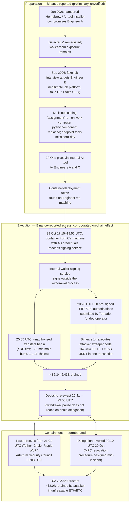
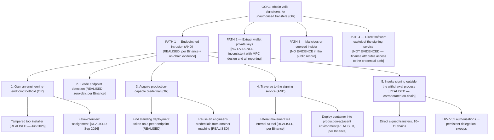

# Project BLACKSWAN II — Sections 1–4

## Interim GRC Post-Incident Assessment: The October 2026 Binance Centralised-Exchange Hack

*Sections 1–4: Executive Summary · Organisational and Technological Background · Incident Reconstruction and Technical Root Cause · Threat Modelling and Security Analysis*

---

# SECTION 1: EXECUTIVE SUMMARY (INTERIM)

## 1.0 Interim status notice — read this first

This is an **interim** assessment, issued approximately two weeks after the incident. Three constraints govern everything that follows, and any reader who skips them will misread the findings:

1. **There is no final root-cause report.** Binance's only substantive technical disclosure is a *preliminary* investigation report dated 3 November 2026, which Binance itself describes as preliminary, with the investigation ongoing, an independent review invited but not published, and some technical details withheld permanently as confidential (Binance, *Security Incident on October 30, 2026: Update on Preliminary Investigation Findings and Response Progress*, 3 Nov 2026, https://www.binance.com/en/square/post/384314641614134). Where this assessment describes the intrusion path, it is describing **Binance's preliminary account, not independently verified fact**, and it is labelled as such throughout.
2. **Several headline numbers are management representations.** Binance's statements about customer coverage, blocked threats, and remediation completeness have not been independently verified (StepSecurity, *Binance's $6.34 Billion Hack: Developer Machines, AI Tooling, and Wallet Signing*, updated 3 Nov 2026, https://www.stepsecurity.io/blog/binance-hack-developer-machine-security). They are recorded here as claims, tiered separately from corroborated fact in §1.5.
3. **Binance reports in UTC+8.** Its preliminary report frames the incident as "October 30" because, in UTC+8, the theft ran 30 Oct 01:15–07:56. In UTC, the theft occurred on **29 October 2026**. All times in this assessment are UTC unless stated otherwise (Binance, 3 Nov 2026, https://www.binance.com/en/square/post/384314641614134).

## 1.1 Incident overview

On 29 October 2026, attackers drained Binance's hot wallets across 10 blockchains (TRM Labs' count) or 11 (Elliptic's) in the largest cryptocurrency theft on record. The first unauthorised outflow occurred at **20:05 UTC** (five hot wallets sending 233.46 million XRP between 20:05 and 20:09 UTC); the main burst moved most funds within roughly 20 minutes; and unauthorised Ethereum activity — repeated re-sweeps of newly deposited funds — continued until **23:56 UTC**, with the malicious delegation finally revoked at **00:10 UTC on 30 October** (TRM Labs, *North Korea Steals USD 6.36 Billion From Binance in the Largest Hack in History*, 30 Oct 2026, https://www.trmlabs.com/resources/blog/north-korea-steals-usd-6-36-billion-from-binance-in-the-largest-hack-in-history; Binance, 3 Nov 2026, https://www.binance.com/en/square/post/384314641614134).

The affected infrastructure was the exchange's **hot wallets** and its **internal wallet-signing service**. The attack classification is a **signing-authority compromise**: there is no evidence of a wallet private-key leak in any source. Binance stated on 30 October and repeated on 3 November that no private-key leak was evidenced, and independent analysis is consistent with the signing *system* having been induced to sign, rather than keys having been extracted (Binance, 3 Nov 2026, https://www.binance.com/en/square/post/384314641614134; TRM Labs, 30 Oct 2026, https://www.trmlabs.com/resources/blog/north-korea-steals-usd-6-36-billion-from-binance-in-the-largest-hack-in-history). The defining summary in the secondary literature is accurate: the attackers did not steal Binance's keys — they made Binance sign (Killswitch, *They Didn't Steal Binance's Keys. They Made Binance Sign.*, 4 Nov 2026, https://www.killswitch.work/killswitch-07-they-didn-t-steal-binance-s-keys-they-made-binance-sign/).

Per Binance's preliminary report — **not independently verified** — the intrusion chain ran over four months: a tampered developer-tool download compromised a first engineer in June 2026; a fake job interview compromised a second engineer in September; an internal AI tool was used on 20 October to pivot to two further devices, where a container-deployment token was found; and on 29 October a container deployed with stolen credentials reached the signing service (Binance, 3 Nov 2026, https://www.binance.com/en/square/post/384314641614134). The US Federal Bureau of Investigation, with the US Secret Service and IRS Criminal Investigation, attributed the theft on 31 October to North Korea's **TraderTraitor** activity cluster and published 628 associated addresses (FBI, *North Korea Responsible for $6 Billion+ Binance Attack*, 31 Oct 2026, https://www.fbi.gov/investigate/cyber/alerts/2026/north-korea-responsible-for-6-billion-binance-attack).

## 1.2 Financial exposure — four measures that must not be merged

Public discussion of this incident routinely collapses four different quantities into one number. They are separated here, as they must be in any defensible risk record:

| Measure | Figure | Attribution and status |
|---|---|---|
| **Stolen (gross)** | ~$6.34B (Binance) / $6.36B (TRM Labs) / ~$6.4B (Chainalysis) / $6.43B (Elliptic) | Range reflects valuation timing, not a dispute about scale. FBI/DOJ: "more than $6 billion" (Binance, 3 Nov 2026, https://www.binance.com/en/square/post/384314641614134; TRM Labs, 30 Oct 2026, https://www.trmlabs.com/resources/blog/north-korea-steals-usd-6-36-billion-from-binance-in-the-largest-hack-in-history; Chainalysis, *The $6.4 Billion Binance Hack*, 30 Oct 2026, updated 5 Nov, https://www.chainalysis.com/blog/binance-exploit-latest-findings-and-response/; Elliptic, *How North Korea is laundering the $6.4 billion stolen from Binance*, updated 10 Nov 2026, https://www.elliptic.co/insights/how-north-korea-is-laundering-the-6-4-billion-stolen-from-binance/) |
| **Frozen / blocked** | ~$2.85B (Binance) / ~$2.8B (Chainalysis) / ~$2.7B (TRM Labs) | Close agreement; spread is definitional (cut-off time; "frozen" vs "intercepted") and the amount is ~94–100% stablecoins and issuer-controlled assets (Chainalysis, 30 Oct 2026, https://www.chainalysis.com/blog/binance-exploit-latest-findings-and-response/; TRM Labs, 30 Oct 2026, https://www.trmlabs.com/resources/blog/north-korea-steals-usd-6-36-billion-from-binance-in-the-largest-hack-in-history). On 12 Nov the US Department of Justice stated that collective efforts had frozen more than $2.7B, of which it had obtained court authorisation to seize or restrain in excess of $1.2B (US Department of Justice, 12 Nov 2026, https://www.justice.gov/opa/pr/justice-department-announces-actions-disrupt-north-koreas-massive-theft-cryptocurrency) |
| **Retained by the attacker** | ~$3.0B in theft-linked addresses, mostly unmoved ETH and BTC (Elliptic, 10 Nov 2026) | Includes more than 420,000 ETH and all 18,270 BTC — approximately $2.4B that no issuer can freeze (TRM Labs, 30 Oct 2026, https://www.trmlabs.com/resources/blog/north-korea-steals-usd-6-36-billion-from-binance-in-the-largest-hack-in-history; Elliptic, updated 10 Nov 2026, https://www.elliptic.co/insights/how-north-korea-is-laundering-the-6-4-billion-stolen-from-binance/) |
| **Actually recovered** | **UNDISCLOSED** | No Binance, DOJ, or analytics source states an amount of stolen assets actually recovered and returned. Frozen ≠ restrained ≠ recovered, and none of the three equals Binance's own replenishment (§1.3) |

A further dynamic belongs in the risk record: racing the freezes, the attacker converted approximately **$325 million of stablecoins into approximately $285 million of ETH** in about 20 minutes, at a cost of more than 10% against market prices (Chainalysis, 30 Oct 2026, https://www.chainalysis.com/blog/binance-exploit-latest-findings-and-response/; TRM Labs, 30 Oct 2026, https://www.trmlabs.com/resources/blog/north-korea-steals-usd-6-36-billion-from-binance-in-the-largest-hack-in-history). The lesson is structural: whatever portion of hot-wallet value is held in bearer assets (ETH, BTC) rather than issuer-controlled tokens is, once signed away, effectively beyond containment.

## 1.3 Customer coverage — a management representation, precisely defined

Binance announced on 12 November that **coverage was complete** (Binance, *Binance Completes Coverage of Assets Impacted in Security Incident; New Proof of Reserves Published*, 12 Nov 2026, https://www.binance.com/en/square/post/387527915862393). "Coverage" has a specific meaning that must not be mistaken for recovery: Binance **replenished the reserves backing customer balances to at least 1:1 from its own funds** — a partial deployment of the SAFU fund, Futures Insurance Funds in excess of the level required by its risk framework, and corporate treasury — purchasing replacement tokens through market and OTC channels. No customer balance was individually debited and refunded; the loss was absorbed on Binance's balance sheet. **No source reports any customer ultimately bearing a loss of funds.** Customers did, however, bear approximately two and a half days without withdrawals, still-phased withdrawals as of 12 November, and the inability to move or exit positions during the pause — none of which the "no loss" framing captures (Binance, 12 Nov 2026, https://www.binance.com/en/square/post/387527915862393; crypto.news, *Binance says $6.3B hack assets covered, reserve proof pending*, 12 Nov 2026, https://crypto.news/binance-hack-assets-covered-proof-of-reserves/).

The coverage progression, as announced contemporaneously, was ~80% (30 Oct) → ~90% (31 Oct) → ~95% (1 Nov) → ~98% (4 Nov) → complete (12 Nov) (CompareCEX, *Binance hack Oct 2026 tracker*, checked through 13 Nov 2026, https://comparecex.com/guides/binance-security-incident-2026-10/). **One disclosure defect must be recorded:** the 3 November preliminary report retroactively states that 98% of affected assets had been replenished "as of October 31" — a figure that conflicts with Binance's own contemporaneous 31 October update (90%) and its 1 November update (95%). No source reconciles the discrepancy (Binance, 3 Nov 2026, https://www.binance.com/en/square/post/384314641614134). This is a crisis-disclosure consistency finding (R-15), not a quibble: in a solvency-adjacent event, retroactively restated progress figures are exactly what undermines confidence in every other figure the operator publishes.

Verification status of the coverage claim rests on Binance's proof of reserves (PoR), which is itself limited (R-13). The 31 October snapshot (10 tokens) had its zero-knowledge proof completed on 2 November, making ≥1:1 backing user-verifiable for those tokens. The 4 November snapshot (44 tokens) was announced with an estimated 50–60-hour proof time, but **no announcement of its completion has been located**. The 12 November snapshot (198 tokens) carried an estimated 40–50-hour proof time and was **not yet published as of this assessment** (due 13 Nov 16:00 – 14 Nov 02:00 UTC) (Binance, *Security Incident | Recovery Process Update No. 7*, 4 Nov 2026, https://www.binance.com/en-AE/square/post/384992929024378; crypto.news, 12 Nov 2026, https://crypto.news/binance-hack-assets-covered-proof-of-reserves/). Until that proof lands, "198 tokens backed ≥1:1" is a Binance claim, and a PoR snapshot in any case attests to assets at a moment for covered tokens — it is not an audit of liabilities, of controls, or of the signing infrastructure that failed.

## 1.4 Operational impact

Withdrawals were paused on 29 October at approximately 22:15 UTC (one independent reconstruction gives 22:33 UTC; the discrepancy is unresolved) and deposits were briefly suspended in the early hours of 30 October; spot and futures trading were not reported suspended. Critically, **suspending withdrawals did not stop the theft**: the Ethereum re-sweeps continued for over 90 minutes after the pause, because the EIP-7702 authorisations already existed on-chain and operated independently of the withdrawal pipeline (Binance, 3 Nov 2026, https://www.binance.com/en/square/post/384314641614134; CryptoTimes, *Binance Hack Explained*, updated 7 Nov 2026, https://www.cryptotimes.io/insights/binance-hack-explained/). Phased withdrawal reopening began on 1 November between 06:00 and 09:00 UTC across 15 networks, continued in batches on 3, 5 and 6 November, and was **still phased on 12 November; no full-reopening date has been announced** (CompareCEX, checked through 13 Nov 2026, https://comparecex.com/guides/binance-security-incident-2026-10/).

Market and confidence effects were material but must be stated with their caveats. Bitcoin fell more than 4% and ether more than 5% on 29 October, amid approximately $1.5B of leveraged liquidations and a simultaneous equity sell-off that the sources themselves note as a contributing factor (Reuters, *Crypto exchanges call for quick moves to bolster defenses after Binance heist*, 31 Oct 2026, https://www.reuters.com/legal/government/crypto-exchanges-call-quick-moves-bolster-defenses-after-binance-heist-2026-10-31/). On reopening, Binance reported net outflows of $3.64B in the first 9.5 hours; its figures of $4.72B net (as of 2 Nov) and $5.28B net (46-hour window) are published without reconciliation and are flagged, not merged, in this assessment (Reuters, *Binance sees outflows stabilising…*, 2 Nov 2026, https://www.reuters.com/business/finance/binance-sees-outflows-stabilising-exchange-returns-online-after-63-billion-heist-2026-11-02/). Santiment measured ~28,316 BTC in net outflows from Binance-associated wallets between 29 October and 5 November — while itself noting that exchange BTC balances were already declining from 25 October, so the full amount cannot be attributed to the incident (CoinEdition, *Binance Hack Triggers 28,316 BTC Outflows, Santiment Reports*, 7 Nov 2026, https://coinedition.com/binance-hack-triggers-28316-btc-outflows-santiment-reports/). User USDT holdings on Binance fell 7.95% between the 1 and 31 October PoR snapshots (to 29.48B) — a figure that *predates* the reopening and therefore reflects October behaviour, not a post-incident run — and fell further to 24.30B by 12 November (crypto.news, *Binance User USDT Holdings Fall 7.95% in Latest Proof of Reserves*, Nov 2026, https://crypto.news/binance-usdt-holdings-fall-proof-of-reserves-october-2026/).

## 1.5 Principal findings, in three evidentiary tiers

**Tier 1 — Corroborated by independent evidence**

- **F-1 (R-07, R-06).** The theft mechanism was abuse of legitimate signing authority. On Ethereum, a Tornado Cash-funded operator submitted 50 pre-signed EIP-7702 authorisations at 20:20 UTC; approximately 3 minutes 24 seconds later the Binance 14 hot wallet was swept (167,464 ETH plus 1.615B USDT and 62 other tokens) in a single transaction, and the delegation re-swept new deposits six more times — independently reconstructed on-chain (TRM Labs, 30 Oct 2026, https://www.trmlabs.com/resources/blog/north-korea-steals-usd-6-36-billion-from-binance-in-the-largest-hack-in-history; Chainalysis, 30 Oct 2026, https://www.chainalysis.com/blog/binance-exploit-latest-findings-and-response/).
- **F-2 (R-08).** Hot-wallet concentration made a single signing path worth more than $6B in minutes: ~$6.36–6.43B across 10–11 chains in a ~20-minute main burst (TRM Labs, 30 Oct 2026; Elliptic, updated 10 Nov 2026, https://www.elliptic.co/insights/how-north-korea-is-laundering-the-6-4-billion-stolen-from-binance/).
- **F-3 (R-09, R-11).** Containment was asymmetric. Issuer freezes began within the hour (Tether 21:01 UTC, Circle 21:04 UTC) and ultimately blocked ~$2.7–2.85B — but the delegated authority on Ethereum could not be revoked until 00:10 UTC, a delay Binance attributes to its MPC design requiring a specialised revocation procedure (Binance, 3 Nov 2026, https://www.binance.com/en/square/post/384314641614134), and ~$3.0B in bearer assets sits beyond any freeze (Elliptic, updated 10 Nov 2026, https://www.elliptic.co/insights/how-north-korea-is-laundering-the-6-4-billion-stolen-from-binance/).
- **F-4.** Attribution is official and early: the FBI attributed the theft to North Korea's TraderTraitor on 31 October and published 628 addresses, urging virtual asset service providers to block transactions with or derived from them — a public-service announcement, not an OFAC designation carrying a statutory blocking duty (FBI, 31 Oct 2026, https://www.fbi.gov/investigate/cyber/alerts/2026/north-korea-responsible-for-6-billion-binance-attack). North Korea denied the attribution on 3 November (CoinDesk, *North Korea denies role in $6.4 billion Binance hack after FBI points to TraderTraitor*, 3 Nov 2026, https://www.coindesk.com/business/2026/11/03/north-korea-denies-role-in-usd6-4-billion-binance-hack-after-fbi-points-to-tradertraitor).

**Tier 2 — Reported by Binance (preliminary), not independently verified**

- **F-5 (R-01–R-06).** The entire endpoint intrusion chain (§3.1): the June 2026 tampered Homebrew/AI-tool download compromising Engineer A, detected and remediated but leaving team exposure; the September 2026 fake job interview compromising Engineer B via a malicious coding assignment that endpoint tools missed; the 20 October pivot through an internal AI tool to Engineers A and C; the container-deployment token found on A's machine; and the 29 October container, deployed from C's machine with A's credentials, reaching the signing service (Binance, 3 Nov 2026, https://www.binance.com/en/square/post/384314641614134).
- **F-6 (R-04).** A prior compromise was detected and remediated in June, yet the exposure it created — the wallet team's identities and roles — was precisely what the successful September targeting used. The remediation closed the device; it did not close the targeting risk (Binance, 3 Nov 2026, https://www.binance.com/en/square/post/384314641614134; assessor's characterisation).
- **F-7 (R-12).** The coverage programme and its funding split (§1.3), Binance's claim to have blocked 57 suspected North Korea-linked threats in 2026 (~one every five days), and its remediation claims (systems rebuilt, entry points closed, enhanced device scanning) are Binance-only figures and assertions (Binance, 3 Nov 2026, https://www.binance.com/en/square/post/384314641614134; Cointelegraph, *Binance Security Chief Warned of Hack Tactic Before $6.3B Theft*, 12 Nov 2026, https://cointelegraph.com/news/binance-cso-foreshadowed-6b-hack-tactic-months-before-attack; StepSecurity, 3 Nov 2026, https://www.stepsecurity.io/blog/binance-hack-developer-machine-security).

**Tier 3 — Cannot yet be established from the public record**

- **F-8 (R-10). Binance's detection time is unknown.** Binance states only that it "subsequently received an internal alert about large transfers" — undated. External on-chain reporting appeared within minutes of the 20:20 UTC Ethereum delegation, and CoinDesk reported a possible multi-billion hack at 21:12 UTC. Whether Binance's internal detection preceded, matched, or followed public detection **cannot be determined**, and this assessment makes no claim about it (Binance, 3 Nov 2026, https://www.binance.com/en/square/post/384314641614134). For the world's largest exchange, the absence of a published detection timeline is itself the finding.
- **F-9 (R-06, R-07).** How the internal AI tool was abused (it is unnamed; no prompt-injection, MCP, or product detail has been published), what segmentation or approval checks stood between a developer container and a cross-chain signing service, and whether signing requests were validated against approved withdrawals — all unknown (StepSecurity, 3 Nov 2026, https://www.stepsecurity.io/blog/binance-hack-developer-machine-security; Hacken, *Lessons from Binance $6.3B hack analysis*, Nov 2026, https://hacken.io/insights/binance-hack/).
- **F-10 (R-12, R-13).** The amount actually recovered; the final allocation of coverage funding among SAFU, Futures Insurance and treasury; whether SAFU has in fact been replenished to ~$1B; and the completion status of the 4 November ZK proof — none disclosed (Binance, 12 Nov 2026, https://www.binance.com/en/square/post/387527915862393).

## 1.6 Lessons so far

1. **The warning-to-breach gap is the central governance fact.** In July 2026, Binance's CSO Jimmy Su described the fake-interview tactic in detail to Cointelegraph — attackers tailoring a job opportunity to an employee and persuading them to run code as a technical assessment (Cointelegraph, 12 Nov 2026, https://cointelegraph.com/news/binance-cso-foreshadowed-6b-hack-tactic-months-before-attack). Chainalysis has since documented that smaller fake-interview attacks over roughly 18 months — more than $14.3M in the studied set — were rehearsals refining the playbook used against Binance (Chainalysis, *DPRK Hackers Perfected Their Fake Interview Playbook Over Dozens of Attacks Before Binance*, 3 Nov 2026, via https://www.chainalysis.com/blog/category/crime/). The threat was known, named, and rehearsed in public. The control failure was not awareness; it was that awareness never became architecture.
2. **Endpoint compromise must be assumed; blast radius is the control.** Reuters' post-incident analysis frames the industry question correctly: not whether social engineering can be stopped, but why internal controls do not limit what one compromised employee can reach (Reuters, 11 Nov 2026, via WEEX republication, https://www.weex.com/news/detail/binance-hack-exposes-cybersecurity-gaps-at-crypto-exchanges-mwox1cwirlxw3g0cua3saqrt). A peer benchmark now exists in public: Coinbase stated on 4 November that no single employee has standing access to its production wallet signing (CryptoCompass, *Coinbase Says It Was Unaffected…*, 4 Nov 2026, https://cryptocompass.com/articles/coinbase-says-it-was-unaffected-by-6-3-billion-binance).
3. **Revocation is a design requirement, not an incident improvisation.** TRM's defensive guidance — monitor for any EIP-7702 delegation on treasury wallets, treat batched authorisations as an indicator of compromise, and maintain a tested, pre-approved revocation method — follows directly from four hours of re-sweeps (TRM Labs, 30 Oct 2026, https://www.trmlabs.com/resources/blog/north-korea-steals-usd-6-36-billion-from-binance-in-the-largest-hack-in-history).
4. **Coverage is not a control.** Binance's balance sheet absorbed a $6.34B loss; that is financial resilience, and it protected customers. It is not evidence that the control environment worked, and it must not be allowed to close the governance file — particularly while the funding split, the SAFU refill, and recovered amounts remain undisclosed.

## 1.7 Strategic recommendations

- **SR-1 — Bind signing authority to policy, and partition it.** A signing service must sign only transactions that match an approved withdrawal intent, with signing infrastructure and approval paths separated by chain and wallet tier, and any EIP-7702 delegation on a treasury wallet treated as a critical alert (addresses R-06, R-07; per TRM Labs, 30 Oct 2026, https://www.trmlabs.com/resources/blog/north-korea-steals-usd-6-36-billion-from-binance-in-the-largest-hack-in-history).
- **SR-2 — Remove standing privilege from engineering endpoints.** No long-lived deployment tokens on laptops; just-in-time, hardware-backed credentials; and a maintained inventory of what any single compromised developer machine can reach (addresses R-02, R-03, R-05; per StepSecurity, 3 Nov 2026, https://www.stepsecurity.io/blog/binance-hack-developer-machine-security).
- **SR-3 — Govern internal AI and automation tooling as privileged identities.** Tools that can act across machines require the same approvals, logging, and scope limits as human administrators (addresses R-05, R-06; per Hacken, Nov 2026, https://hacken.io/insights/binance-hack/).
- **SR-4 — Pre-engineer containment.** Tested delegation-revocation under MPC, hot-wallet velocity limits and circuit breakers that operate independently of the withdrawal pipeline, and freeze-coordination playbooks with issuers (addresses R-08, R-09, R-11, R-14).
- **SR-5 — Restore assurance discipline.** Publish a detection timeline; reconcile progress figures before publication rather than restating them afterwards; complete and announce every PoR proof; and deliver the final post-mortem and the invited independent review (addresses R-10, R-13, R-15).

## 1.8 Executive risk statement

This incident demonstrates that, at the world's largest cryptocurrency exchange, a four-month intrusion that began with two social-engineering compromises of individual engineers could be converted — through standing credentials, cross-machine tooling, and a reachable signing service — into the largest theft in the industry's history, in about twenty minutes of execution. The enterprise risk is not that employees can be deceived; that is a constant. The risk is that the architecture treated deceived employees' machines as trusted, treated a signing service's callers as authorised for whatever they requested, and concentrated more than $6B of immediately transferable value behind that single path — two months after the organisation's own security chief had described this exact attack in public. Until the final root-cause report and independent review are published, the completeness of remediation is an assertion by the affected party, and this assessment treats it as such.

---

# SECTION 2: ORGANIZATIONAL AND TECHNOLOGICAL BACKGROUND

## 2.1 Entity discipline: Binance the exchange is not BNB Chain

This assessment concerns **Binance's centralised exchange** — the custodial trading platform whose hot wallets and internal signing service were compromised. It must not be confused with the October 2022 exploit of the BSC Token Hub bridge, which concerned BNB Chain *protocol* infrastructure (genesis system contracts and a validator set), involved no exchange custody systems, and is the subject of the companion assessment (Project BLACKSWAN I). The two incidents share a brand ecosystem and nothing else of evidentiary relevance: different entity, different architecture, different failure mode — a forged cryptographic proof against a bridge in 2022; abused signing authority inside an exchange in 2026. Any analysis that imports findings from one into the other is unsound, and this assessment does not do so.

Within the exchange, the relevant organisational functions are: the **wallet infrastructure team** (development and operations for deposit/withdrawal systems — the team to which the compromised engineers belonged, per Binance's preliminary report); the **security function** led by the Chief Security Officer, which owns threat detection, including the North Korea-linked threat monitoring Binance cites; and the **executive layer** (co-CEOs Richard Teng and Yi He, and founder CZ) which fronted crisis communications. The FBI's attribution statement and the DOJ's seizure action are addressed in §3; the fragmented regulatory perimeter around the exchange is treated in later sections of this report (R-16).

## 2.2 Custodial wallet architecture: hot wallets, cold storage, and the signing service

A centralised exchange holds customer assets in wallets it controls. The standard architecture separates:

- **Cold storage** — wallets whose keys are kept offline, holding the majority of assets. Co-CEO Richard Teng stated on 30 October that most customer assets were in cold storage and that the attack affected the exchange's own hot wallet (reported by Cointelegraph, via secondary summaries of Binance's statements, 30 Oct 2026).
- **Hot wallets** — internet-connected wallets that service day-to-day deposit and withdrawal flows. They are, by design, the most exposed and the most liquid component of the system. In this incident, hot wallets across 10–11 chains held, in aggregate, more than $6B of immediately transferable value (TRM Labs, 30 Oct 2026, https://www.trmlabs.com/resources/blog/north-korea-steals-usd-6-36-billion-from-binance-in-the-largest-hack-in-history).
- **The withdrawal pipeline** — the business process that validates a customer withdrawal request (account checks, limits, risk screening) and constructs a transaction for signing.
- **The wallet-signing service** — the internal service that holds or accesses signing capability and produces valid signatures for wallet transactions. It is the junction between business intent and irreversible on-chain effect, and therefore the highest-consequence component in the architecture.

The control expectation at that junction is the one Hacken's post-incident analysis states plainly: a signer that signs whatever an authorised caller sends, without checking the request against an approved withdrawal, is the core failure pattern (Hacken, *Lessons from Binance $6.3B hack analysis*, Nov 2026, https://hacken.io/insights/binance-hack/). Binance's own account establishes that the attackers obtained signatures **outside** the normal withdrawal process: "attackers used unauthorized access to the internal wallet signing service to bypass normal withdrawal processes and initiate transactions" (Binance, 3 Nov 2026, https://www.binance.com/en/square/post/384314641614134). What Binance has **not** published is the control detail that would let an assessor judge the design: what authentication and authorisation a caller needed, whether requests were bound to withdrawal records, what value limits applied, and how the service was segmented from the corporate network (F-9, §1.5).

## 2.3 MPC signing, at the level the public record supports

Binance states that the affected hot wallets use **multi-party computation (MPC)** (Binance, 3 Nov 2026, https://www.binance.com/en/square/post/384314641614134). In an MPC (threshold-signature) design, no complete private key exists in one place: key material is split into shares held by separate parties or systems, and a valid signature is produced only when a threshold of share-holders cooperates in the signing protocol. Properly implemented, MPC removes the single-key-theft scenario — consistent with the absence of any evidenced key leak here.

MPC, however, changes rather than eliminates the risk surface, and this incident exhibits its characteristic weakness: **the security boundary moves from the key to the signing policy and to whatever can invoke the signing protocol.** If an attacker reaches a component that is an authorised participant or an authorised caller, the threshold protocol will faithfully co-sign an illegitimate transaction. Binance's second MPC-related admission is operational: because no single private key existed, there was no single key with which to immediately revoke the Ethereum delegations; a specialised revocation procedure had to be designed and executed during the incident, extending containment from minutes to hours (Binance, 3 Nov 2026, https://www.binance.com/en/square/post/384314641614134). The governance lesson is that threshold signing must be paired with threshold *governance*: pre-engineered revocation, policy binding, and caller authorisation that is independent of network reachability (§4, SR-1, SR-4).

## 2.4 EIP-7702, explained accurately and briefly

EIP-7702 is an Ethereum account-abstraction mechanism (introduced with the Pectra upgrade) that allows an externally owned account (EOA) to **delegate its execution to smart-contract code** by means of a signed authorisation. The account's address and balance do not change; but when the account is called, it executes the delegated code instead of behaving as a plain account. The authorisation is a signed object that **any third party (a relayer/operator) can submit on-chain** — the signature, not the submitter, is the authority.

The attack applied this as follows, per on-chain reconstruction. The signing path was induced to produce **50 signed authorisations** for the Binance 14 hot wallet across 50 consecutive nonce values — pre-signing a range guaranteed that one authorisation would match the wallet's nonce at execution time, because a busy hot wallet's nonce moves constantly. A Tornado Cash-funded operator wallet submitted the batch at **20:20 UTC**; once a delegation to attacker-deployed sweeper code was in place, a call to Binance 14 executed that code and swept **167,464 ETH and 63 tokens, including 1.615B USDT, in a single transaction approximately 3 minutes 24 seconds later**. The delegation persisted across subsequent deposits: funds arriving at Binance 14 were re-swept at 20:41, 20:59, 21:04, 21:44, 22:39 and 23:56 UTC. Binance 14's separate role as executor of a Binance smart account additionally enabled the removal of 823M USDC (frozen by Circle shortly afterwards) (TRM Labs, 30 Oct 2026, https://www.trmlabs.com/resources/blog/north-korea-steals-usd-6-36-billion-from-binance-in-the-largest-hack-in-history; Chainalysis, 30 Oct 2026, https://www.chainalysis.com/blog/binance-exploit-latest-findings-and-response/; Alfocea, *The October 29 Binance theft: 50 signatures, one lucky nonce…*, Nov 2026, https://cr0hn.medium.com/on-october-29-2026-at-20-20-59-utc-the-binance-hot-wallet-known-as-binance-14-stopped-being-an-becd5588e542).

Two properties made this mechanism decisive. First, **the delegation lived on-chain**, so it was unaffected by Binance suspending its own withdrawal systems. Second, **revocation required a new authorisation from the compromised wallet**, which — under MPC — Binance could not produce quickly (§2.3). EIP-7702 is a legitimate and useful standard; the control failure is that a treasury wallet could acquire a delegation to arbitrary code without that event being prevented by signing policy or detected as a critical anomaly in real time (R-07, R-09).

## 2.5 Threat actor: TraderTraitor

The FBI "refers to this specific North Korean malicious cyber activity as 'TraderTraitor'" and stated that North Korea "was responsible for the theft of more than $6 billion USD in virtual assets from cryptocurrency exchange Binance, on or about October 29, 2026" (FBI, 31 Oct 2026, https://www.fbi.gov/investigate/cyber/alerts/2026/north-korea-responsible-for-6-billion-binance-attack). The FBI, with USSS and IRS-CI, observed TraderTraitor actors converting stolen assets primarily into ether, expected further laundering through DeFi and instant-swap services, and published 628 addresses (independently counted as 608 Ethereum, 19 Bitcoin, 1 Solana) that VASPs were urged to block.

Three features of the actor profile matter for control design:

1. **The recruitment vector is a documented, rehearsed playbook, not a novelty.** Chainalysis's follow-on research documents dozens of smaller fake-interview attacks over approximately 18 months — over $14.3M in the studied set — functioning as rehearsals that refined the playbook later used against Binance (Chainalysis, 3 Nov 2026, via https://www.chainalysis.com/blog/category/crime/). The actor targets identifiable engineering staff through legitimate job platforms, fictitious companies, live video interviews with impersonated HR staff and executives, and malicious "technical assessment" code.
2. **The actor is patient and multi-stage.** Preparation for the on-chain phase began at least 36 hours before the theft (operator-wallet funding via Tornado Cash on 28 October, with test deployments), and — on Binance's account — the endpoint phase ran for four months (TRM Labs, 30 Oct 2026, https://www.trmlabs.com/resources/blog/north-korea-steals-usd-6-36-billion-from-binance-in-the-largest-hack-in-history; Binance, 3 Nov 2026, https://www.binance.com/en/square/post/384314641614134).
3. **Attribution rests on financial behaviour as much as intrusion forensics.** Chainalysis announced its attribution on 30 October; its strongest evidence was the real-time **commingling of Binance proceeds with proceeds of the September 2026 Bitget theft** (itself North Korea-attributed), independently observed by on-chain investigators via THORChain (Chainalysis, 30 Oct 2026, https://www.chainalysis.com/blog/binance-exploit-latest-findings-and-response/). The laundering operation that followed was industrial in scale: more than 20,000 wallets, 16 blockchains, at least 36 services and at least 65,000 transactions (Elliptic, updated 10 Nov 2026, https://www.elliptic.co/insights/how-north-korea-is-laundering-the-6-4-billion-stolen-from-binance/). Note for the record: descriptions circulating in commentary of Hong Kong intermediaries, Russian and Cambodian networks and UnionPay cash-out channels describe Chainalysis-documented behaviour from **previous** North Korean thefts — the expected end-game pattern — and have **not** been observed for these funds, of which Elliptic assesses only a negligible amount had likely been cashed out as of 10 November (Olivier/Forvis Mazars via ITWeb, *What the Binance hack tells us about how crypto really works*, 12 Nov 2026, https://itweb.africa/article/what-the-binance-hack-tells-us-about-how-crypto-really-works/mQwkoM6YrZ373r9A; Elliptic, updated 10 Nov 2026, https://www.elliptic.co/insights/how-north-korea-is-laundering-the-6-4-billion-stolen-from-binance/).

Binance itself has not named an attacker; its preliminary report cites the FBI's attribution. North Korea denied responsibility on 3 November, characterising the attribution as a "grave political provocation," without offering a technical rebuttal (CoinDesk, 3 Nov 2026, https://www.coindesk.com/business/2026/11/03/north-korea-denies-role-in-usd6-4-billion-binance-hack-after-fbi-points-to-tradertraitor).

## 2.6 Critical assets and the trust assumptions that failed

| # | Critical asset | Why it is critical |
|---|---|---|
| A-1 | The wallet-signing service and its signing policy | Sole junction between intent and irreversible transfer; compromise converts directly to loss |
| A-2 | Hot wallets (10–11 chains) and their aggregate balances | The loss pool itself; >$6B transferable in minutes |
| A-3 | Signing authorisations and delegations (incl. EIP-7702 state) | Portable authority: a signed authorisation is spendable by whoever holds it |
| A-4 | Engineering endpoints of the wallet infrastructure team | The evidenced entry point; holders of credentials, tokens and network reach |
| A-5 | Credentials and deployment tokens (incl. container-deployment token) | The bridge from endpoint compromise to production effect |
| A-6 | Internal AI/automation tooling with cross-machine reach | A privileged identity in software form; per Binance, the lateral-movement vehicle |
| A-7 | Customer balances and the reserves backing them (incl. SAFU, Futures Insurance Funds) | The liability side; the coverage event of §1.3 |
| A-8 | Organisational credibility of disclosures and PoR | The asset that determines whether a liquidity event becomes a solvency panic |

The architecture, as evidenced, rested on trust assumptions that the incident falsified — each is stated as the design appears to have held it, with the outcome:

| # | Trust assumption | Outcome |
|---|---|---|
| T-1 | An engineering endpoint that passes endpoint-security tooling is safe to hold production-adjacent credentials | **Violated** — per Binance, endpoint tools missed zero-day malware on Engineer B's machine (R-03) |
| T-2 | Software obtained through normal developer channels (package managers, tool installers) is authentic | **Violated** — per Binance, a tampered Homebrew installer compromised Engineer A in June (R-02) |
| T-3 | Recruitment activity is a personal matter external to production security | **Violated** — the fake interview was the decisive initial access (R-01) |
| T-4 | A caller that reaches the signing service and authenticates is authorised for the transactions it requests | **Violated** — signatures were obtained outside the withdrawal process (R-07) |
| T-5 | Internal tools that act across employee machines are benign because they are internal | **Violated** — per Binance, an internal AI tool carried the compromise to two further engineers (R-05, R-06) |
| T-6 | Suspending withdrawals stops unauthorised outflows | **Violated** — on-chain EIP-7702 delegations operated independently of the withdrawal pipeline (R-14) |
| T-7 | Remediation of a detected endpoint compromise closes the incident | **Violated** — the June remediation left the targeting exposure that September exploited (R-04) |

---

# SECTION 3: INCIDENT RECONSTRUCTION AND TECHNICAL ROOT CAUSE

## 3.1 Chronological narrative, in evidentiary tiers

**Phase 0 — Preparation of the ground (June–September 2026) [Binance-reported, preliminary].** Per Binance's preliminary report, in June 2026 Engineer A — a wallet development and operations engineer — searched online to install a popular AI coding tool and downloaded a **tampered Homebrew installer**. Binance states its security team proactively detected the anomaly, replaced the device and rotated all related credentials; however, Engineer A's role information and the identities of colleagues on the wallet infrastructure team "had already been exposed to the attackers" (Binance, 3 Nov 2026, https://www.binance.com/en/square/post/384314641614134). The assessor notes the structural significance: the June incident was closed as a device compromise, but its product — a targeting package on the wallet team — remained live (R-04).

In September 2026, Software Engineer B, whose profile on a **legitimate job platform** identified Binance as employer, was approached by an impersonator posing as a project director of a fictitious company. A first-round live video interview with a fake "HR representative" (supported by a social-media account with personal photos and video) built trust; a second round, over a popular messaging app, featured an impersonated CEO. Near the end, B was asked to download an "assignment" containing a code repository **onto their work computer**. The repository's installation executed malicious code which used obfuscation and evasion, **replaced a component of the legitimate development tool pyenv with a malicious version**, executed commands, communicated with an attacker server, and erased its traces. Binance describes the malware as zero-day and states endpoint security tools failed to detect it at the time (Binance, 3 Nov 2026, https://www.binance.com/en/square/post/384314641614134; corroborated as Binance's account by Reuters, *Binance hackers used fake job interview to compromise computer before $6.3 billion attack*, 3 Nov 2026).

**Phase 1 — Lateral movement (20 October 2026) [Binance-reported; mechanism unknown].** Per Binance, attackers used Engineer B's compromised computer to **take control of the devices of Engineer A and Engineer C** (another wallet software engineer) **through internal AI tools**, and quickly discovered **a token with container-deployment permissions on Engineer A's computer** (Binance, 3 Nov 2026, https://www.binance.com/en/square/post/384314641614134). Binance has not named the tool or explained the abuse path; independent analysis confirms the report points to no prompt injection, MCP exploit, or named product (StepSecurity, 3 Nov 2026, https://www.stepsecurity.io/blog/binance-hack-developer-machine-security). In total, Binance's account implicates **three engineers and four computers** over roughly four months.

**Phase 2 — On-chain preparation (28 October 2026) [Corroborated on-chain].** At least 36 hours before the theft, the operator wallet was funded by three small Tornado Cash withdrawals, and test deployments and rehearsals were conducted against three wallets (TRM Labs, 30 Oct 2026, https://www.trmlabs.com/resources/blog/north-korea-steals-usd-6-36-billion-from-binance-in-the-largest-hack-in-history).

**Phase 3 — Access to the signing service (29 October, 17:15–19:56 UTC) [Binance-reported].** Per Binance (01:15–03:56 UTC+8), attackers logged into Engineer C's computer, **deployed a container using credentials stolen from Engineer A**, and ran a malicious script, reaching the internal wallet-signing service (Binance, 3 Nov 2026, https://www.binance.com/en/square/post/384314641614134). Whether the signing service authenticated the container, checked requests against withdrawal records, or applied value limits is **not disclosed** (F-9).

**Phase 4 — The theft (29 October, 20:05–23:56 UTC) [Corroborated on-chain].** The drain began at 20:05 UTC with XRP and other non-Ethereum chains; the Ethereum leg began at 20:20 UTC with the submission of the 50 EIP-7702 authorisations and the Binance 14 sweep ~3 minutes later (§2.4). Most value moved in a ~20-minute main burst; the Binance 14 delegation re-swept incoming deposits six further times, the last unauthorised transfer landing at 23:56 UTC (TRM Labs, 30 Oct 2026, https://www.trmlabs.com/resources/blog/north-korea-steals-usd-6-36-billion-from-binance-in-the-largest-hack-in-history; Chainalysis, 30 Oct 2026, https://www.chainalysis.com/blog/binance-exploit-latest-findings-and-response/). Asset totals by chain (TRM, at theft prices): Ethereum ~$3.79B (200,630 ETH; 1.875B USDT; 823M USDC; 88.5M RLUSD; 181 further tokens); Bitcoin 18,270 BTC (~$1.47B); Tron ~$628M; XRP Ledger ~$296M; Solana ~$96M; Arbitrum/Optimism/Base ~$39M; Avalanche ~$28M; Polygon ~$10M (TRM Labs, 30 Oct 2026, https://www.trmlabs.com/resources/blog/north-korea-steals-usd-6-36-billion-from-binance-in-the-largest-hack-in-history).

**Phase 5 — Containment, in parallel and in arrears [Corroborated].** Third-party containment was fast: Tether froze 971.1M USDT at 21:01 UTC and Circle froze 823M USDC at 21:04 UTC; Ripple froze the RLUSD wallet at 22:01 UTC (40.5M RLUSD remaining of 88.5M taken); World Liberty Financial froze 27.8M USD1 at 22:10 UTC; the Arbitrum Security Council forcibly moved ~$30M of assets from the attacker's Arbitrum wallet at 00:08 UTC (TRM Labs, 30 Oct 2026, https://www.trmlabs.com/resources/blog/north-korea-steals-usd-6-36-billion-from-binance-in-the-largest-hack-in-history). Binance states the verified frozen total reached $2.54B by 23:35 UTC (Binance, 3 Nov 2026, https://www.binance.com/en/square/post/384314641614134). Meanwhile the attacker raced the freezes, swapping ~$325M of stablecoins into ~$285M of ETH (Chainalysis, 30 Oct 2026, https://www.chainalysis.com/blog/binance-exploit-latest-findings-and-response/). Binance's own containment lever — pausing withdrawals at ~22:15 UTC — did not reach the on-chain delegation; revocation was only effected at **00:10 UTC on 30 October**, which Binance attributes to the MPC design requiring a specialised revocation procedure (Binance, 3 Nov 2026, https://www.binance.com/en/square/post/384314641614134).

**Phase 6 — Disclosure and recovery (30 October – 12 November) [Corroborated sequence; content partly Binance-only].** Binance's first formal update (30 October) attributed the incident to "a compromised DevOps engineer's laptop" — an account Binance itself superseded the same day ("additional points of breach") and replaced on 3 November with the three-engineer chain (§3.1). Early disclosure therefore **understated the intrusion path** (R-15). The FBI attributed the theft to TraderTraitor on 31 October (FBI, 31 Oct 2026, https://www.fbi.gov/investigate/cyber/alerts/2026/north-korea-responsible-for-6-billion-binance-attack). Coverage milestones and PoR snapshots followed as detailed in §1.3; withdrawals reopened in phases from 1 November. On 12 November, Binance announced coverage complete, and the DOJ announced court-authorised seizure/restraint of more than $1.2B within the more-than-$2.7B frozen total (Binance, 12 Nov 2026, https://www.binance.com/en/square/post/387527915862393; US Department of Justice, 12 Nov 2026, https://www.justice.gov/opa/pr/justice-department-announces-actions-disrupt-north-koreas-massive-theft-cryptocurrency). *For the avoidance of doubt: the same DOJ release announced a separate action against the "FaceStealer" campaign; that action does not concern this incident and no part of it is treated as evidence here.* As of this assessment, the attacker retains ~$3.0B, largely unmoved (Elliptic, updated 10 Nov 2026, https://www.elliptic.co/insights/how-north-korea-is-laundering-the-6-4-billion-stolen-from-binance/), laundering proceeds through an automated operation spanning 20,000+ wallets and 16 chains, including real-time commingling with the September 2026 Bitget theft proceeds (Chainalysis, 30 Oct 2026, https://www.chainalysis.com/blog/binance-exploit-latest-findings-and-response/; Elliptic, updated 10 Nov 2026, https://www.elliptic.co/insights/how-north-korea-is-laundering-the-6-4-billion-stolen-from-binance/).

## 3.2 Detailed timeline (all times UTC)

| Time (UTC) | Event | Evidence tier / source |
|---|---|---|
| Jun 2026 (day not published) | Engineer A downloads tampered Homebrew installer for an AI coding tool; endpoint compromised | Binance preliminary report, 3 Nov 2026 |
| Jun 2026 | Binance detects the anomaly, replaces the device, rotates credentials; wallet-team role/identity exposure already effected | Binance preliminary report |
| Sep 2026 | Fake job interview targets Engineer B via a legitimate job platform; malicious coding "assignment" run on work computer; pyenv component replaced; endpoint tools miss zero-day malware | Binance preliminary report |
| 20 Oct 2026 | Attackers pivot via an internal AI tool from B's machine to Engineers A and C; container-deployment token found on A's machine | Binance preliminary report; tool/mechanism undisclosed |
| 28 Oct 2026 | Operator wallet funded via three small Tornado Cash withdrawals; test deployments/rehearsals on three wallets | Corroborated on-chain (TRM Labs, 30 Oct 2026) |
| 29 Oct, 17:15–19:56 | Container deployed from Engineer C's machine using Engineer A's credentials; malicious script reaches the internal wallet-signing service | Binance preliminary report (01:15–03:56 UTC+8) |
| 29 Oct, 20:05–20:09 | **Theft begins**: five hot wallets send 233.46M XRP, leaving minimum balances | Corroborated (TRM Labs; Binance) |
| 29 Oct, ~20:05–20:25 | Main burst: most funds across 10–11 chains move within ~20 minutes | Corroborated (TRM Labs; Chainalysis) |
| 29 Oct, 20:20 | Operator submits **50 pre-signed EIP-7702 authorisations** for Binance 14 | Corroborated on-chain (TRM Labs; Chainalysis) |
| 29 Oct, ~20:24 | Binance 14 swept in a single transaction 3m24s later: 167,464 ETH + 1.615B USDT + 62 other tokens | Corroborated on-chain (TRM Labs) |
| 29 Oct, 20:41 / 20:59 / 21:04 / 21:44 / 22:39 / 23:56 | Delegation re-sweeps new deposits to Binance 14 six further times | Corroborated on-chain (TRM Labs) |
| 29 Oct, ~21:00 onwards | Attacker swaps ~$325M stablecoins → ~$285M ETH in ~20 minutes, racing the freezes | Corroborated (Chainalysis) |
| 29 Oct, 21:01 | **Tether freezes** 971.1M USDT in the main receiving wallet | Corroborated (TRM Labs) |
| 29 Oct, 21:04 | **Circle freezes** 823M USDC | Corroborated (TRM Labs) |
| 29 Oct, 21:12 | CoinDesk reports a possible multi-billion-dollar hack — external detection is in the public record. **Binance's own detection time has never been stated** | Corroborated (CoinDesk, via research timeline) |
| 29 Oct, 22:01 | Ripple freezes RLUSD wallet (40.5M RLUSD still inside) | Corroborated (TRM Labs) |
| 29 Oct, 22:10 | World Liberty Financial freezes 27.8M USD1 | Corroborated (TRM Labs) |
| 29 Oct, ~22:15 | Binance pauses withdrawals (one reconstruction gives 22:33 — unresolved). Re-sweeps continue regardless | Binance action; time per CryptoTimes timeline, updated 7 Nov 2026 |
| 29 Oct, 23:35 | Binance states verified frozen total has reached $2.54B | Binance preliminary report |
| 29 Oct, 23:56 | Final unauthorised transfer (2,961.9 ETH, broadcast earlier and pending) | Corroborated (Binance; on-chain) |
| 30 Oct, 00:08 | Arbitrum Security Council forcibly moves 8,426 ETH + 74.6M ARB (~$30M) from the attacker's Arbitrum wallet | Corroborated (TRM Labs) |
| 30 Oct, 00:10 | **Malicious EIP-7702 delegation revoked** (new Binance 14 authorisation clearing the delegated code) | Corroborated (Binance; on-chain reconstruction 00:10:35) |
| 30 Oct, 00:13–~04:17 | Deposits also suspended, then restored as working (Yi He) | Binance via secondary timelines |
| 30 Oct | Binance *Security Incident Update*: ~$6.3B impact; ~$3B frozen claimed; cause given as a compromised DevOps laptop — **superseded the same day** by Update #2 ("additional points of breach"; >$6.34B set aside; coverage ~80%) | Binance (via CompareCEX tracker) |
| 31 Oct | **FBI attributes the theft to North Korea / TraderTraitor**; 628 addresses published; VASPs urged to block | Corroborated — FBI, 31 Oct 2026 |
| 31 Oct | Binance Recovery Update #3: coverage ~90%; funding sources named (SAFU partial, Futures Insurance excess, treasury); PoR snapshot taken (10 tokens, 00:00 UTC) | Binance |
| 1 Nov, 06:00–09:00 | **Phase 1 withdrawal reopening** — 15 networks (BTC first) | Corroborated (Binance; trackers) |
| 1 Nov | Recovery Update #4: coverage ~95% | Binance |
| 2 Nov | 31 Oct PoR **ZK proof completed** — 10-token holders can verify ≥1:1 | Binance Recovery Update #5 |
| 3 Nov | **Binance preliminary investigation report** published (full chain in §3.1; retroactively claims 98% replenished "as of 31 Oct," conflicting with the contemporaneous 90%/95% figures). North Korea denies attribution (KCNA). Chainalysis publishes fake-interview playbook research | Binance; CoinDesk, 3 Nov 2026; Chainalysis, 3 Nov 2026 |
| 4 Nov | Recovery Update #7: coverage ~98%; PoR snapshot (44 tokens), ZK estimated 50–60h — **no completion announcement has been located** | Binance, 4 Nov 2026 |
| 5–6 Nov | Withdrawal reopening batches 3 and 4; 6 Nov notice targets 13 Nov for six further assets | Binance (via trackers) |
| 10 Nov | Elliptic update: **~$3.0B remains in theft-linked addresses**, mostly unmoved ETH/BTC; negligible cash-out assessed | Corroborated (Elliptic) |
| 12 Nov | Binance announces **coverage complete**; PoR snapshot (198 tokens), ZK proof pending (due 13 Nov 16:00 – 14 Nov 02:00 UTC) | Binance, 12 Nov 2026 |
| 12 Nov | **DOJ**: court-authorised seizure/restraint of >$1.2B within >$2.7B collectively frozen (separate FaceStealer action in the same release is not this incident) | Corroborated — US DOJ, 12 Nov 2026 |

## 3.3 Attack-flow diagram

## 3.4 Attack-surface analysis

| Attack surface | Exposure | How it featured | Evidence tier |
|---|---|---|---|
| Recruitment / social channel | Employees publicly identifiable by employer on legitimate job platforms; interview processes invite running third-party code | The decisive initial access (Engineer B); preceded by actor rehearsals over ~18 months | Binance-reported; playbook corroborated (Chainalysis, 3 Nov 2026) |
| Developer supply chain | Engineers install tools via public package channels (Homebrew) on production-adjacent machines | June compromise of Engineer A via tampered installer | Binance-reported |
| Engineering endpoints | Wallet-team workstations held credentials, a deployment token, and reach toward production systems | Two of three compromises landed here; token and pivot both endpoint-resident | Binance-reported |
| Endpoint detection tooling | Relied on to catch commodity and novel malware | Missed the September zero-day, per Binance | Binance-reported |
| Internal AI / automation tooling | Cross-machine capability makes the tool a privileged identity | Lateral-movement vehicle to Engineers A and C | Binance-reported; mechanism unknown |
| Identity and tokens | Standing container-deployment token stored on a laptop; credentials portable between machines | Token found on A; container deployed from C using A's credentials | Binance-reported |
| Path from endpoints/containers to the signing service | Segmentation and authorisation checks undisclosed | A single deployment path reached a signing service covering 10–11 chains | Effect corroborated; control design **unknown** |
| Signing-service policy | Whether requests were bound to approved withdrawals, value-limited, or delegation-aware | Signed transfers outside the withdrawal process; 50 EIP-7702 authorisations produced | Effect corroborated (on-chain); policy design **unknown** |
| On-chain delegation state (EIP-7702) | Treasury wallet could carry a persistent delegation to arbitrary code | Six re-sweeps over ~3.5 hours; survived withdrawal suspension | Corroborated on-chain |
| Hot-wallet balances | >$6B across chains in online wallets | The loss pool; concentration converted one signing path into a record theft | Corroborated |
| Freeze ecosystem | Containment depends on issuers/venues acting on bearer-asset chains where no freeze exists | ~$2.7–2.85B frozen (stablecoins); ~$3.0B unfreezable | Corroborated |
| Disclosure and reserves surface | Public figures drive depositor behaviour during the event | Early understatement of the path; retroactively restated coverage figure; pending ZK proofs | Corroborated as published record |

## 3.5 Root-cause analysis

**Immediate cause (corroborated).** Unauthorised transactions bearing valid Binance signatures were executed across 10–11 chains, having been initiated through the internal wallet-signing service outside the normal withdrawal process; on Ethereum, pre-signed EIP-7702 authorisations delegated a hot wallet to attacker code (Chainalysis, 30 Oct 2026, https://www.chainalysis.com/blog/binance-exploit-latest-findings-and-response/; TRM Labs, 30 Oct 2026, https://www.trmlabs.com/resources/blog/north-korea-steals-usd-6-36-billion-from-binance-in-the-largest-hack-in-history; Binance, 3 Nov 2026, https://www.binance.com/en/square/post/384314641614134).

**Contributing causes.**
1. Initial access succeeded twice against the same team, through two different social vectors — a tampered tool download and a fake recruitment process (Binance-reported; R-01, R-02).
2. Endpoint detection did not detect the September malware, described by Binance as zero-day with obfuscation, component replacement, and trace erasure (Binance-reported; R-03).
3. The June compromise was remediated at device level while its intelligence product — team targeting data — remained effective (Binance-reported facts; R-04).
4. A standing container-deployment token was present on an engineer's laptop, and credentials were usable from a different engineer's machine (Binance-reported; R-05).
5. An internal AI tool provided cross-machine reach between employee devices (Binance-reported; mechanism unknown; R-05, R-06).
6. Hot-wallet value concentration placed >$6B behind the signing path (corroborated; R-08).
7. Revocation of on-chain delegated authority was slow by design — MPC required a purpose-built procedure mid-incident (Binance admission; R-09).
8. The primary operational containment lever (withdrawal suspension) was architecturally incapable of stopping the Ethereum leg (corroborated; R-14).

**Systemic causes — stated with their limits.** Two systemic findings are supported by the public record. First, a **warning-to-control translation failure**: the decisive TTP was described publicly by Binance's own CSO in July 2026, was the subject of dozens of documented rehearsal attacks over ~18 months, and Binance states it blocked 57 suspected North Korea-linked threats in 2026 — yet the successful attack still traversed employee endpoints, standing tokens, and a reachable signing service (Cointelegraph, 12 Nov 2026, https://cointelegraph.com/news/binance-cso-foreshadowed-6b-hack-tactic-months-before-attack; Chainalysis, 3 Nov 2026, via https://www.chainalysis.com/blog/category/crime/; Binance, 3 Nov 2026, https://www.binance.com/en/square/post/384314641614134). Defence was weighted toward *detecting attempts* rather than *bounding the consequence of a successful one* (Reuters, 11 Nov 2026, https://www.weex.com/news/detail/binance-hack-exposes-cybersecurity-gaps-at-crypto-exchanges-mwox1cwirlxw3g0cua3saqrt). Second, **assurance opacity**: detection timing, signing-policy design, segmentation, and coverage-funding detail are all undisclosed, so the control environment cannot currently be audited from outside (R-10, R-13).

What this assessment **cannot** establish as systemic root cause — and therefore does not assert — includes: whether a signing-policy control was ever designed and failed, or never existed; the state of internal risk ownership and prior internal-audit findings; and whether the internal AI tool's cross-machine capability had ever been risk-assessed. Each requires Binance's final root-cause report and the invited independent review. Any interim report that purported to settle them would be fabricating.

## 3.6 Five Whys (inference levels labelled)

1. **Why did more than $6B leave Binance in about twenty minutes?** Because validly signed transfers and delegations, initiated outside the withdrawal process, were executed across 10–11 chains before any control interrupted them. *(Corroborated mechanism.)*
2. **Why could an attacker-controlled process obtain those signatures?** Per Binance, because a container deployed with a stolen deployment token, from a compromised engineer's machine, reached the internal wallet-signing service. *(Binance-reported; the service's own checks are undisclosed.)*
3. **Why did a compromised endpoint carry that reach?** Because endpoints of the wallet team held standing credentials and tokens with production effect, and internal tooling connected those endpoints to one another. *(Binance-reported facts; the characterisation of this as a privilege-design choice is assessor inference.)*
4. **Why were three wallet-team engineers' machines compromised?** Because two distinct social vectors (tampered tooling; fake recruitment) defeated user and endpoint controls against a team whose identities a prior, remediated compromise had already exposed. *(Binance-reported.)*
5. **Why did a publicly rehearsed, internally anticipated technique succeed end-to-end?** *(Analytical inference, held provisionally pending the final report.)* Because threat knowledge was operationalised as detection and blocking of attempts — the metric Binance cites is attempts stopped — rather than as architectural limits ensuring that one successful deception cannot reach signing authority. The control system measured the front door; the loss walked through the corridor behind it.

## 3.7 MITRE ATT&CK mapping — where it fits, and where it runs out

Unlike a blockchain-protocol exploit, this was a **conventional enterprise intrusion** for most of its length, and ATT&CK maps it well up to the signing-service boundary. The mapping below is an assessor mapping of Binance-reported and corroborated events to techniques; the mapping itself is analysis, not evidence.

| ATT&CK tactic | Technique | Incident application |
|---|---|---|
| Reconnaissance | T1589 Gather Victim Identity Information | Wallet-team engineers identified via employer details on a legitimate job platform (building on June exposure, per Binance) |
| Initial Access | T1566 Phishing (social-engineering lure) | Fake recruitment process culminating in the "assignment" download — ATT&CK has no dedicated fake-interview technique; the lure is modelled here |
| Initial Access / Persistence | T1195.002 Supply Chain Compromise: Compromise Software Supply Chain | Tampered Homebrew installer (June); malicious pyenv component substituted for a legitimate tool (September) |
| Execution | T1204.002 User Execution: Malicious File | Engineer B ran the assignment's installation on a work computer |
| Execution | T1059 Command and Scripting Interpreter | Malware executed commands and ran a malicious script in the signing-service phase (per Binance) |
| Persistence / Defense Evasion | T1554 Compromise Host Software Binary | Legitimate pyenv component replaced with a malicious version |
| Defense Evasion | T1027 Obfuscated Files or Information; T1070 Indicator Removal | Obfuscation/evasion and trace erasure described by Binance; endpoint tools did not detect |
| Credential Access | T1528 Steal Application Access Token | Container-deployment token taken from Engineer A's machine and used from Engineer C's |
| Lateral Movement | T1021 Remote Services; T1072 Software Deployment Tools | Movement to Engineers A and C (via internal AI tooling — see gap note); container deployment as the production step |
| Command and Control | T1071 Application Layer Protocol | Malware communicated with an attacker server (per Binance) |
| Impact | T1657 Financial Theft | Validly signed transfers and delegation sweeps moved >$6B to attacker addresses |

**Gaps, stated plainly.** (i) ATT&CK has **no technique for abuse of internal AI/agent tooling** to move between employee machines; T1021/T1072 are approximations, and the gap matters because this tool class is now a evidenced lateral-movement vector (R-05). (ii) The decisive act — **inducing a legitimate signing service to sign unauthorised transactions** — has no dedicated technique; it is an abuse of intended functionality by an authenticated path, approximated only by combining Valid Accounts (T1078) concepts with T1657. (iii) **EIP-7702 delegation abuse** is blockchain-native and outside ATT&CK's scope entirely. The correct conclusion is not that ATT&CK failed, but that an exchange's threat model must extend beyond it at exactly the point where enterprise IT becomes financial infrastructure.

---

# SECTION 4: THREAT MODELING AND SECURITY ANALYSIS

## 4.1 Model scope

**System in scope:** the path from a member of the public, through Binance's engineering workforce and internal tooling, to the wallet-signing service and hot wallets — i.e., the full evidenced attack surface, not merely the component that failed last.

**Threat actors.** (i) **TraderTraitor** (FBI-attributed): a state-sponsored, financially motivated actor with demonstrated patience (months), rehearsed social-engineering playbooks, developer-supply-chain capability, and industrial-scale laundering (FBI, 31 Oct 2026, https://www.fbi.gov/investigate/cyber/alerts/2026/north-korea-responsible-for-6-billion-binance-attack; Chainalysis, 3 Nov 2026, via https://www.chainalysis.com/blog/category/crime/). This is the realised actor and the design-basis threat for an exchange of Binance's scale. (ii) Other organised financially motivated groups capable of purchasing or replicating the playbook — the techniques are now public in detail. (iii) A malicious or coerced insider — no evidence in this incident; retained in the model because the same controls (least privilege, separation of duties, signing policy) govern both.

**Trust boundaries.**
- **TB-1 — Public internet ↔ employee:** recruitment approaches, job-platform profiles, downloadable tooling. Crossed by both initial accesses.
- **TB-2 — Employee endpoint ↔ internal tooling:** the endpoint is treated as a trusted operator console for internal AI/automation tools.
- **TB-3 — Corporate environment ↔ production wallet enclave:** the boundary the container deployment crossed, per Binance's account; its controls are undisclosed.
- **TB-4 — Withdrawal pipeline ↔ signing service:** the intent boundary. The incident's essence is that signing occurred without crossing this boundary legitimately — requests arrived at the signer without the pipeline's authorisation context.
- **TB-5 — Signing service ↔ public blockchains:** the irreversibility boundary. Everything beyond it (delegations, transfers) is outside the operator's unilateral control; containment depends on issuers, validators' governance (cf. Arbitrum), and pre-positioned revocation capability.

## 4.2 STRIDE analysis by component

● = threat realised in this incident (on Binance-reported or corroborated evidence). ○ = applicable, not evidenced as realised. — = not materially applicable.

| Component | S | T | R | I | D | E | Principal realised / applicable threats |
|---|---|---|---|---|---|---|---|
| Recruitment channel | ● | — | ○ | ● | — | — | **Spoofing:** impersonated project director, HR representative and CEO of a fictitious company. **Information disclosure:** employer/team details harvested from a legitimate job platform |
| Engineering endpoint | ○ | ● | ○ | ● | — | ● | **Tampering:** tampered installer; pyenv component replaced. **Information disclosure:** credentials, deployment token, team data. **Elevation of privilege:** malware executed commands with the engineer's authority; evaded endpoint tooling |
| Internal AI / dev tooling | ● | ○ | ○ | ● | — | ● | **Spoofing:** actions taken through a legitimate tool under a compromised user's context are indistinguishable from the user's. **Elevation of privilege:** cross-machine control exceeding any single user's intended scope. **Information disclosure:** token discovered on a peer's machine |
| Identity & credentials | ● | — | ○ | ● | — | ● | **Spoofing:** Engineer A's credentials used from Engineer C's machine. **Information disclosure:** standing token resident on a laptop. **Elevation of privilege:** a deployment token conferred production effect |
| Signing service | ● | ● | ○ | — | — | ● | **Spoofing (of intent):** requests presented as authorised signing work without withdrawal-pipeline provenance. **Tampering:** signed outputs (transfers; EIP-7702 authorisations) determined by the attacker. **Elevation of privilege:** one path exercised signing authority across 10–11 chains |
| Hot wallets | — | ● | — | ○ | ● | — | **Tampering:** Binance 14's execution delegated to attacker code on-chain. **Denial of service:** withdrawal availability lost for ~2.5 days and phased thereafter |
| Withdrawal pipeline | — | — | — | — | ● | — | **Not breached — bypassed.** Its controls were never evaluated by the attacker because the attack routed around it; its suspension (DoS of legitimate function) did not impede the theft |

*Model note:* STRIDE's per-component view understates the incident's real shape, which was **compositional**: no single component's failure was sufficient. Recruitment spoofing (TB-1) only mattered because endpoints held tokens (TB-2), tokens only mattered because a deployment path reached the signer (TB-3/TB-4), and the signer only mattered at this scale because hot wallets concentrated >$6B behind it (TB-5). Threat models that score components independently will systematically under-rate exactly this class of failure — a methodological finding this assessment carries into its control recommendations.

## 4.3 Evaluation against security principles

| Principle | Verdict | Basis |
|---|---|---|
| **Zero Trust** | **Not evidenced; inconsistent with observed outcome** | Per Binance's account, a stolen credential plus network reach sufficed to traverse from an employee endpoint to the signing service. A zero-trust design verifies every request's identity, device, and authorisation context regardless of origin; no public evidence describes such verification at TB-3/TB-4, and the outcome is evidence against its effective presence |
| **Defense in Depth** | **Failed internally; partially supplied externally** | Behind the endpoint there is no evidenced second control that independently checked signing intent — the pipeline was routed around, not defeated in layers. The depth that did operate came from outside the firm: issuer freezes and the Arbitrum Security Council bounded the loss (R-11) |
| **Least Privilege** | **Violated** | A standing container-deployment token on a laptop; credentials portable across machines; a single signing path with cross-chain scope. Each is a standing-privilege artefact whose compromise had production effect (R-05, R-06, R-07) |
| **Separation of Duties** | **Cannot be established; not evidenced** | No public evidence describes multi-party approval for production deployments reaching signing infrastructure, or for signing requests themselves. The available peer benchmark — Coinbase's 4 November statement that no single employee has standing access to its production wallet signing (CryptoCompass, 4 Nov 2026, https://cryptocompass.com/articles/coinbase-says-it-was-unaffected-by-6-3-billion-binance) — defines the expectation Binance's final report will be judged against |
| **Secure by Design** | **Failed at the delegation/revocation surface** | EIP-7702 delegation on a treasury wallet and MPC revocation were evidently not pre-engineered into the wallet design: revocation required a procedure designed during the incident (Binance admission), and TRM's guidance treats both delegation monitoring and a pre-tested revocation method as controls that should pre-exist (TRM Labs, 30 Oct 2026, https://www.trmlabs.com/resources/blog/north-korea-steals-usd-6-36-billion-from-binance-in-the-largest-hack-in-history) |
| **Fail Secure** | **Failed — the fail-closed boundary was drawn around the wrong component** | When operators shut the withdrawal pipeline, the system did not fail closed: the on-chain delegation continued paying out for over 90 minutes. A fail-secure design ties the emergency stop to the *signing* function and to on-chain authority, not only to the customer-facing pipeline (R-14) |
| **Continuous Monitoring** | **Cannot be established** | Binance claims substantial monitoring of inbound threats (57 claimed blocks) and an internal alert of unknown timing (F-8). Monitoring of *signing behaviour* — anomalous authorisation batches, new delegations on treasury wallets, outflows unmatched to withdrawals — is not evidenced; the authorisation batch and six re-sweeps proceeded without a publicly evidenced internal interruption (R-10) |

**Synthesis.** The realised attack did not defeat Binance's strongest controls; it avoided them. Each principle above fails in a different vocabulary, but the underlying architecture is one decision repeated: **authority was organised around components and their callers, not around verified intent and bounded consequence.** That is the finding the remediation programme (Sections 11–13 of this report) is built to reverse.

## 4.4 Attack tree

## 4.5 Control interruption points

Each point is a place where a control would have broken the realised chain. "Status" is judged strictly on the public record.

| # | Interruption point (stage) | Control that interrupts | Risk IDs | Status in this incident |
|---|---|---|---|---|
| CP-1 | Software acquisition (Jun initial access) | Verified-provenance installation: signed/allow-listed packages, isolated install environments for engineering tools | R-02 | **Ineffective or absent** — per Binance, the installer came from a web search for a popular tool |
| CP-2 | Recruitment interaction (Sep initial access) | Candidate-code policy with technical teeth: third-party assessment code runs only in a sacrificial sandbox, never on a production-adjacent machine; targeted-staff briefings for the wallet team | R-01 | **Not evidenced** — the CSO had publicly described this tactic in July; the assignment nonetheless ran on a work computer |
| CP-3 | Persistence on the endpoint | Integrity monitoring of developer-tool components (e.g., pyenv/Homebrew paths) — behaviour-independent of malware novelty | R-03 | **Ineffective** — component replacement persisted; Binance attributes the miss to a zero-day, which integrity monitoring is specifically designed to survive |
| CP-4 | Aftermath of the June detection | Exposure-closure: treat harvested team identities as a live threat — heightened monitoring and contact-point rotation for the exposed team | R-04 | **Not performed, as evidenced** — September targeting used precisely the June exposure (per Binance) |
| CP-5 | Credential storage and use | No standing tokens on endpoints; just-in-time credentials bound to user, device, and task; tokens non-transferable between machines | R-05 | **Absent, as evidenced** — a deployment token sat on a laptop and credentials operated from a different machine |
| CP-6 | Cross-machine tooling | Internal AI/automation tools governed as privileged identities: per-action approval, full logging, scope limits | R-05, R-06 | **Cannot be established** — no public evidence of approval or logging controls on the tool |
| CP-7 | Production boundary (TB-3/TB-4) | Segmented signing enclave: the signing service accepts requests only from the withdrawal pipeline's service identity, mutually authenticated, with requests bound to withdrawal records | R-06, R-07 | **Cannot be established** — Binance does not describe the barrier; the outcome shows that, whatever existed, it did not hold |
| CP-8 | Signing policy | Policy-bound signing: sign only transactions matching approved withdrawal intent; per-chain and per-tier separation of signing authority; value-velocity limits | R-07, R-08 | **Not evidenced** — signatures were produced outside the withdrawal process across 10–11 chains (corroborated effect) |
| CP-9 | On-chain authority | Delegation guardrails: EIP-7702 authorisations for treasury wallets blocked by policy or alerted in real time; batched authorisations across nonce ranges treated as a critical indicator | R-07, R-10 | **Absent, as evidenced** — 50 authorisations executed; six re-sweeps ran ~3.5 hours (TRM Labs, 30 Oct 2026, https://www.trmlabs.com/resources/blog/north-korea-steals-usd-6-36-billion-from-binance-in-the-largest-hack-in-history) |
| CP-10 | Containment | Pre-tested MPC revocation procedure and signing-level circuit breakers that act independently of the withdrawal pipeline | R-09, R-14 | **Absent** — the revocation procedure was designed during the incident (Binance admission); the withdrawal pause could not reach the delegation |
| CP-11 | Ecosystem containment | Pre-agreed freeze playbooks with stablecoin issuers and major venues; rapid propagation of FBI/analytics address lists | R-11 | **Effective** — freezes began at 21:01 UTC and bounded losses; structurally capped at the stablecoin share, which is why CP-8/CP-9 remain the decisive points |

**Reading of the table.** The chain had eleven realistic interruption points; the only one that operated was the one outside Binance's control (CP-11). Two internal points are judged failed on corroborated effect (CP-9, CP-10), four on Binance's own account (CP-1 to CP-5), and two cannot be judged at all because Binance has not described the controls (CP-6, CP-7) — which, for the two boundaries that matter most (TB-3, TB-4), is the most consequential entry in the table.
