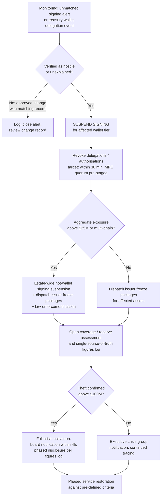

# Project BLACKSWAN II — Interim GRC Assessment of the October 2026 Binance Exchange Incident

## Sections 9–15: Regulatory Implications · Incident Response Review · Remediation Roadmap · Audit Programme · Governance Dashboard · Board Reporting · Interim Conclusion

*Status: INTERIM. Evidence as of 13 November 2026. Binance-only claims are labelled preliminary/unverified wherever they are used. The controlling artefacts for Sections 11 and 12 are `data/remediation-roadmap.csv` and `audit/audit-test-plan.md` respectively.*

---

## SECTION 9 — REGULATORY AND COMPLIANCE IMPLICATIONS

### 9.1 Approach: three classes of obligation, kept separate

This section evaluates regulatory exposure without asserting that any law was violated — on the public evidence, no regulator has alleged a violation by any entity in connection with this incident, and this assessment makes no such claim. Three classes of instrument are kept strictly separate throughout, because conflating them is the most common error in post-incident regulatory commentary:

1. **Binding law and regulation** — instruments that impose enforceable duties on a specific licensed entity in a specific jurisdiction.
2. **Supervisory expectations** — examination standards, guidance and enforcement practice that shape what a supervisor will ask for after an incident, whether or not a specific technical control is prescribed.
3. **Voluntary frameworks and market standards** — NIST CSF, SP 800-53, ISO/IEC 27001 and similar (mapped in Section 8), which bind no one by themselves but define the vocabulary in which supervisors, auditors, insurers and counterparties will discuss this incident.

Which class any given instrument falls into — and whether it reaches this incident at all — depends on entity-level facts that are not public (see §9.6). The analysis below therefore identifies *exposure channels*, not breaches.

### 9.2 The United States: a patchwork, with one deep regime

The structural fact of the US position was set out in the principal independent analysis of the incident: unlike banks, which face a single federal cybersecurity regime of risk assessments, monitoring, incident response and continuous examination of the largest institutions, US crypto exchanges face **no single federal cybersecurity regime**; requirements vary by state licence (Reuters, *Analysis: Binance hack reveals crypto's uphill battle against hackers*, 11 Nov 2026, https://www.weex.com/news/detail/binance-hack-exposes-cybersecurity-gaps-at-crypto-exchanges-mwox1cwirlxw3g0cua3saqrt).

Within that patchwork, the contrast case is New York. The New York Department of Financial Services regime (23 NYCRR Part 500) is described in the same analysis as the toughest state framework: it requires a maintained cybersecurity programme, multi-factor authentication, and a designated CISO, and it carries examination and enforcement behind those requirements. By contrast, state money-transmitter regimes elsewhere generally require licensees to share programme information and submit to examination, but **often do not prescribe particular technical controls** such as encryption standards (Reuters, 11 Nov 2026, URL above). The compliance consequence for this incident is asymmetrical: an entity licensed in New York would face a supervisor able to ask prescriptive questions about the controls that failed — endpoint management, access control to the signing environment, incident-response testing — while an entity licensed only under money-transmitter regimes elsewhere would more likely face questions about programme adequacy in general terms. Neither outcome is a finding; both are supervisory postures the operator's compliance function should expect and prepare for (risk R-16).

A further caution from the same analysis: many exchanges do not operate in the US at all and are subject to the regimes of wherever they do business (Reuters, 11 Nov 2026, URL above). Public sources do not establish which group entities operate which functions in which jurisdictions for this incident; §9.6 lists what would be needed.

### 9.3 Sanctions and AML dimensions of a state-attributed theft

This incident carries an unusual compliance dimension: the alleged thief is a sanctioned state's military cyber programme. The FBI, with the US Secret Service and IRS-CI, attributed the theft to North Korea's TraderTraitor activity and published 628 addresses "holding or have held assets from the theft" (FBI, *North Korea Responsible for $6 Billion+ Binance Attack*, 31 Oct 2026, https://www.fbi.gov/investigate/cyber/alerts/2026/north-korea-responsible-for-6-billion-binance-attack). Three precision points matter for compliance teams:

- **The FBI alert is a public-service announcement, not an OFAC designation.** It urges virtual asset service providers to block transactions with or derived from the listed addresses, but by itself it creates no statutory blocking duty. This assessment does not assert that any specific sanctions obligation attached to any specific address or transaction; that determination depends on designation status, jurisdiction and the facts of each dealing, and belongs to counsel, not to a GRC report.
- **The state response is real and judicial.** On 12 November the US Department of Justice announced collective freezes of more than $2.7 billion and court authorisation to seize or restrain more than $1.2 billion of it, with tracing continuing through bridges, mixers and exchanges (US Department of Justice, 12 Nov 2026, https://www.justice.gov/opa/pr/justice-department-announces-actions-disrupt-north-koreas-massive-theft-cryptocurrency). Any institution that subsequently touches theft-derived funds should expect law-enforcement contact; screening against the FBI list is the practical industry control, as TRM's defensive guidance also reflects (TRM Labs, 30 Oct 2026, https://www.trmlabs.com/resources/blog/north-korea-steals-usd-6-36-billion-from-binance-in-the-largest-hack-in-history).
- **The same DOJ release contains a separate action** (the "FaceStealer" infrastructure seizure) that is *not* part of this incident. Compliance and communications teams mining the release for obligations must not import FaceStealer facts into this incident's file — a conflation already visible in some headlines, and one this assessment explicitly rejects (see methodology).

The political environment around the attribution is also part of the disclosure landscape, recorded here neutrally and without adopting any position: the US President publicly diverged from the FBI's attribution on 31 October ("We don't know if it's North Korea — but if it is, we'll talk to North Korea about it", reported by Reuters, 2 Nov 2026, https://www.reuters.com/business/finance/binance-sees-outflows-stabilising-exchange-returns-online-after-63-billion-heist-2026-11-02/), and North Korea denied responsibility on 3 November, calling the attribution a "grave political provocation" (CoinDesk, 3 Nov 2026, https://www.coindesk.com/business/2026/11/03/north-korea-denies-role-in-usd6-4-billion-binance-hack-after-fbi-points-to-tradertraitor). Neither statement changes the evidentiary status of the FBI attribution; both affect how an operator's own public statements will be received, which is a disclosure-governance consideration under risk R-15, not a compliance determination.

### 9.4 Incident-reporting and notification expectations

No public source establishes that a breach-notification duty to individuals was triggered: there is no evidence in any source reviewed that customer personal data was compromised — the target was the operator's own wallets and signing infrastructure. Reporting expectations that may nonetheless apply are supervisory rather than public: licensed entities in prescriptive regimes (New York being the exemplar) typically owe their supervisor prompt notice of material cybersecurity events, and any entity's *failure to have made* such a notice would be a supervisory matter invisible from public evidence. This assessment therefore records incident-reporting as **cannot be established** from public sources, in both directions: it cannot be shown that any required report was missed, and it cannot be shown that all required reports were made. The remediation roadmap (REC-17) addresses the underlying gap — the absence of an evidenced, jurisdiction-by-jurisdiction obligations register — rather than any specific filing.

### 9.5 Financial-services expectations and the "bank standard" debate

The post-incident debate has been framed by experts as a standards gap rather than a firm-specific failing: social engineering is well understood, and the contested question is why exchanges lack the internal safeguards and **circuit breakers** — transaction limits, automatic spending-pattern review — that would bound the damage when (not if) an employee is compromised (Reuters, 11 Nov 2026, URL above, quoting the CTO of OpenZeppelin). Industry context reinforces the supervisory direction of travel: more than $22.3 billion has been stolen from crypto platforms since 2021 (Chainalysis figure cited in Reuters, 11 Nov 2026, URL above), and peer positioning began within days — Coinbase's 4 November statement emphasised over 99% cold storage, distributed keys, multiple approvals, withdrawal limits, anomaly monitoring with halt capability, and **no single employee with standing access to production wallet signing** (CryptoCompass, 4 Nov 2026, https://cryptocompass.com/articles/coinbase-says-it-was-unaffected-by-6-3-billion-binance). A peer's marketing statement is not a regulatory standard; but it is a reliable preview of the questions supervisors, insurers and institutional counterparties will ask, and Section 8's crosswalk is built so that each such question has a mapped control and an evidence requirement.

### 9.6 What would be needed to determine actual applicability

No applicability determination is possible until the following are established, none of which is fully public:

1. The legal-entity map: which group entities operate the exchange, custody customer assets, employ the affected engineers, and operate the signing service, and in which jurisdictions each is licensed.
2. The US footprint per entity: state licences held (and whether any New York licence is in the perimeter), US-person customer exposure, and USD payment-rail touchpoints.
3. Where the signing infrastructure and the compromised endpoints were administered from, and under which entity's policies.
4. Each entity's supervisor-notice obligations and a log of notices actually given for this incident.
5. The designation status, at each relevant time, of the FBI-listed addresses under applicable sanctions programmes, and the entity's screening records against them.

Until those facts are available, the correct regulatory conclusion is the narrow one: **exposure is fragmented and entity-dependent (R-16); no violation is asserted; supervisory attention should be assumed and prepared for.**

---

## SECTION 10 — INCIDENT RESPONSE AND CRISIS MANAGEMENT REVIEW

### 10.1 Evaluation against NIST SP 800-61

The response is evaluated against the NIST SP 800-61 incident-handling lifecycle (Preparation; Detection and Analysis; Containment, Eradication and Recovery; Post-Incident Activity). Verdicts use this assessment's evidence discipline: a phase is scored on what the evidence shows, and where the decisive fact is undisclosed the verdict says so rather than inferring competence or failure from the outcome.

| Phase | Verdict | Basis (summary) |
|---|---|---|
| Preparation | **Partially effective — intelligence strong, translation weak** | The exact TTP was foreseen at CSO level in July 2026; a related compromise was detected in June 2026; but the September vector succeeded against the same team (§10.2) |
| Detection and Analysis | **Cannot be established** | Operator detection time undisclosed; public detection demonstrably within minutes; early scoping (single laptop) was superseded by the operator itself (§10.3) |
| Containment | **Fast externally, mis-aimed internally, slow at the signature layer** | Issuer freezes from 21:01 UTC; withdrawal pause ~22:15 UTC did not stop on-chain delegations; revocation took ~3h50m due to MPC latency (§10.4) |
| Eradication and Recovery | **Disciplined, incomplete** | Phased reopening from 1 Nov; coverage programme executed to a 12 Nov completion claim; withdrawals still phased at day 14; eradication claims unverified (§10.5) |
| Post-Incident Activity | **Strong start, open commitments** | Preliminary report within 5 days; final post-mortem and independent review outstanding; some details withheld permanently (§10.6) |

### 10.2 Preparation: the warning-to-breach gap

Preparation is the phase this incident most seriously damages, because the foreseeability evidence is unusually complete. In July 2026 the operator's CSO described the fake-interview / malicious-assessment tactic in detail — "something we worry about a lot internally" — including why its steps can individually look benign to security software (Cointelegraph, 12 Nov 2026, https://cointelegraph.com/news/binance-cso-foreshadowed-6b-hack-tactic-months-before-attack). The operator states it blocked 57 suspected North Korea-linked threat incidents during 2026 using tactics including fake job interviews (Binance, 3 Nov 2026, https://www.binance.com/en/square/post/384314641614134 — operator-reported, unverified). Chainalysis documents the playbook being rehearsed in smaller attacks over roughly 18 months before Binance (Chainalysis, 3 Nov 2026, https://www.chainalysis.com/blog/category/crime/). And in June 2026 the operator *detected* the precursor compromise of Engineer A — then, on its own account, replaced the device and rotated credentials while the attackers retained the one asset that mattered: knowledge of who the wallet engineers were (Binance, 3 Nov 2026, URL above).

The preparation failure is therefore not ignorance and not detection tooling in the abstract. It is the absence of two specific translations: (i) a known, named TTP was not converted into a hard procedural control (verified recruitment contact; sandbox-only external code) for the identifiable population it targets; and (ii) a detected compromise was remediated as a device problem, not as an **exposure event** for the people and access the device revealed (risks R-01, R-04). These are governance failures of follow-through, and they are the kind that preparation-phase auditing exists to catch.

### 10.3 Detection and Analysis: scored honestly as unevidenced

The operator's preliminary report states only that it "subsequently received an internal alert about large transfers" — **no detection time is given, and no source establishes whether internal detection preceded external reporting** (Binance, 3 Nov 2026, URL above). What is established is the speed of *public* detection: on-chain analysts described the Binance 14 delegation and sweep within roughly eight minutes of the 20:20 UTC authorisation transaction, and CoinDesk reported a possible multi-billion hack at 21:12 UTC (research evidence E-24/E-26; Chainalysis, 30 Oct 2026, https://www.chainalysis.com/blog/binance-exploit-latest-findings-and-response/). A GRC assessment must not convert public detection speed into an internal detection capability finding. Detection is therefore classified **cannot be established**, and the non-disclosure of the detection timestamp is itself recorded as a transparency gap: it is the single most basic fact an incident report can contain, and its absence prevents any mean-time-to-detect judgement (risk R-10).

Analysis shows a similar split. Producing a coherent preliminary account within five days of a four-month, three-engineer intrusion is fast by industry standards. But the operator's first-day scoping — a compromised DevOps engineer's laptop — was superseded the same day ("additional points of breach") and replaced on 3 November by a materially wider path (Binance announcements, 30 Oct–3 Nov 2026, tracked at CompareCEX, https://comparecex.com/guides/binance-security-incident-2026-10/). Early under-scoping is common in live incidents; the control lesson is that initial public statements should carry explicit confidence labels, which connects directly to the disclosure findings in Section 14.

### 10.4 Containment: three different speeds at three different layers

**External containment was fast and multi-party.** Stablecoin issuers froze attacker funds beginning within the hour — Tether at 21:01 UTC and Circle at 21:04 UTC on TRM's timeline — and the verified frozen total reached $2.54B by 23:35 UTC and ~$2.7B–$2.85B thereafter (TRM Labs, 30 Oct 2026, URL above; US Department of Justice, 12 Nov 2026, URL above). This is the response's clearest strength, and it was a *coordination* achievement across issuers, venues and law enforcement rather than a purely internal one.

**Platform containment was aimed at the wrong layer.** Withdrawals were paused at ~22:15 UTC (one reconstruction says 22:33) — but suspending withdrawals did not stop the theft, because the EIP-7702 authorisations already existed on-chain and operated independently of the withdrawal infrastructure; re-sweeps continued at 21:44, 22:39 and 23:56 UTC (Binance, 3 Nov 2026, URL above; Chainalysis, 30 Oct 2026, URL above). The lesson generalises: for delegation-based attacks, the containment lever is revocation of the authorisation, not closure of the withdrawal queue.

**Signature-layer containment was slow for a designed reason.** The malicious delegations were revoked at 00:10 UTC — approximately 3 hours 50 minutes after the delegation transaction. The operator's explanation is structural: the hot wallets use multi-party computation, there was no single private key with which to revoke, and a specialised revocation procedure had to be designed and executed mid-incident (Binance, 3 Nov 2026, URL above). MPC is a sound control against key theft; here it traded directly against revocation speed. The governance point is that this trade-off was apparently never pre-engineered: TRM's guidance — maintain a **tested, pre-approved revocation-signing method** before you need it — describes exactly the artefact that did not exist (TRM Labs, 30 Oct 2026, URL above) (risk R-09; remediation REC-06).

### 10.5 Eradication and Recovery: discipline in reopening, assertions in eradication

Recovery operations were the most visibly disciplined part of the response. Withdrawals reopened in controlled phases — 15 networks on 1 November, further batches on 3, 5 and 6 November — rather than in a single high-risk restoration, and the coverage programme progressed on an announced cadence to a completion claim on 12 November (Binance announcements via CompareCEX, URL above; Binance, 12 Nov 2026, https://www.binance.com/en/square/post/387527915862393). Two qualifications apply. First, recovery was still incomplete at the assessment date: withdrawals remained phased on 12 November and no full-reopening date has been announced, so "recovery" cannot yet be scored as complete (risk R-14). Second, eradication — rebuilt systems, replaced devices, disabled credentials, entry points closed — rests entirely on operator assertion; independent analysts note the remediation claims have not been independently verified (StepSecurity, 3 Nov 2026, https://www.stepsecurity.io/blog/binance-hack-developer-machine-security). Eradication is accordingly classified **insufficiently evidenced**, pending the independent review.

### 10.6 Post-Incident Activity: a strong start with open commitments

Publishing a substantive preliminary report within five days, naming the attack chain against the operator's own engineers, is materially better than industry norms and should be recorded as a strength. The open commitments are equally specific: the detailed post-mortem promised on 30 October has not appeared; the invited independent review has not reported; and the operator has stated some technical details "will remain confidential" permanently. Each of those is a legitimate choice — and each caps the assurance outsiders can take from the post-incident process. This interim assessment's revision triggers (methodology §9) are built around those publications.

### 10.7 Playbook: exchange hot-wallet / signing compromise

The following playbook is the assessor's design, derived from the failure points above. **All thresholds are proposed control parameters for adoption and tuning by the operator — they are not the operator's historical settings.** Its governing principle inverts the 29 October sequence: act at the **signature layer first** (freeze signing, revoke authorisations), the **asset layer second** (issuer freezes), and the **platform layer third** (withdrawal queues) — because that is the order in which value actually leaves.

**Standing pre-conditions (prepared in peacetime):** pre-authorised freeze-request packages for the top issuers and venues with 24×7 contact trees (REC-10); pre-tested revocation methods per chain with MPC quorum pre-staging and an on-call rota (REC-06); a pre-delegated authority matrix naming who may suspend signing, per tier, without escalation delay; a figures log opened automatically with the incident record (REC-12).

**Quantitative escalation thresholds (PROPOSED):**

| Trigger | Threshold | Automatic / immediate action | Authority |
|---|---|---|---|
| EIP-7702 delegation detected on any treasury/hot wallet | **Any occurrence** | Sev-1 alert to Wallet Security + IR duty officer; delegation treated as hostile until proven otherwise | Automatic (monitoring) |
| Signing output with no matching approved withdrawal (unmatched signing) | Any single event, or aggregate > **$1M** equivalent in 15 min | Suspend signing for the affected wallet tier; page IR commander | Pre-delegated to duty officer |
| Unmatched signing continuing or multi-chain | Aggregate > **$25M** equivalent, or ≥2 chains | Suspend signing estate-wide for hot wallets; open issuer-freeze packages; notify executive crisis group | IR commander |
| Confirmed theft | > **$100M** equivalent, or any state-actor indicators | Full crisis activation: board notification within 4 hours; law-enforcement liaison; coverage/reserve assessment opened; disclosure log discipline in force | CISO + General Counsel |
| Delegation/authorisation revocation | From confirmation of hostile delegation | Revocation complete within **30 minutes** (drill-measured standard, REC-06) | Wallet Infrastructure on-call |

**Decision flow:**

**Playbook notes.** (1) Withdrawal suspension is a *customer-protection and liquidity* measure in this playbook, not a containment measure — the 29 October evidence is that it does not stop delegation-based theft. (2) Every threshold breach and decision is timestamped into the figures log, so that the post-incident report can state detection, decision and action times — the facts whose absence limits Section 10.3 of this assessment. (3) The playbook is exercised semi-annually under REC-21, including one issuer-participating freeze tabletop per year.

---

## SECTION 11 — REMEDIATION AND SECURITY IMPROVEMENT ROADMAP (NARRATIVE)

The controlling artefact is `data/remediation-roadmap.csv` (22 recommendations, REC-01–REC-22); this section explains the sequencing logic so the Board can see *why* items sit where they do. Prioritisation is by **risk reduction per unit of time**, not by ease: in each phase, the items that most reduce the probability or the blast radius of a repeat signing compromise come first.

**Phase 1 (0–30 days) — make the realised attack fail.** Six items close the specific holes the attackers used: the recruitment-lure protocol and sandbox-only external code (REC-01, R-01/R-02); endpoint tool allow-listing with verified EDR coverage (REC-02, R-02/R-03); the post-compromise exposure protocol that the June 2026 case lacked (REC-03, R-04); removal of standing tokens from endpoints into brokered, short-lived issuance (REC-04, R-05/R-06); signing-output invariant monitoring with automatic suspension thresholds (REC-05, R-07/R-10); and the pre-tested, drill-measured revocation capability whose absence cost nearly four hours (REC-06, R-09). Phase 1 is deliberately narrow: none of it requires architecture change, and all of it is verifiable within the phase.

**Phase 2 (31–90 days) — make the architecture and the numbers trustworthy.** Segmentation enforcement between corporate endpoints and the signing environment (REC-07, R-06); the signing policy engine binding signatures to approved withdrawals (REC-08, R-07); a board-approved hot-wallet exposure cap with automated sweeping (REC-09, R-08); the standing freeze-coordination framework (REC-10, R-11); the proof-of-reserves integrity programme that treats proof completion as a controlled deliverable (REC-11, R-13); and disclosure control built on a single-source-of-truth figures log (REC-12, R-15). Phase 2 is where governance artefacts — caps, policies, registers — are created, because Phase 1's technical fixes decay without them.

**Phase 3 (3–6 months) — measure, and govern the money.** Detection performance becomes measured rather than asserted (REC-13, R-03/R-10); the personnel-security programme addresses the targeted population directly (REC-14, R-01/R-02); the coverage and reserve policy converts an improvised $6.34B funding assembly into a governed, stress-sized framework with a final allocation report for this incident (REC-15, R-12); withdrawal resilience engineering makes the next suspension surgical and the next reopening criteria-based (REC-16, R-14); and the regulatory obligations register closes the fragmented-exposure gap (REC-17, R-16).

**Phase 4 (6–12 months) — remove the structural concentration.** Segregated signing architecture per chain and tier, so no single compromise domain can sign across the estate (REC-18, R-06/R-07); completion of the identity transformation to hardware-backed, phishing-resistant privileged access (REC-19, R-05); recurring independent assurance over custody, signing and the coverage policy (REC-20, R-08/R-12); an institutionalised exercise programme (REC-21, R-04/R-14); and a published transparency standard that makes this incident's good practices — a preliminary report in five days — a commitment rather than a choice (REC-22, R-13/R-15).

**Coverage and honesty notes.** Every one of the 16 register risks is addressed by at least one recommendation; the CSV's coverage was verified programmatically. Two limits are stated plainly. First, R-11 (external freeze dependency) cannot be remediated away: roughly $3.0B of the stolen value sat in assets no issuer can freeze (Elliptic, updated 10 Nov 2026, https://www.elliptic.co/insights/how-north-korea-is-laundering-the-6-4-billion-stolen-from-binance/), so the residual strategy for the unfreezable share is exposure reduction (REC-09), not faster freezing. Second, several Phase 1–2 items formalise capabilities the operator says it has already built since 3 November (Binance, 3 Nov 2026, URL above); where that is so, the recommendation's function is to make the capability **evidenced and testable** — the roadmap's success criteria are written so that an announcement cannot satisfy them, but an audit test can.

---

## SECTION 12 — INTERNAL AUDIT AND CONTROL TESTING PROGRAMME (NARRATIVE)

The controlling artefact is `audit/audit-test-plan.md`, which specifies seven tests in full (objective, risk statement, control objective, procedure, population, sampling, evidence, expected result, exception criteria, reporting). This section records the approach and the judgements behind it.

**Approach: reperformance over inquiry.** The defining feature of this incident is that several controls *existed on paper or in tooling* and failed in operation — endpoint tooling that did not detect the September malware, a remediation that closed a device but not an exposure. An audit programme that asks "do you have this control?" would have passed the pre-incident environment. Every test in the plan therefore requires inspection of system-generated evidence, reperformance (attempting the blocked install, the unapproved path, the unexpected delegation), or observation (witnessing a timed revocation drill). Where a test touches the incident itself — Test T-06's revocation drill, Test T-07's review of signing-alert records for 29 October — the historical event is used as a known-bad regression case, not as a substitute for current-period testing.

**Sampling philosophy.** Populations that are small and individually critical are examined in full: every signing authorisation, every delegation event, every brokered credential issued above its lifetime policy. Large populations (endpoints, install events) are sampled statistically, with the wallet/signing stratum examined at 100% and a zero-tolerance attribute for unmanaged code or resident tokens on that stratum — because the incident proved that a single endpoint in that population is a sufficient condition for a $6.4B event. Findings are quantified by privilege and reachability, not merely counted.

**Penetration testing is not control testing — and a phishing simulation is not endpoint forensics.** Three different instruments answer three different questions, and the incident shows why confusing them is dangerous:

- A **penetration test** asks whether a skilled adversary can defeat the environment *today*, along paths the tester chooses. It is point-in-time and path-dependent; the inherited-library and process failures that enabled this incident (a token on a laptop, a remediation that stopped at the device) are exactly the findings pen tests routinely walk past, because they are governance facts, not exploitable code.
- A **social-engineering simulation** (Test T-02) tests the *human and procedural* control family: verification callbacks, reporting behaviour, sandbox discipline. It produces evidence about awareness and procedure — and **no evidence whatsoever** about whether endpoint detection would catch the payload if a person did run it.
- **Endpoint forensic and configuration testing** (Tests T-01, T-03) tests the *technical* control family: allow-listing, EDR efficacy, token hygiene. It produces no evidence about whether staff would report the approach in the first place.

The September compromise defeated one control from each family in sequence — the human control (the download happened), the procedural control (no verified channel was used), and the technical control (the malware was not detected). A credible audit opinion therefore requires all three instruments, reported separately, with no netting-off: a 95% simulation report rate does not compensate for an EDR gap, and a perfect allow-list does not compensate for staff who can be talked around it. GRC control testing, as distinct from both, asks the period question — *did the control operate, for the whole period, for the whole population, and can you show me?* — which is the question the final post-mortem and the independent review will ultimately have to answer for October 2026.

---

## SECTION 13 — KEY RISK INDICATORS AND KEY PERFORMANCE INDICATORS

The dashboard below is a **proposed** governance instrument. Every target and threshold is marked **PROPOSED**: none of these values is the operator's historical performance, and several measure capabilities whose current state the public evidence cannot establish (notably metrics 3, 5 and 6, where the incident itself is the reason the metric must exist). The dashboard is designed so that each metric has an owner who is not the person whose work it measures.

| # | Metric | Definition | Calculation | Target (PROPOSED) | Warning (PROPOSED) | Critical (PROPOSED) | Frequency | Owner |
|---|---|---|---|---|---|---|---|---|
| 1 | Recruitment-lure verification readiness | % of staff in sensitive roles who have completed role-specific training on verifying recruitment approaches and sandbox-only handling of external code | Completions ÷ in-scope population, from LMS records | ≥98% | 95–97% | <95%, or any wallet/signing team member untrained | Monthly | Director, Security Awareness & Culture |
| 2 | Unmanaged dev-tool installs blocked | % of attempted software installs on engineering endpoints that were outside the allow-list and were blocked before execution | Blocked unmanaged attempts ÷ all unmanaged attempts (EDR/management telemetry) | 100% blocked | Any unmanaged install detected post-execution on a standard endpoint | Any unmanaged install executed on a wallet/signing endpoint | Weekly | Head of Endpoint Security |
| 3 | Time-to-revoke delegated signing authority | Elapsed time from revocation decision to confirmed on-chain revocation of a test delegation, measured in live drills | Drill timestamps: decision record → revocation confirmation, per chain, slowest chain reported | <30 min | 30–60 min | >60 min, or any drill not completed in the quarter | Quarterly drill | Head of Wallet Infrastructure |
| 4 | Hot-wallet share of total reserves | Value held in hot wallets as a % of total reserves, per asset and in aggregate | Hot-wallet balances ÷ total reserve balances (PoR tooling) | ≤ board-approved cap (cap itself PROPOSED at ≤5% aggregate) | Cap breach <24h, self-corrected by sweep | Cap breach ≥24h, or any breach during an incident | Daily | Head of Custody Risk |
| 5 | Unmatched-signing alerts | Count of signing events lacking a matching approved withdrawal, and % triaged within 15 minutes | Signing-service logs correlated to withdrawal approvals; triage timestamps | 0 executed unmatched signings; 100% of alerts triaged ≤15 min | Any alert triaged >15 min | Any unmatched signing executed | Continuous; reported monthly | Director, Threat Detection & Response |
| 6 | PoR proof completion within stated window | % of proof-of-reserves snapshots whose ZK proof is published within the window stated at snapshot time | Proofs published in-window ÷ snapshots taken | 100% | 1 proof late but published, with public explanation | Any proof unpublished 24h past its window, or any snapshot with no stated window | Per snapshot; reported monthly | Head of Financial Reporting |
| 7 | Treasury-wallet delegation events | Count of EIP-7702 (or equivalent) delegations created on treasury/hot wallets outside an approved change | On-chain monitoring of all treasury/hot wallet addresses | 0 unapproved | Any approved delegation not closed within its change window | Any unapproved delegation (automatic Sev-1) | Continuous; reported monthly | Head of Wallet Security Engineering |
| 8 | Standing privileged tokens on endpoints | Count of deployment-capable or production-capable tokens/keys found resident on engineering endpoints by discovery scanning | Scan findings classified by privilege, wallet/signing stratum reported separately | 0 | 1–3 low-privilege findings, remediated ≤5 days | Any deployment-capable token, or any finding on a wallet/signing endpoint | Weekly scan | Head of Identity & Access Management |
| 9 | Freeze-request dispatch time | Elapsed time from confirmed theft/delegation event to complete freeze-request packages received by top issuers, measured in incidents and exercises | Incident/exercise timestamps: confirmation → issuer acknowledgement | <15 min | 15–30 min | >30 min | Per incident/exercise; reported quarterly | Director, Incident Response |
| 10 | Post-compromise exposure reviews on time | % of detected endpoint compromises receiving a documented exposure review (identities, roles, tokens, monitoring uplift) within 10 business days | Reviews completed in-window ÷ qualifying compromises | 100% | 90–99% | <90%, or any wallet-team compromise unreviewed | Monthly | Director, Threat Detection & Response |
| 11 | Detection time for signing anomalies | Time from a signing-anomaly event (real or injected in exercise) to a triaged alert | Exercise/incident timestamps: event → triaged alert | <15 min | 15–30 min | >30 min, or **any event first detected via a public/external channel** | Per event; reported quarterly | Director, Threat Detection & Response |
| 12 | Public-figure corrections | Count of material corrections or restatements to incident or reserve figures published by the operator | Published corrections log, materiality assessed by Legal/Finance | 0 | 1 non-headline correction, promptly issued | Any restated headline figure (loss, frozen, coverage) | Per incident; reported quarterly | Chief Communications Officer |

Two design notes. First, metric 11's critical threshold deliberately includes *the channel* of detection, not only its speed: on 29 October the fastest detection was public, and a dashboard that would have shown green on speed alone would have concealed the assurance failure. Second, metric 6 exists because of a live fact: the 4 November snapshot's proof has no announced completion and the 12 November proof was pending at the assessment date (Binance, 4 Nov 2026, https://www.binance.com/en-AE/square/post/384992929024378; Binance, 12 Nov 2026, https://www.binance.com/en/square/post/387527915862393) — under this dashboard, both would already be visible to the Audit Committee as tracked exceptions rather than discovered by journalists.

---

## SECTION 14 — BOARD AND EXECUTIVE REPORTING

### 14.1 Reporting discipline during a live incident

The reporting failure mode this incident illustrates is not silence — the operator communicated frequently — but **figure drift**: numbers that changed between updates without a visible reconciliation (the 90% contemporaneous coverage figure for 31 October versus the 98% restated for the same date on 3 November; acknowledgement times that differ between published timelines; outflow totals published for overlapping windows that cannot be reconciled as stated — all registered in `evidence/evidence-and-sources.md`, CF-03, CF-04, CF-06). In a custody business, the board's product is trust in numbers; figure discipline is therefore a board-level control, not a communications preference. The discipline this assessment recommends, and which the roadmap operationalises at REC-12, is:

- **Cadence.** Flash report to the executive crisis group within 4 hours of crisis activation and every 12 hours until containment is declared; daily written situation reports thereafter until service restoration; a standing item at every Board Risk Committee meeting until the final post-mortem is published and its actions are closed. Each report carries the same fixed structure: confirmed facts / operator assessments / unknowns — the three tiers of the methodology — so that confidence is visible rather than implied.
- **Single-source-of-truth figures log.** Every number that may be published — stolen, frozen, restrained, retained-by-attacker, coverage, outflows — exists exactly once in a controlled log recording value, definition, source system, timestamp and owner. Public statements may only draw from the log; any change to a logged value is itself logged with the reason, so a restatement is a documented event, never a silent edit. The coverage restatement of 3 November is precisely the event this control exists to make visible.
- **Separation of measures.** Board papers present stolen, frozen, court-restrained, attacker-retained, recovered and coverage as six distinct lines, in that order, every time. The two most damaging confusions available in this incident — frozen-as-recovered, and coverage-as-recovery — are both prevented by that single formatting rule.
- **Decision log.** Every material crisis decision (suspension of withdrawals, reopening phases, coverage funding draw, public attribution language) is minuted with its basis and its information state at the time, so that later review judges decisions by what was known, not by outcomes.

### 14.2 The three risks escalated first, in business language

1. **"Whoever can make the machine sign, owns the money." (R-07 with R-06)** Our hot wallets did not have their keys stolen; the signing service itself was reached and used. One stored token, one internal tool able to act on other machines, and one signing service for every chain meant a single intrusion path led to the entire hot-wallet estate. Until signing is segregated and policy-bound, the size of the next event is limited mainly by how much we keep in hot wallets.
2. **"We could pay for this once. The Board has not yet seen the policy that says we can pay for it as a system." (R-12 with R-08)** Coverage was assembled during the crisis from three reserves; the final split has not been reported to this committee, the SAFU refill is announced but unconfirmed, and the amount we keep reachable by any signing compromise has no board-approved cap. The question for the Board is not whether this loss was absorbed — it was — but whether reserve sizing is a governed decision or an improvisation that happened to work.
3. **"Our assurance to customers currently rests on proofs that were not all completed and figures that moved." (R-13 with R-15)** The largest proof-of-reserves statement was still unverified when "coverage complete" was announced; an earlier snapshot's proof has no announced completion; and a headline figure was restated without reconciliation. Customers and regulators will forgive a theft faster than they will forgive numbers they cannot rely on. Verification discipline is a licence-to-operate control.

### 14.3 Decisions required of executives and the Board

1. Approve the hot-wallet exposure cap and automated sweeping (REC-09) — a balance-sheet risk decision, not a security preference.
2. Approve funding and the mandate for signing-architecture segregation (REC-18), accepting the multi-quarter timeline this implies.
3. Adopt the coverage and reserve policy, and require the final allocation report for this incident, including evidenced SAFU replenishment (REC-15).
4. Set the deadline for the final post-mortem and confirm that the independent review's conclusions will be published (REC-22).
5. Adopt the figures-log discipline and the public transparency standard as permanent controls, with compliance reported to the Risk Committee after every major incident (REC-12, REC-22).

---

## SECTION 15 — CONCLUSION (INTERIM)

### 15.1 Principal technical lessons, so far

1. **The signing service is the perimeter.** The attackers never needed a private key; they needed the organisation's own signing authority to cooperate. Defence that concentrates on key custody while leaving signing policy, signing reachability and signing-output monitoring comparatively weak defends the wrong asset (Chainalysis, 30 Oct 2026, https://www.chainalysis.com/blog/binance-exploit-latest-findings-and-response/; Hacken, Nov 2026, https://hacken.io/insights/binance-hack/).
2. **Account abstractions are standing authority.** The EIP-7702 delegations functioned as pre-signed, self-executing payout instructions that survived the closure of the withdrawal system and re-swept incoming funds for hours. Any delegation on a treasury wallet is a critical event by definition, whether or not it is yet understood (TRM Labs, 30 Oct 2026, https://www.trmlabs.com/resources/blog/north-korea-steals-usd-6-36-billion-from-binance-in-the-largest-hack-in-history).
3. **Security controls trade against each other, and the trade must be pre-engineered.** MPC eliminated the single-key risk and simultaneously imposed a ~3h50m revocation latency, because no pre-tested revocation path existed. The lesson is not to abandon MPC; it is that every control's incident-time cost must be designed and drilled before the incident (risk R-09).
4. **For wallet engineers, the endpoint is production.** A laptop holding a deployment token, reachable development tooling and a profile that names the employer is, functionally, part of the production signing environment, and must be engineered, monitored and audited as such (StepSecurity, 3 Nov 2026, https://www.stepsecurity.io/blog/binance-hack-developer-machine-security).

### 15.2 Principal GRC lessons

1. **Foreseeability without translation is the costliest governance failure.** The tactic was named by the CSO in July, rehearsed by the adversary for ~18 months, and preceded by a detected compromise of the same team in June — and the procedural controls that would have broken the chain (verified recruitment contact, sandbox-only external code, post-compromise exposure review) were not in place. Threat intelligence that does not terminate in a control change is documentation, not defence (Cointelegraph, 12 Nov 2026, https://cointelegraph.com/news/binance-cso-foreshadowed-6b-hack-tactic-months-before-attack).
2. **Remediation scope is a governance decision.** The June compromise was remediated to the boundary of the device; the exposure it created — named, targeted people — was outside that boundary and materialised in September. Incident closure criteria must explicitly include the exposure the incident created, not only the artefact it used (risk R-04).
3. **Coverage is not recovery, and frozen is not either.** The operator's financial response was genuinely strong, but public understanding of it was degraded by vocabulary: reserves were replenished with company money while ~$3.0B remained with the attacker and the recovered amount stayed undisclosed (Elliptic, updated 10 Nov 2026, https://www.elliptic.co/insights/how-north-korea-is-laundering-the-6-4-billion-stolen-from-binance/). Boards and assessors must hold the six measures apart (Section 14.1), or every subsequent number is suspect.
4. **Disclosure quality is a control, with the same status as a firewall rule.** One restated headline figure did more reputational work than any single technical fact in the preliminary report. Figure governance — a single log, dual sign-off, visible corrections — belongs in the control framework, tested like any other control (risk R-15; audit Test T-02/T-07 evidence standards applied to communications records).

### 15.3 What the final post-mortem must establish

This interim assessment closes with the questions the operator's final post-mortem (and the independent review) must answer before any finding here can be finalised. They are stated in full in the evidence index (NV-01–NV-12); the decisive ones are:

- The operator's **detection timestamp**, and whether internal detection preceded public reporting (NV-01).
- The **identity of the internal AI tool and the mechanism of its abuse**, and the segmentation and approval design that let a container deployed with a stolen token reach a cross-chain signing service — including whether signing requests were validated against approved withdrawals (NV-03, NV-04).
- Whether **any amount has been recovered**, stated separately from frozen and restrained totals (NV-02).
- The completion status of the **4 November ZK proof** and the verification of the **12 November proof** (NV-05, NV-06).
- The **final coverage funding allocation** and evidenced completion of the SAFU replenishment (NV-08).
- The date of **full withdrawal reopening**, and the criteria by which the final phase will be declared (NV-07).

### 15.4 Prioritisation and demonstrating effectiveness

If resources force a choice, the order is: (1) signing-output monitoring with automatic suspension and pre-tested revocation (REC-05, REC-06) — because they bound the *next* event regardless of its entry vector; (2) token elimination and segmentation (REC-04, REC-07) — because they break the demonstrated path; (3) the exposure cap (REC-09) — because it caps what any residual path can reach; (4) figure and proof discipline (REC-11, REC-12) — because trust is the asset the incident actually put at risk. Management demonstrates effectiveness not by announcing completion but by producing the artefacts the audit plan specifies: drill timestamps, alert logs, proof publications, allocation reports. An announcement is a claim; this assessment's taxonomy exists to keep claims and evidence in separate columns until the evidence arrives.

### 15.5 Maturity commentary (qualitative, with methodology caveat)

No numeric maturity score is assigned: the methodology (Section: Methodology §6–§8) does not support one on public evidence fifteen days after an incident, and a score would imply a precision the evidence cannot carry. Qualitatively, and provisionally, the picture is **uneven in a specific pattern**: crisis-phase capabilities that depend on money, relationships and executive will — issuer freeze coordination, liquidity coverage, communication frequency, phased service restoration — performed at a level few organisations could match; while peacetime capabilities that depend on process discipline — translating threat intelligence into targeted controls, scoping remediation to exposure rather than artefact, pre-engineering revocation, and governing published figures — performed below what the operator's own stated awareness would predict. That pattern, if the final post-mortem confirms it, is the profile of an organisation whose incident response has outgrown its control governance. Closing that gap — not any single tool — is the remediation programme's actual objective.

### 15.6 Conditions for revision of this interim assessment

This assessment will be revised, and its provisional findings re-graded, when any of the following occurs: publication of the final post-mortem or the independent review; verification of the 12 November proof of reserves or resolution of the 4 November proof's status; disclosure of a recovered amount or of the final coverage allocation; announcement of full withdrawal reopening; any operator restatement of a figure relied on here; or any regulatory action concerning this incident. Until then, every conclusion in Sections 9–15 should be read with its label: corroborated, operator-reported, or — where this document has been most careful to say so — still unknown.

*— End of Sections 9–15. Project BLACKSWAN II interim assessment, 13 November 2026.*
